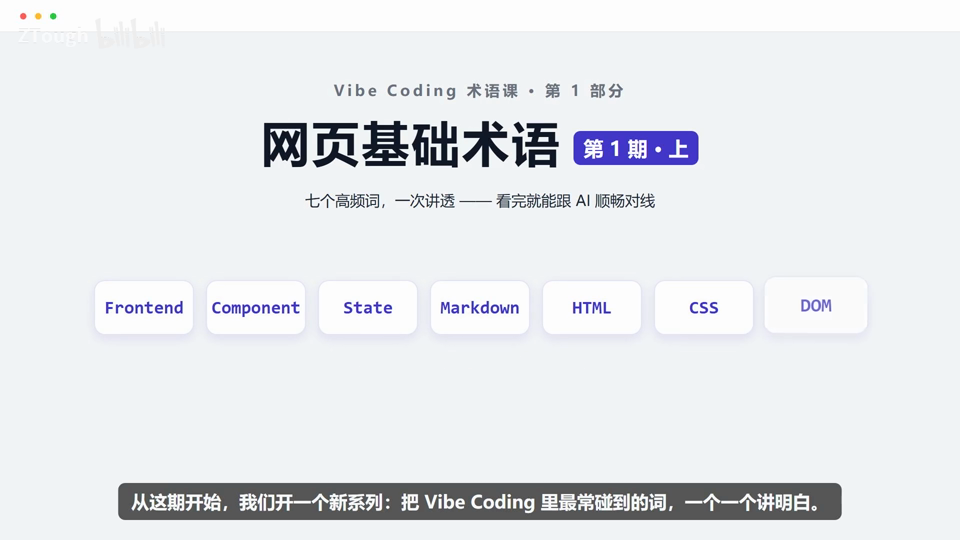
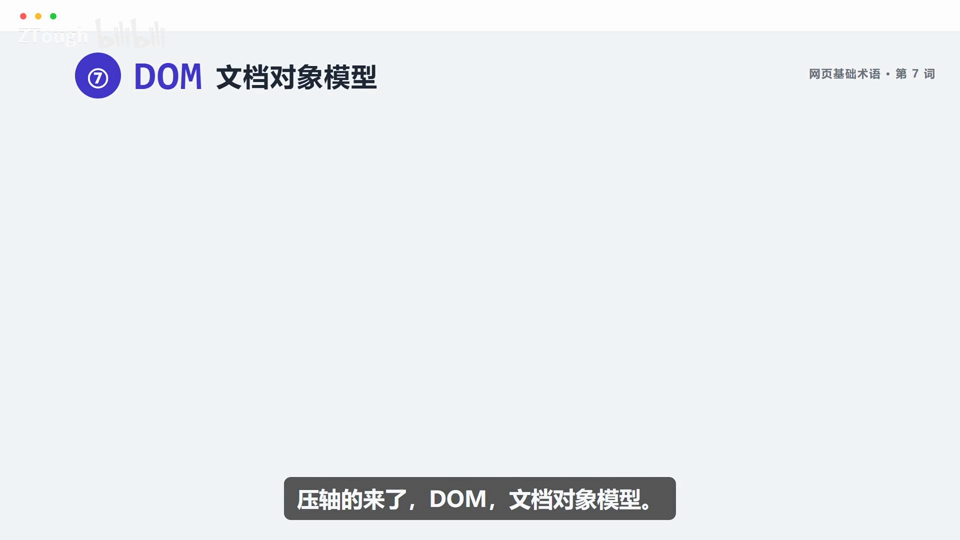
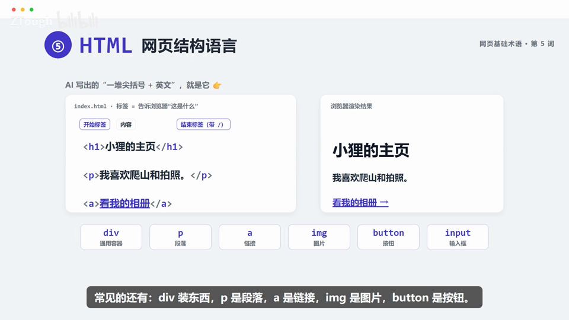

# Vibe Coding 术语课 第01 集｜Vibe Coding 术语课 01｜网页基础术语·七个高频词一次讲透，看完就能跟 AI 顺畅对线

> 主题：网页基础术语(共14词的第1期上·7词):从喊一声'帮我做个网页'到页面跑起来的整条链路上,AI回复里最常出现的 Frontend/DOM 等7个基础词,看懂就能跟 AI 顺畅对线

> 视频时长 5:17｜逐字稿见 `~/VibeCoding术语课/逐字稿/01_*.txt`｜术语 7 个

### 1. Frontend｜前端

- **定义**：网页里你能看到、点到、输入的那一层都算前端;但账号到底建没建成,要等后端查完数据库才算数。

- **要点**：
  - 你能看到•点到•输入——都算前端;输入框、保存按钮、提示条都是前端的活
  - 口诀:前端管看得见,后端管办得成(请求发出后,后端查库/校验/写入,结果回来才知道'成功没')

- **给 AI 的句式**：向AI提需求时把'页面显示与交互'归为前端来描述;涉及查账号存不存在、校验、写入的活儿要意识到它在后端,别让浏览器端代码硬扛。

- **避坑**：保命提醒:密钥、价格、权限规则别写在前端——前端代码在浏览器里跑,谁都能打开看。

- **视频画面**：

  

### 2. Component｜组件

- **定义**：把会被反复使用的界面打包成一块'通用积木',哪里需要哪里插;改组件这一处,三个页面一起变。

- **要点**：
  - 例子:一张商品卡(图片/名称/价格/按钮)在首页、搜索结果、收藏页各用一次,别复制3份(以后要改3处)
  - 口诀:发现重复,抽成组件
  - 一次性的小图标,没必要硬拆

- **给 AI 的句式**：让AI把在多个页面重复出现的界面'抽成一个组件复用',之后统一改样式只需改组件这一处。

- **避坑**：别走极端:一个只用一次的小图标,没必要硬拆成组件。

- **视频画面**：

  

### 3. State｜状态

- **定义**：页面不是死的图片,它记得住'此刻'——悄悄记着的一张'小账',记录页面当下记住的事。

- **要点**：
  - 点保存→'正在提交…'(防止连点),请求结束再切到'保存成功'或'出错了'
  - 高亮的那一行 = 页面'此刻'的值;状态=页面当下记住的事
  - 状态只能来自真实操作、真实结果

- **给 AI 的句式**：描述交互需求时把状态流转说清楚,如'保存按钮经历待命→提交中→成功/出错,提交中要防止连点'。

- **避坑**：千万别在页面里提前写死一个'成功'——刷新一下就露馅了;状态只能来自真实操作、真实结果。

- **视频画面**：

  

### 4. Markdown｜轻量标记语言

- **定义**：一种轻量排版格式:写的时候是带着符号的纯文本(源码SOURCE),渲染出来就是干净排版(RENDERED);AI给的文档里全是#和**指的就是它。

- **要点**：
  - # 一级标题、**加粗**、- 列表项、三个反引号围起来是代码块
  - 特别适合写需求、文档和笔记:README.md、需求文档、笔记/知识库,纯文本文件放多少年都打得开
  - 它不是Word那种所见即所得

- **给 AI 的句式**：用Markdown写需求文档丢给AI,或要求AI以Markdown输出文档/笔记/代码块。

- **避坑**：注意它不是Word那种所见即所得——别往不支持Markdown的地方(如Word)直接粘。

- **视频画面**：

  

### 5. HTML｜网页结构语言

- **定义**：AI写出的'一堆尖括号+英文单词'就是它;用标签告诉浏览器'这是什么',负责搭网页骨架。

- **要点**：
  - 标签一般成对出现:开始标签 + 内容 + 结束标签(带/)
  - 常见标签:div通用容器、p段落、a链接、img图片、button按钮、input输入框
  - 分工:HTML定结构,CSS管外观,JS管交互——三个凑齐才是像样的网页

- **给 AI 的句式**：让AI'用HTML把页面骨架搭出来',说清页面有哪些标题、段落、链接、图片、按钮即可。

- **视频画面**：

  

### 6. CSS｜样式表

- **定义**：HTML是骨架,CSS是装修——颜色、字号、间距、圆角全归它管;基本单位是'规则'。

- **要点**：
  - 规则 = 选择器{声明}:选择器挑哪些元素,声明规定长什么样
  - 一个按钮可能同时命中好几条规则,浏览器按匹配范围/优先级/书写顺序算出最终胜出的样式
  - 想知道到底谁赢了:打开DevTools的Styles/Computed,一眼看出最终值

- **给 AI 的句式**：说外观需求时指明'用CSS实现'——颜色、字号、间距、圆角归CSS管;样式不如预期就提醒AI检查选择器命中范围与优先级。

- **视频画面**：

  

### 7. DOM｜文档对象模型

- **定义**：把HTML文件交给浏览器,它不会照着打印,而是先把文档拆成一棵'活树',每个标签每段文字都是树上的一个节点,这棵树就叫DOM,页面照着它渲染。

- **要点**：
  - index.html源文件 → 浏览器内存视图(html文档根 > body主体 > ul列表 > li…)= DOM
  - 这棵树能被脚本修改(JS可改):点'新增',JS往树上插一个新节点,页面立刻多一条——哪怕原始文件里根本没有它
  - 口诀:源文件是图纸,DOM是浏览器搭出来、随时能改的'活树'

- **给 AI 的句式**：听到AI说'操作DOM'就是在说'用JS让页面内容增删改、立刻更新';想要不刷新就新增列表项,直接描述成'往列表插一项'即可。

- **视频画面**：

  

  

---
> 本集串联：七个词串成一条生产线:你喊一声'给我做个网页'——前端负责你看到的一切;重复出现的界面抽成组件;页面记住'当下'靠状态;跟AI写需求、做笔记用Markdown;骨架由HTML搭,好不好看交给CSS;浏览器再把它们变成一棵随时能改的活树DOM,页面就活了。网页基础术语一共14个,这期讲了前7个,还剩7个,下期见分晓。
