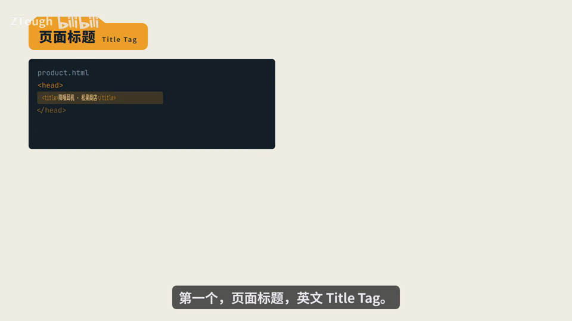
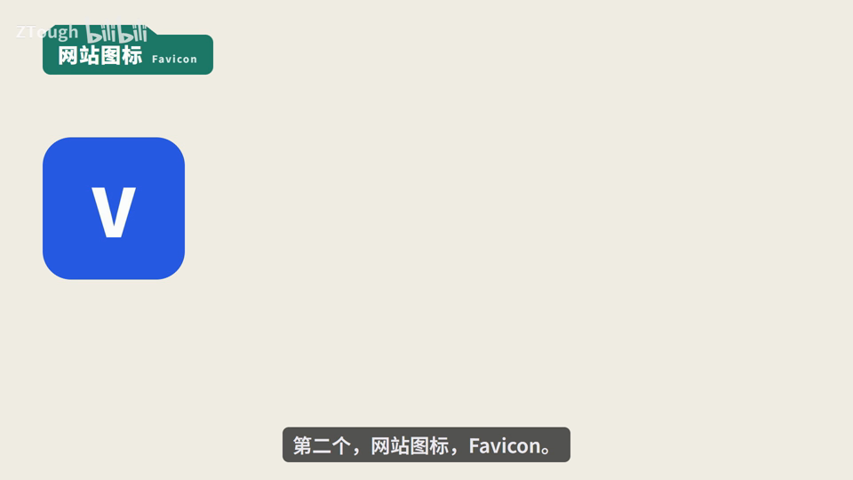
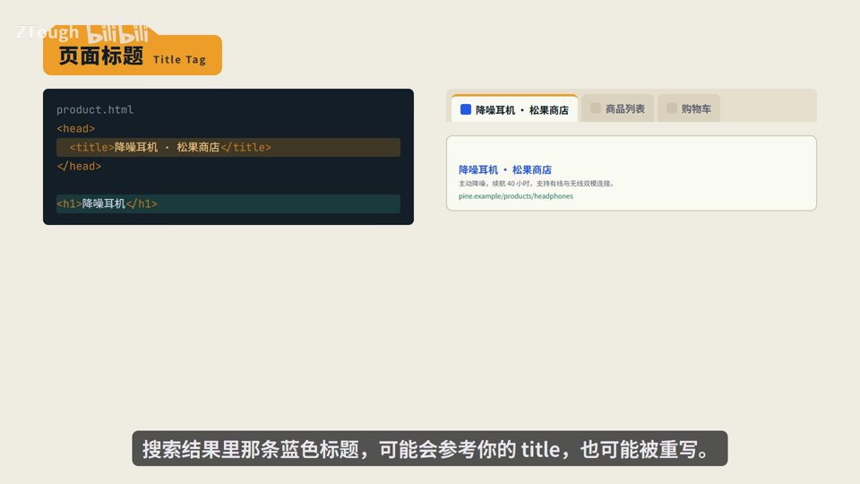
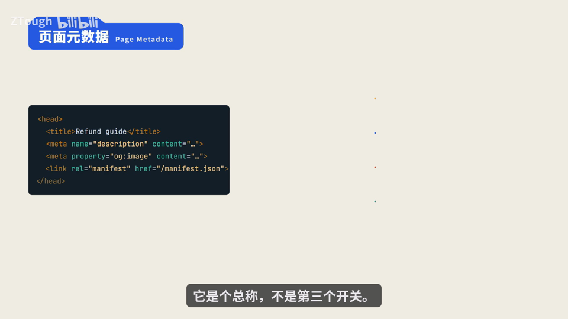
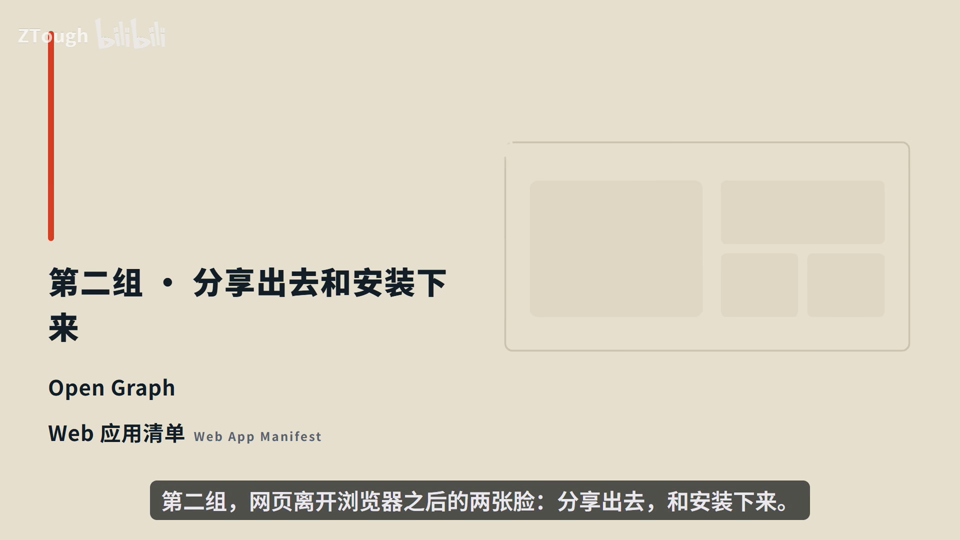
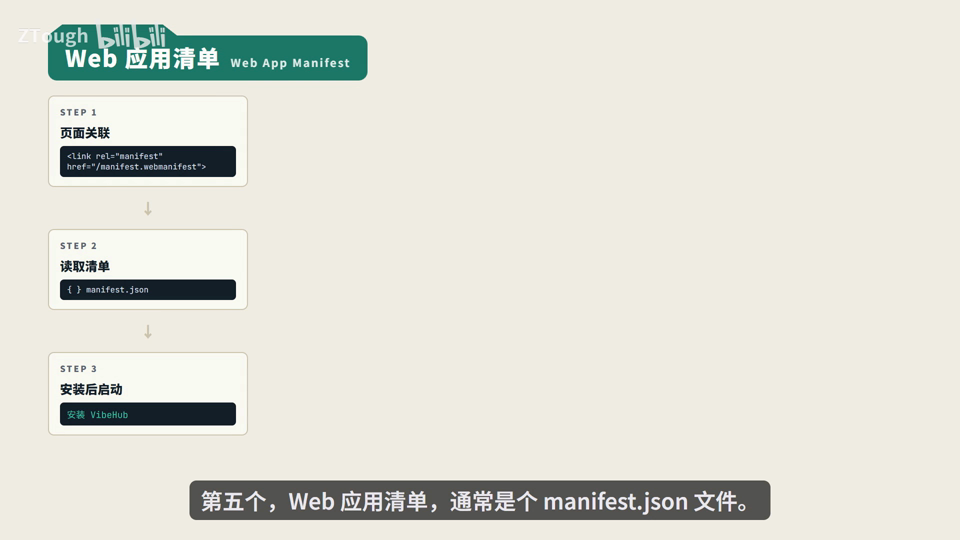
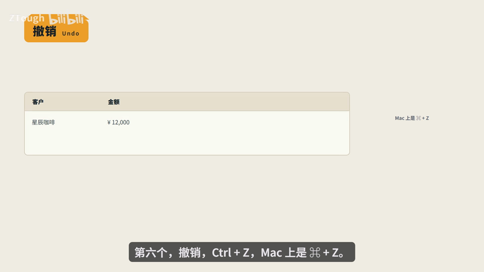
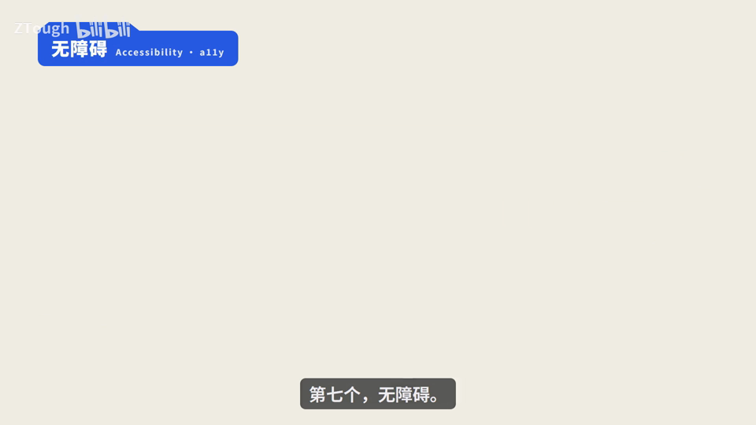
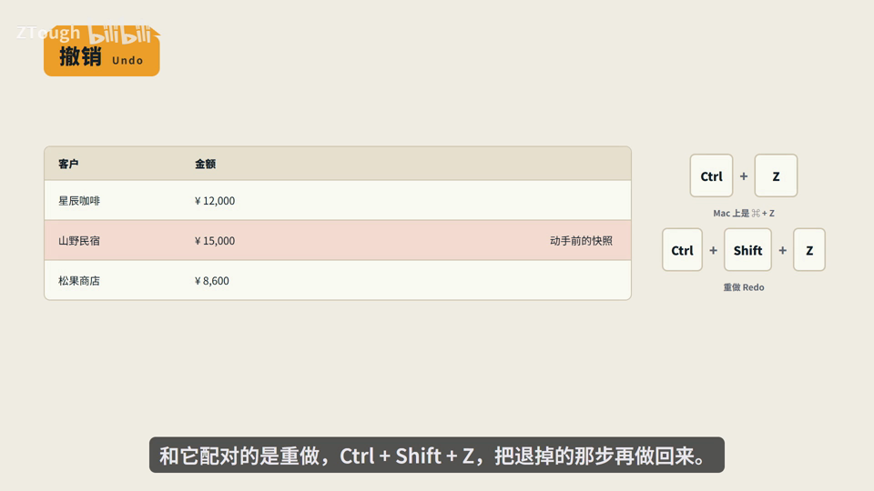

# Vibe Coding 术语课 第02 集｜Vibe Coding 术语课：AI 写网页必懂的 7 个基础术语，一次讲透 | 网页基础术语 · 一期讲清验收标准

> 主题：AI交付网页的验收标准:同一个网页有4张脸(浏览器标签/搜索结果/分享卡片/桌面图标),再加2个'用起来'的兜底词,共7词;按'它最终显示在哪儿'去验收,别在代码里盯着

> 视频时长 6:11｜逐字稿见 `~/VibeCoding术语课/逐字稿/02_*.txt`｜术语 7 个

### 1. Title Tag｜页面标题

- **定义**：写在<head>里的<title>,浏览器拿它当标签页的名字——你打开十个页面,靠它分得清哪个是哪个。

- **要点**：
  - 商品页例子:<title>降噪耳机•松果商店</title>,正文H1只写'降噪耳机'——两个字段各管各的
  - 搜索结果里那条蓝色标题可能参考你的title,也可能被重写,别承诺搜索结果一定长这样
  - 验收很简单:切两个商品页,看浏览器标签变不变,变了就对了

- **给 AI 的句式**：给AI需求时要求'每个页面写清<title>';验收时切换两个页面看浏览器标签有没有跟着变。

- **避坑**：title和H1是两个字段,改一个不会自动改另一个。

- **视频画面**：

  

  

### 2. Favicon｜网站图标

- **定义**：标签页上那个小方片图标,活儿很简单——帮人在一堆页面里认出你。

- **要点**：
  - 它出现在三个地方:标签页、书签栏、历史记录
  - 注意:它和页头Logo不是一回事,和搜索框里的功能图标也不是一回事;三个可以长得像,但换一个另外两个不会自己跟着变
  - 验收:别在页面里找,它压根不在页面里——去标签页、书签、历史记录里看,看不到就是没读到

- **给 AI 的句式**：给AI需求加一句'配favicon,用<link rel=icon>';验收时不看页面正文,去标签页/书签/历史记录看有没有图标。

- **避坑**：Favicon ≠ 页头Logo ≠ 功能图标,三者不会自动同步,别在页面里找favicon。

- **视频画面**：

  

  

### 3. Page Metadata｜页面元数据

- **定义**：一个总称,不是单个开关——凡是放在<head>里描述这个网页、但不在正文里显示出来的信息都算元数据。

- **要点**：
  - title管浏览器标签,description可能变成搜索摘要,og:字段管链接分享,manifest管安装入口
  - 重点:它们的消费方不一样(浏览器/搜索/分享平台/安装系统),字段写对了只代表某一个消费方读到了
  - 验收句式:别问'元数据做完没有',要问'浏览器看到什么?搜索看到什么?分享出去是什么?装到桌面是什么?'

- **给 AI 的句式**：需求/验收时按消费方拆开问,而不是笼统说'把元数据写好';分享没图去查分享字段,装完启动路径错去查manifest,别一上来重写正文。

- **避坑**：别把元数据当成一个开关,做完就以为全好了——谁读它,就检查谁那一处。

- **视频画面**：

  

  

### 4. Open Graph｜分享预览

- **定义**：管链接'分享出去'这张脸:把链接甩到群里或社交平台时,别人看到的是有图有摘要的卡片还是一行光秃秃的网址,由og:*字段决定;很多人叫它OG。

- **要点**：
  - 用og:*描述分享预览,og四件套:og:title标题、og:description摘要、og:image配图、og:url地址
  - 只有普通title(no og:title/og:image/og:url)时:无预览图、分享出去是裸链接;补齐og四件套后卡片就有图有标题有摘要
  - 坑1:og:image这张图得是公网能直接打开的地址——只存在本机或要登录才能看的平台,抓不到
  - 坑2:平台会缓存——改完了要让它重新抓一次,再去看真实的卡片长什么样

- **给 AI 的句式**：需求写'转发到群/社交平台要有分享卡片',并配齐og:title/description/image/url四件套;验收要看真实分享卡片,源码对了不等于卡片更新了。

- **避坑**：两个坑:og:image必须是公网可直接打开的地址;平台有缓存,改完要触发重新抓取后再看真实卡片。

- **视频画面**：

  

### 5. Web App Manifest｜Web 应用清单

- **定义**：描述网页被'安装到桌面'之后长什么样的配置文件(通常是个manifest.json):叫什么名字、用哪个图标、从哪个地址打开、像不像独立应用。

- **要点**：
  - 三步走:STEP1页面用<link rel=manifest>关联清单 → STEP2浏览器读取清单manifest.json → STEP3安装后启动
  - 四个字段:name名字、icons图标、start_url启动地址、display窗口形态(像独立应用还是像标签页)
  - 验收标准只有一个:装上之后看——桌面上的名字、图标、点开跳到哪儿;改完文件要删掉重装再看
  - 提醒:有manifest不等于能离线跑,离线是另一套东西

- **给 AI 的句式**：想让人把网页装到手机桌面,就让AI配manifest并写清name/icons/start_url/display;验收=真装上再看,别只盯文件。

- **避坑**：有Manifest能离线跑是误解——离线是另一套东西,别混为一谈;改完manifest要删掉重装再验收。

- **视频画面**：

  

### 6. Undo｜撤销

- **定义**：撤销上一步操作:在表格里删错一行,按一下它(Windows Ctrl+Z,Mac上是⌘+Z),那行内容原样回来。

- **要点**：
  - 它回来的不是重新生成的内容,是你动手之前那份快照,所以不会带进新错误
  - 和它配对的是重做Redo(Ctrl+Shift+Z,Mac ⌘+Shift+Z):把退掉的那步再做回来
  - 它有边界:通常只记得最近几步,页面一刷新/一关,历史就清了

- **给 AI 的句式**：给会误操作的地方(如表格删除行)安排撤销,或在需求里明确'要紧的删除要弹确认,别只靠撤销兜底'。

- **避坑**：撤销只退最近几步,刷新就没了——真正要紧的删除别指望撤销兜底,该谈确认就谈确认。

- **视频画面**：

  

  

### 7. Accessibility｜无障碍

- **定义**：AI回复里常见的缩写a11y(=a+11个字母+y):你测试页面用的是鼠标和好眼睛,但访客可能用键盘、读屏软件,或在太阳底下眯眼看手机;无障碍就是把这些场景都用起来。

- **要点**：
  - 检查点一:每张有信息的图片都配alt文字说明——图挂了或被读屏时,这段文字顶上
  - 检查点二:拔掉鼠标,只用Tab走一遍——每个按钮都能到达,焦点位置看得见,顺序不乱
  - 检查点三:正文和背景的对比度至少4.5:1,这条同时帮到所有在户外看手机的人
  - 无障碍不是做慈善,做好了普通用户也受益

- **给 AI 的句式**：验收前让AI过一遍无障碍三件套:信息图都有alt、纯键盘Tab能走通、正文/背景对比度≥4.5:1。

- **避坑**：别默认用户有鼠标和好眼睛——键盘可达、焦点可见、对比度够,是能直接检查的底线。

- **视频画面**：

  

  

---
> 本集串联：验收只看一处:它最终显示在哪儿——浏览器标签看页面标题(Title Tag)和网站图标(Favicon),搜索结果看页面元数据(Page Metadata),分享卡片看Open Graph,桌面图标看Web应用清单;每个词都对应一个你看得见的地方,去那儿验收,别在代码里盯着。剩下的撤销(Undo)和无障碍(Accessibility)是给用的人兜底的,不体现在某张脸上。下次AI交付页面,你就知道该打开哪扇门去看了——这七个词值得收藏起来对着验收。
