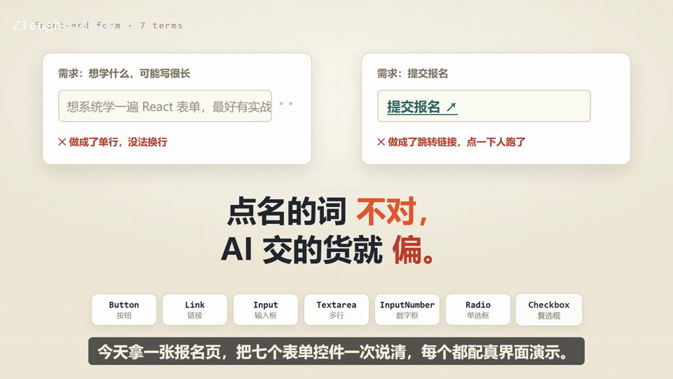
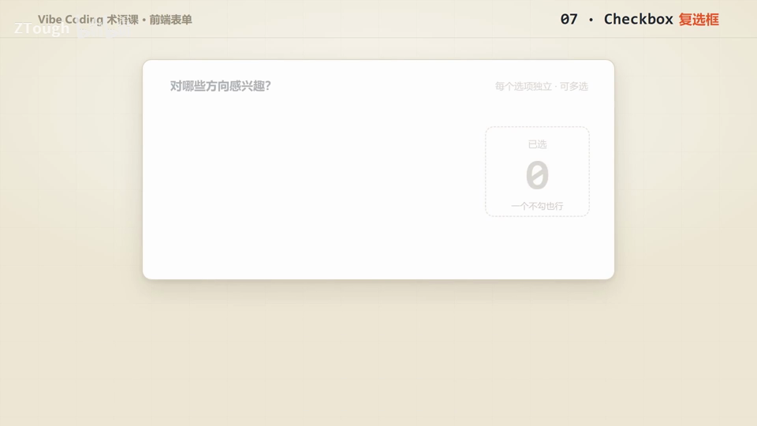
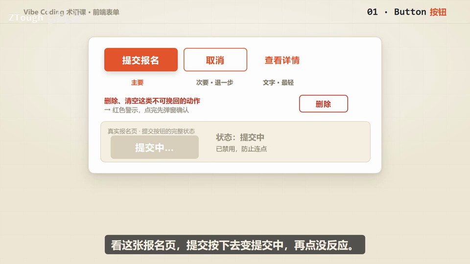

# Vibe Coding 术语课 第03 集｜Vibe Coding 术语课：前端表单 7 个词，把报名页放心交代给 AI

> 主题：一张报名页上的七个表单控件(Button→Checkbox):点名的词说对,AI 交的货才不偏

> 视频时长 5:28｜逐字稿见 `~/VibeCoding术语课/逐字稿/03_*.txt`｜术语 7 个

### 1. Button｜按钮

- **定义**：点一下就执行一个动作的控件,保存、提交、删除都算动作,动作有轻重之分。

- **要点**：
  - 按钮按轻重分级:最主要的动作用实心「主要」按钮,「次要」是取消/返回这类退一步的,「文字」最轻
  - 提交中状态要置灰、再点无效,防止手快连点重复提交
  - 删除、清空这类不可挽回的动作要用红色警示,点完先弹窗确认

- **给 AI 的句式**：「『提交』做成主要按钮;提交中置灰禁用,防止重复提交」

- **避坑**：反例:提交按钮被做成了跳转链接,点一下人就跑了(视频开头翻车案例)

- **视频画面**：

  

### 2. Link｜链接

- **定义**：住在文字里、点了能带你去别处(另一个页面/文档/下载地址)的元素。

- **要点**：
  - 嵌在正文里:报名须知、往期课程这类入口都做成链接,如「上课方式见报名须知」
  - 用颜色+下划线,让人一眼能看出可点
  - 报名须知页用新窗口打开,可返回报名页

- **给 AI 的句式**：「『报名须知』做成链接、新窗口打开;提交动作别用链接」

- **避坑**：提交、删除是按钮的活,链接负责带路;也别只写「点击这里」这种不说清去哪儿的文案

- **视频画面**：

  

### 3. Input｜输入框

- **定义**：收短文本的单行输入控件,一行就放得下,姓名、账号、邮箱、搜索词都用它。

- **要点**：
  - 标签要常驻看得见,别用灰字提示顶替
  - 格式错了要在框下方用红字说明原因(如「邮箱格式不对,请检查」),别只让框变色
  - 长内容别硬塞单行——想系统学 React 这类要换行的,该用多行文本框

- **给 AI 的句式**：「『邮箱』用单行输入框,标签常驻;出错时在框下方红字说明原因」

- **避坑**：反例:placeholder 当标签——打字后提示消失,用户不知道这格填啥

- **视频画面**：

  

### 4. Textarea｜多行文本框

- **定义**：跟输入框是一对的控件,不限行数、回车能换行,专门收一段话。

- **要点**：
  - 输入框一行、收一句话(如昵称);多行文本框收一段话
  - 评论、个人简介、给 AI 的提示词都归它管
  - 旁边常配实时字数统计,接近上限会变红提醒(示例 21/200)

- **给 AI 的句式**：「『想学什么』用多行文本框,限200字,实时显示剩余字数」

- **避坑**：一句话写得完的内容(如昵称)用回输入框即可,不必一律上多行文本框

- **视频画面**：

  

### 5. InputNumber｜数字输入框

- **定义**：只能填数字、还配了加减按钮的输入框,按一下数字就 +1/-1。

- **要点**：
  - 报名人数、买几件、库存、金额这类数量输入用它
  - 能设上下限:限1-10人,超出会被拦下,到顶后加号直接置灰
  - 演示:报名人数点加号数字往上跳,到10上限加号变灰

- **给 AI 的句式**：「『报名人数』用数字输入框,1-10 的整数,可点加减,超范围拦下」

- **避坑**：手机号、身份证看着像数字,其实是字符串、不能加减,别用步进器,用普通输入框

- **视频画面**：

  

### 6. Radio｜单选框

- **定义**：一组选项里只能挑一个的控件,选了新的会自动取消旧的。

- **要点**：
  - 适合选项不多、想让人一眼看全直接比较的场景(如场次:上午/下午/晚场)
  - 选项可以带说明:费用、时效写在旁边(免费约3天送达 / ¥8 明天18点前),一眼比明白
  - 点整行都能选中

- **给 AI 的句式**：「『场次』做成一组单选,只允许选一个;点整行都能选中」

- **避坑**：只剩一个需要确认的项(如同意条款)别用单选——那是复选框的活

- **视频画面**：

  

### 7. Checkbox｜复选框

- **定义**：每个选项独立、看上哪个勾哪个,能勾好几个也能一个不勾的控件。

- **要点**：
  - 多选都归它管:兴趣方向(前端/UI/AI/数据)全勾上,列表批量选人
  - 表头「全选」:勾了仨里俩,表头不亮全勾也不空着,而是出现一根「半选」横杠
  - 同意条款单独一个复选框:打勾=用户明确确认,勾选后才允许提交

- **给 AI 的句式**：「『兴趣方向』用复选框允许多选;『同意协议』单独一个复选框」

- **避坑**：一句话记住:单选=单选题;复选框=多选题,还能交白卷;同意类的勾选别跟普通多选混在一起

- **视频画面**：

  

  

---
> 本集串联：七个词一次到齐,每行都是给 AI 的一句指令:按钮做事、链接带路、输入框收一行、多行文本框收一段、数字输入框收数字、单选一组挑一个、复选框多选还能全不选——七个字段名说对,右边这张报名页一次成型。表单近亲 Switch 开关/Select 下拉/Slider 滑块留给后面的课。
