# Vibe Coding 术语课 第04 集｜Vibe Coding 术语课｜前端控件 7 连：switch 到 tree-select，看 UI 不再懵

> 主题：七个前端控件都在替你做同一件事:让用户给程序「一个值」——值的形状越复杂,控件越高级

> 视频时长 4:16｜逐字稿见 `~/VibeCoding术语课/逐字稿/04_*.txt`｜术语 7 个

### 1. Switch｜开关

- **定义**：拨一下就在开/关两种状态间翻转、程序里用一个布尔值就全装下的控件。

- **要点**：
  - 开和关就两个状态,程序里一个布尔值装下
  - 二选一的活都是它的:页面加个总开关,一键切深色模式
  - 演示:浅色 OFF → 拨一下变深色 ON,界面应声切换

- **给 AI 的句式**：「页面加个总开关,一键切深色模式」——说句加个开关,它端上来的就是 switch

- **避坑**：音量这种不能只有静音和最大的需求它不是(中间全是值)——那是 slider 的活

- **视频画面**：

  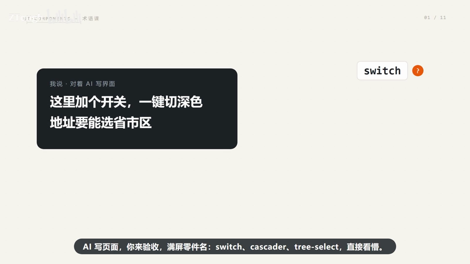

  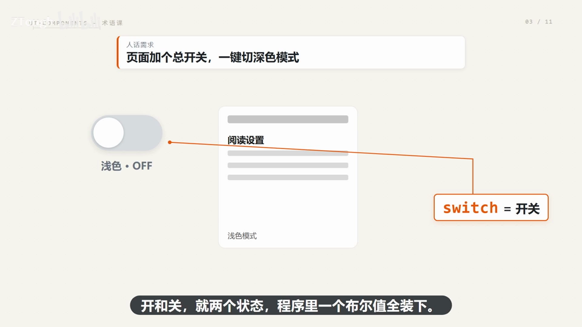

### 2. slider｜滑块

- **定义**：一条轨道一个钮拖着走、在连续范围里取任意值(如音量停在 40%)的控件。

- **要点**：
  - 音量不能只有静音和最大,要能停在 40%——中间全是值
  - 拖到哪值就是哪儿,拖的时候常有气泡跟着报数(标配)
  - 给的是连续值

- **给 AI 的句式**：「音量做成 0~100 的滑杆」——AI 不会给你造输入框,直接上 slider

- **避坑**：别拿它当评分用:滑块给连续值,打分要离散档是 rate 的活

- **视频画面**：

  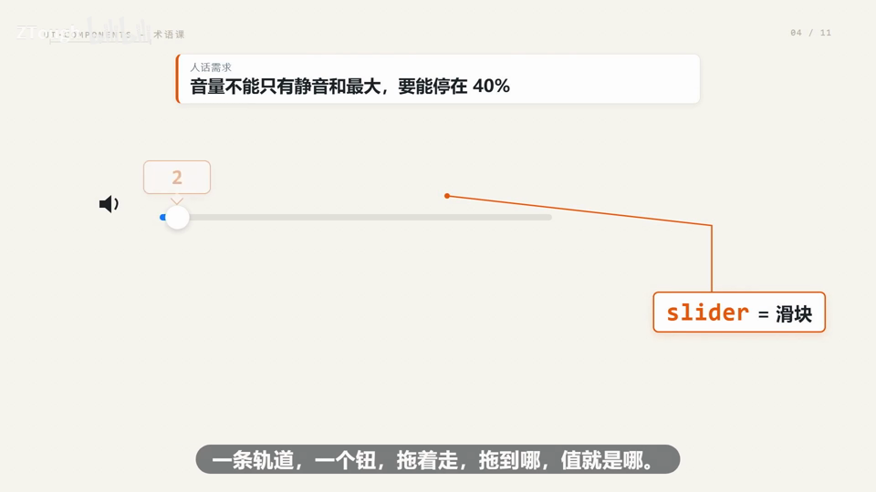

  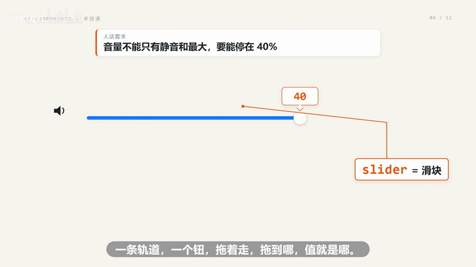

### 3. rate｜评分

- **定义**：让用户点几下星就完成打分、不用写 200 字小作文的控件。

- **要点**：
  - 看完让用户点星打分,别让人写小作文
  - 星星给离散档:一颗星一个态度(演示 4 分)
  - 想要更细,加个半星开关

- **给 AI 的句式**：prompt 里说「这里来个五星评分」——AI 默认连悬停点亮都替你排好了

- **避坑**：注意 rate 跟 slider 不一样:滑块给连续值,星星给离散档

- **视频画面**：

  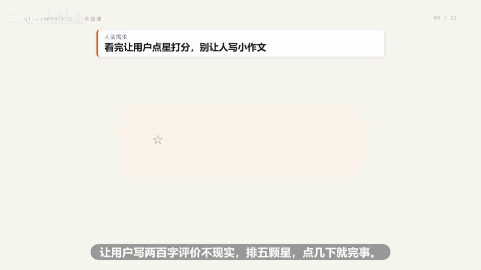

  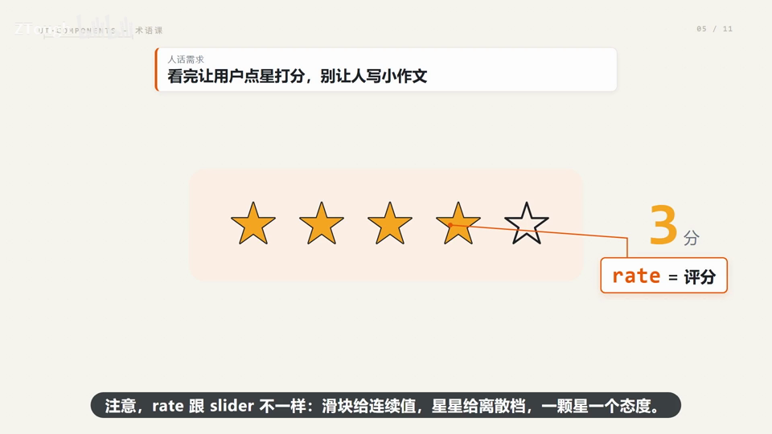

### 4. select｜下拉选择

- **定义**：点开弹出列表、翻着挑一个的固定选项单选控件,不用敲键盘。

- **要点**：
  - 固定选项里单选,适合二三十个内:性别、套餐、城市
  - 选中的那行高亮,再点一下收起,框里回填干净(已选中:旗舰版)
  - 最大好处是用户不用打字,也就没有打错的可能

- **给 AI 的句式**：「套餐做下拉选择,固定选项二三十个内,别让用户打字」——别让 AI 图省事换成输入框

- **避坑**：选项一多 select 就顶不住(几百个城市下拉滚三屏)——那是 auto-complete 的活

- **视频画面**：

  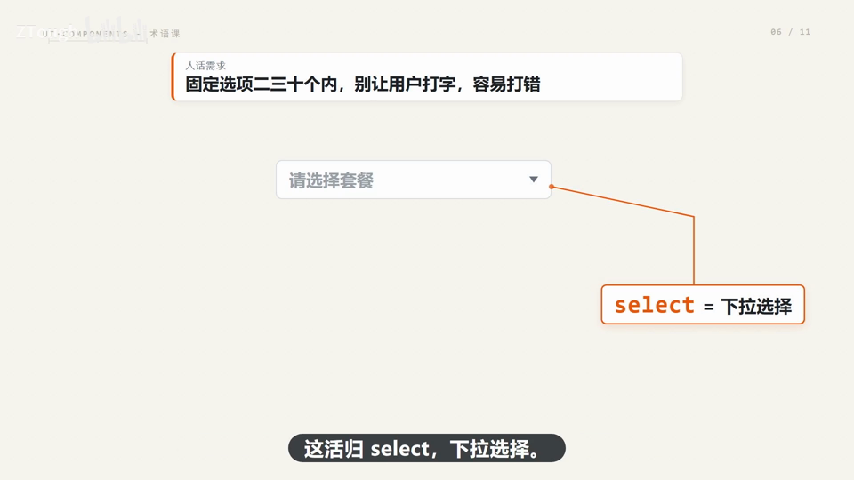

  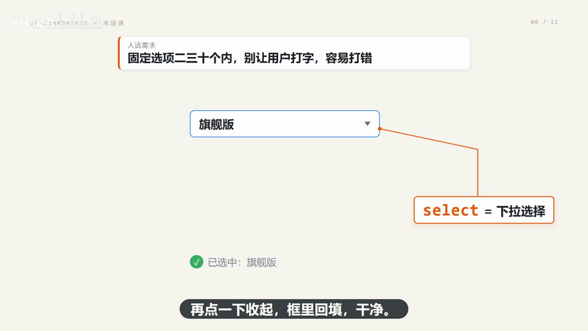

### 5. auto-complete｜自动补全

- **定义**：本质是输入框加联想,边打字边过滤候选(敲个「深」字,深圳自己浮上来)的控件。

- **要点**：
  - 选项多、用户心里大概知道叫什么:翻着选是 select,打着选是 auto-complete
  - 候选实时过滤:敲「深」字,杭州/深圳/西安/西宁只剩深圳,回车带走
  - 演示:回车选择深圳(一线城市)

- **给 AI 的句式**：「全国几百个城市,列表翻不动,边打边筛」——AI 就该上 auto-complete

- **视频画面**：

  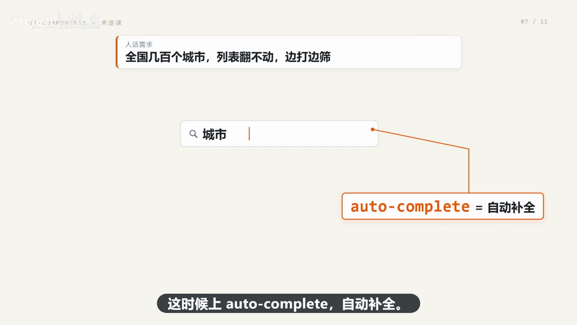

  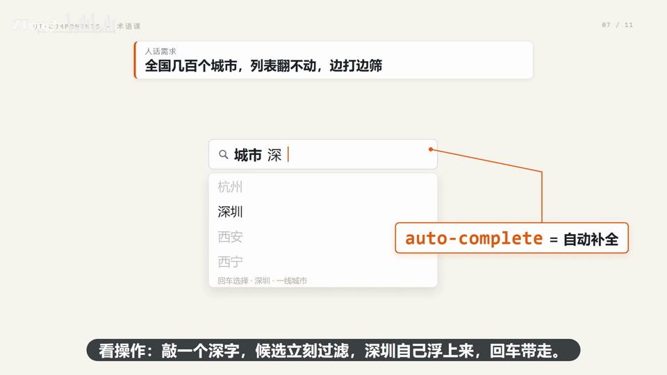

### 6. cascader｜级联选择

- **定义**：多级联动选择的控件,每级候选由上一级决定,省市区一次选完。

- **要点**：
  - 收货地址省市区三级,一次选完,别拆三个下拉
  - 点开第一列是省,选广东省,第二列自动刷出城市;选深圳市,第三列跟着出区
  - 每级候选由上一级决定,这个机制叫联动(广东省/深圳市/南山区)

- **给 AI 的句式**：prompt 里写「省市区三级地址」——AI 直接端 cascader,不会拆成三行下拉

- **避坑**：别把三级套娃拆成三个下拉让用户连选三遍,体验会崩

- **视频画面**：

  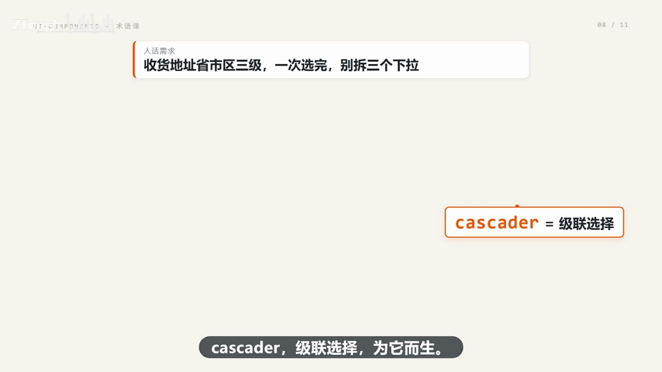

### 7. tree-select｜树选择

- **定义**：在树形结构里勾多个节点、父子联动的选择控件,树形结构的多选只有它能干得干净。

- **要点**：
  - 适用:按组织架构选人,部门挂小组、小组挂成员,天生一棵树
  - 勾一个父节点,子节点全部自动带上(勾父带子)
  - 只勾了一部分子节点,父节点显示「半选」方块,提示没选全

- **给 AI 的句式**：「按组织架构选人:部门挂小组,组里还能多选」——树形结构的多选上 tree-select

- **视频画面**：

  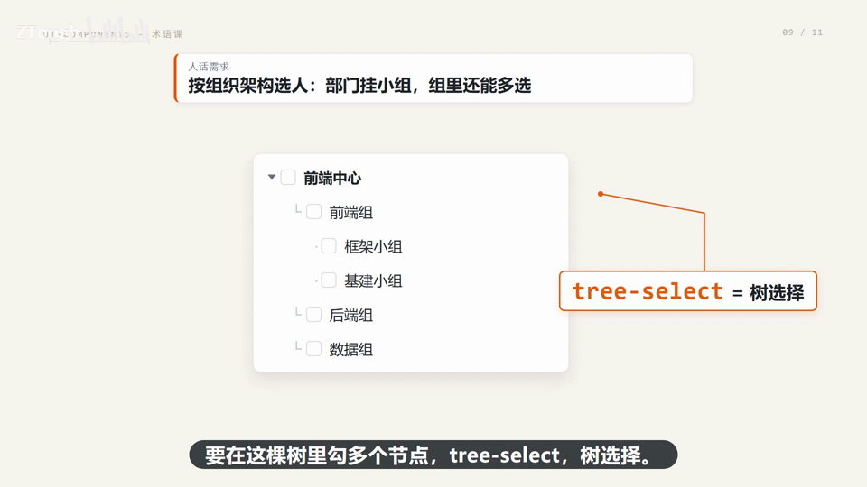

  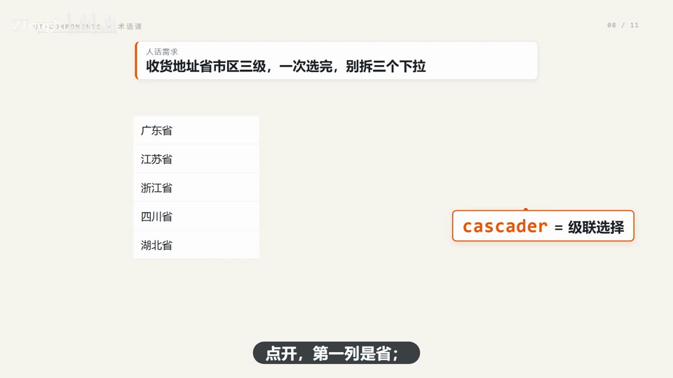

---
> 本集串联：七个词走一遍:开关存两态(布尔值)、滑块存连续值、评分存离散档、下拉翻着选一个、自动补全打着选、级联逐层下钻、树选择管父子多选——它们干的是同一件事:把用户给程序的一个值做得顺手、不出错。零件认全,AI 生成的界面你才真读得懂。
