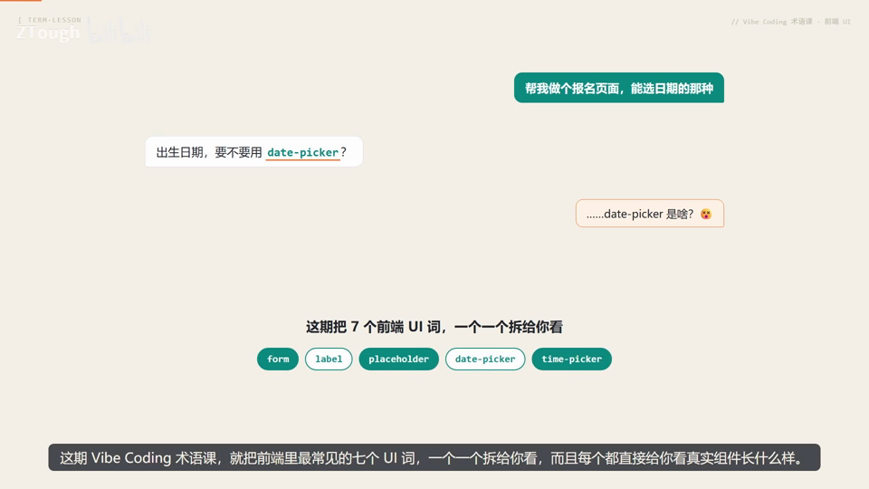
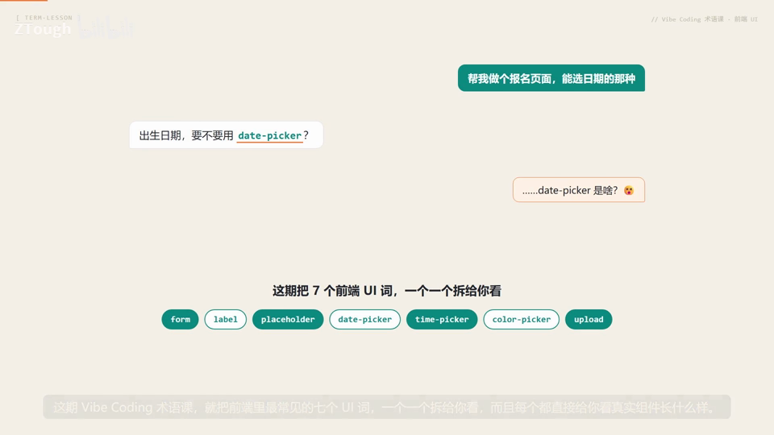
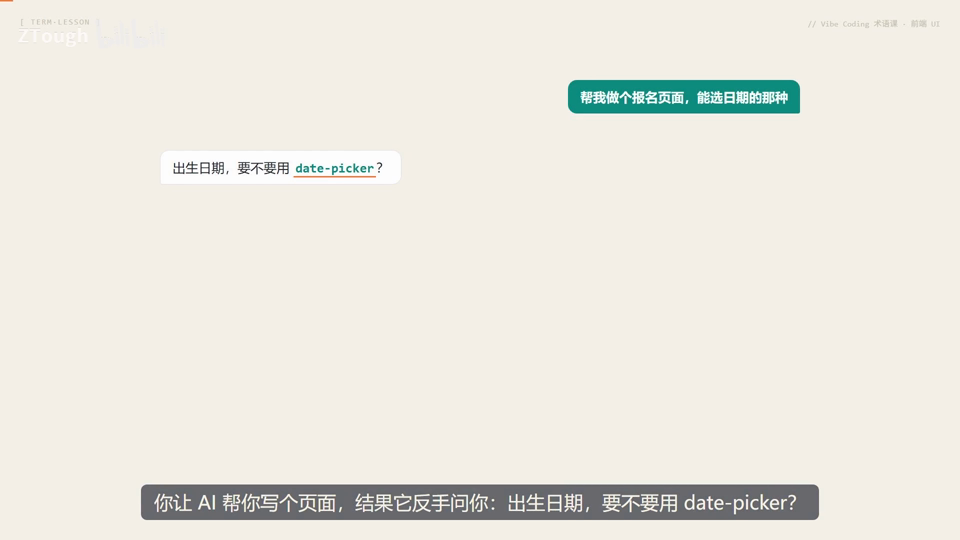
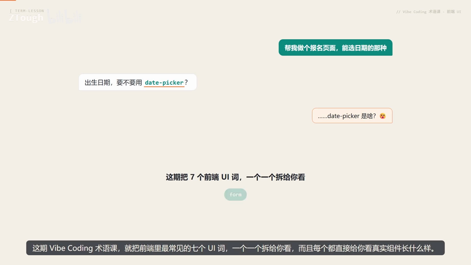
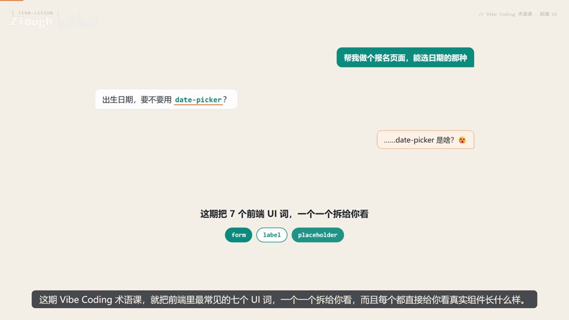
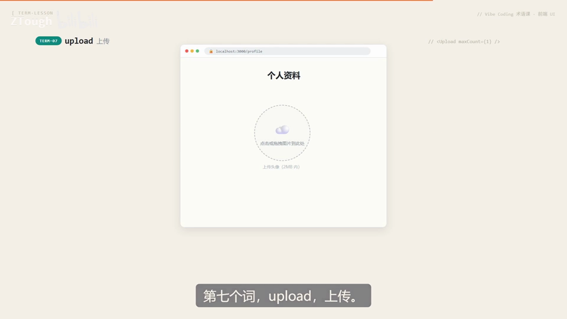
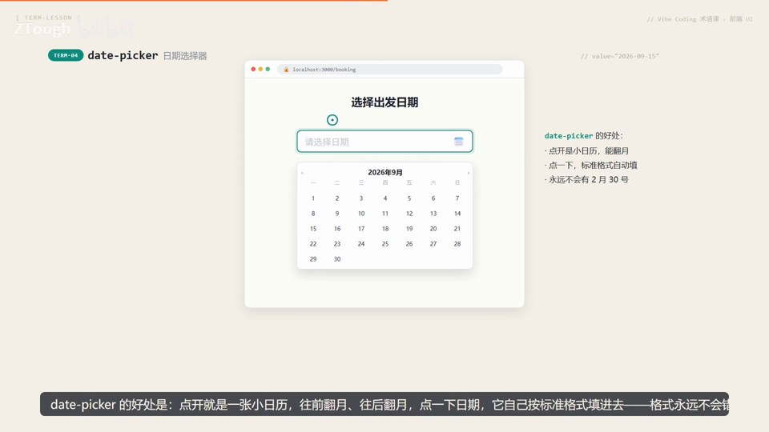

# Vibe Coding 术语课 第05 集｜Vibe Coding 术语课：AI 一说你就懵的 7 个前端 UI 词（form/label/date-picker 全真实演示）

> 主题：AI 反问「出生日期要不要用 date-picker」你就愣住的七个 UI 词,全住在一张网页表单里,逐个真实演示

> 视频时长 4:54｜逐字稿见 `~/VibeCoding术语课/逐字稿/05_*.txt`｜术语 7 个

### 1. form｜表单

- **定义**：包住整张表单的外壳:把所有输入框打包成一张完整的表,提交时统一收集数据并做校验。

- **要点**：
  - form 不是某个输入框,而是包住所有输入框的那个外壳
  - 干三件事:打包字段成一张表、提交时统一收集数据、顺手做校验
  - 校验不过(密码太短、邮箱格式不对)在按钮下方标红提示(演示:密码至少8位)

- **给 AI 的句式**：「做一个报名表单:包一层 form,提交时校验」——AI 就知道这一页需要一组能提交、能校验的输入控件

- **视频画面**：

  

  

### 2. label｜标签

- **定义**：输入框旁边那行小字,告诉用户这一栏到底填什么(如「用户名」)。

- **要点**：
  - label=输入框旁边那行小字,这行字告诉你这一栏填什么
  - label 和输入框是绑定的:点一下这行小字,光标自动跳进输入框
  - 没有 label 的输入框,用户只能干瞪眼猜这栏填啥

- **给 AI 的句式**：「用户名输入框,label 写『用户名』」——别让它给你一排光秃秃的框

- **避坑**：没配 label,用户只能猜(演示:一个光秃秃的输入框,「这栏填啥??」)

- **视频画面**：

  

### 3. placeholder｜占位提示

- **定义**：输入框里面灰灰的提示字,告诉你这里该填什么格式,一动手输入就消失。

- **要点**：
  - label 在框外面、一直在、是字段名;placeholder 在框里面、一输入就消失、只是示例
  - 示例:邮箱框里灰字 name@example.com,提示邮箱格式长这样
  - 灰字消失 = 用户开始输入了

- **给 AI 的句式**：「邮箱框 placeholder 写『请输入邮箱』/『name@example.com』」

- **避坑**：记住:灰字是示例,不是填好的内容——别把 placeholder 当 label 用

- **视频画面**：

  

### 4. date-picker｜日期选择器

- **定义**：点开就是一张能翻月的小日历,点一下日期就按标准格式自动填好的选日期控件。

- **要点**：
  - 好处一:点开是小日历,能翻月(2026年9月)
  - 好处二:点一下,标准格式自动填好(2026-09-15)
  - 好处三:永远不会有 2月30号 这种不存在的日期

- **给 AI 的句式**：「出生日期用 date-picker」——AI 就知道要给你日历,而不是让你裸手打字

- **避坑**：让用户手打出厂日期,他可能给你敲个 2月30号出来

- **视频画面**：

  

  

### 5. time-picker｜时间选择器

- **定义**：跟 date-picker 是一对兄弟:date 管几月几号、time 管几点几分,点开是时间列表挑一个。

- **要点**：
  - 预约、排期、提醒这类界面都少不了它
  - 点开是一张时间列表(08:00~11:00 半小时一档),挑一个就行(已选 10:00)
  - 比手输靠谱,不会出现 25点 这种鬼时间

- **给 AI 的句式**：日期时间两个都要?直接说 date-time-picker,很多组件库都直接支持;「预约时间用 time-picker」

- **视频画面**：

  

### 6. color-picker｜颜色选择器

- **定义**：把「选颜色」变成看得见的事的控件:面板上拖一拖、点一点,色块跟着变,同步给出 #FF6B81 这种色值。

- **要点**：
  - 做个人主页、后台设置,经常要让人挑个颜色当主题色
  - 拖一拖、点一点,左边色块跟着变
  - 所见即所得——面板挑完色值自动出来,不用懂色彩理论

- **给 AI 的句式**：「主题色加一个 color-picker」——AI 就会给你配好这个调色面板

- **视频画面**：

  

### 7. upload｜上传

- **定义**：收文件的入口,让用户交头像、附件、证件照的控件。

- **要点**：
  - 最常见的形态是虚线框:点它,或直接把文件拖进来
  - 放进来会出现小卡片:文件名/大小/进度(avatar.png 1.2MB 54%→100%)
  - 传完打个勾,显示「上传完成,可以提交了」

- **给 AI 的句式**：「头像加 upload,限 2MB」——AI 会连格式校验一起给你做掉

- **视频画面**：

  

  

---
> 本集串联：学词不为了背,是为了跟 AI 下对单:把七个词串成一段话发给 AI——包一层 form 提交时校验;姓名输入框 label 写「姓名」;邮箱框 placeholder 写 name@example.com;出生日期用 date-picker;预约时间用 time-picker;主题色用 color-picker;证件上传用 upload 限 2MB——AI 基本一次把你想要的页面做出来,术语到位,改稿次数直接减半。
