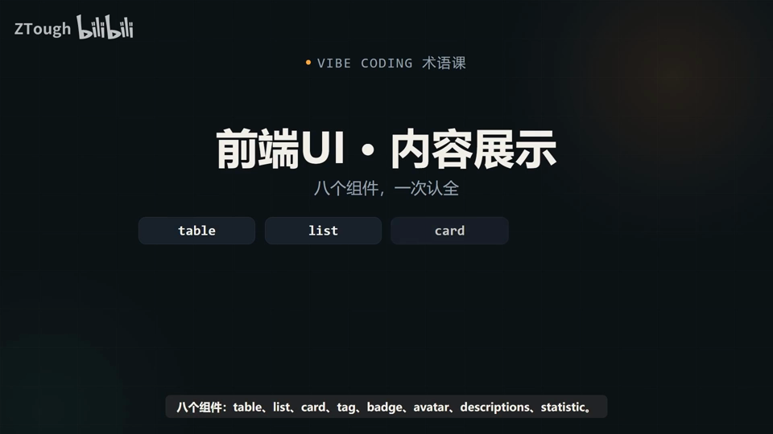
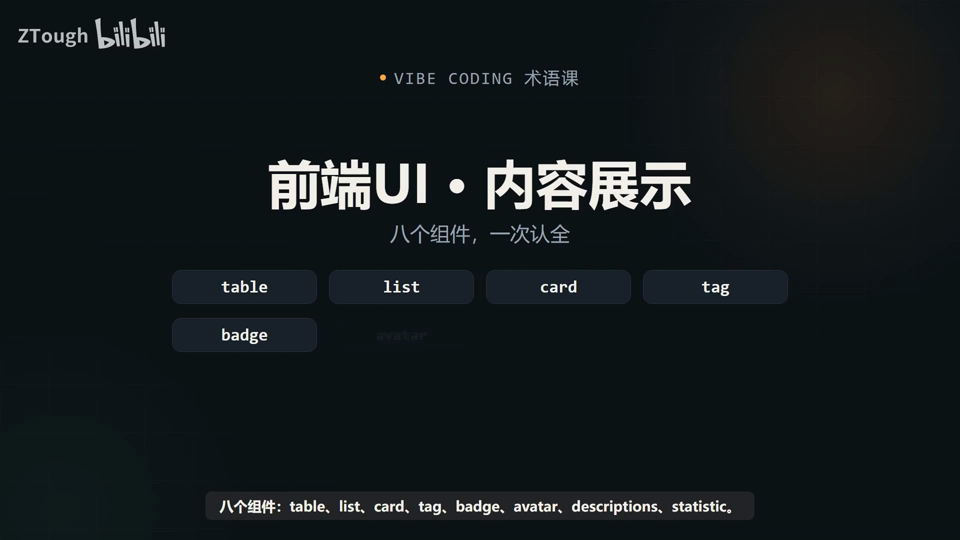
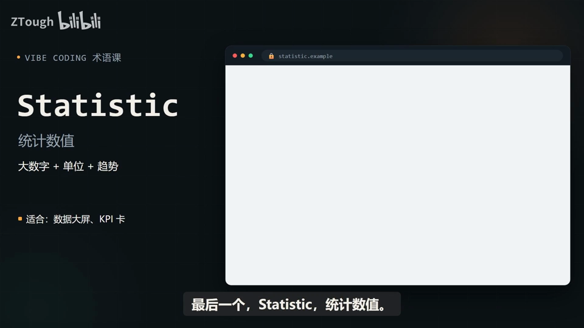
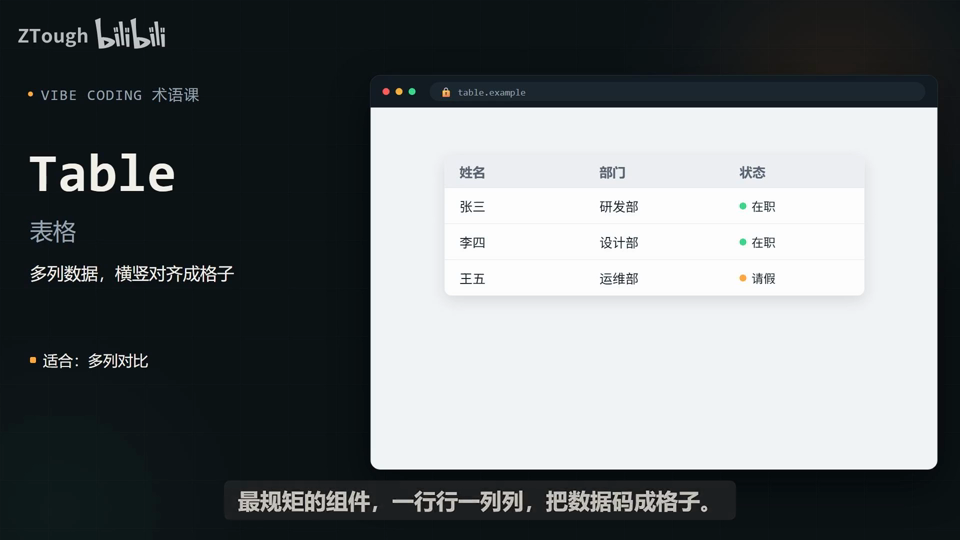

# Vibe Coding 术语课 第06 集｜Vibe Coding 术语课：前端 UI 内容展示，8 个组件一个比一个讲清楚

> 主题：内容展示组件八件套：Table/List/Card/Tag/Badge/Avatar/Descriptions/Statistic，按“要对比/浏览/分组/标记/报数/认人/看详情/亮数据”选型

> 视频时长 2:43｜逐字稿见 `~/VibeCoding术语课/逐字稿/06_*.txt`｜术语 8 个

### 1. Table｜表格

- **定义**：多列数据，横竖对齐成格子。

- **要点**：
  - 适合：多列对比
  - 一行行一列列，把数据码成格子
  - 典型如员工列表——姓名/部门/状态，一眼扫过去全清楚

- **给 AI 的句式**：要展示多列、需要逐行对比的数据时写：“这份员工列表用 Table 表格排成行列对齐的格子”。

- **视频画面**：

  

### 2. List｜列表

- **定义**：一条条竖着排，轻量内容流。

- **要点**：
  - 适合：消息流、文章列表
  - 比 Table 轻，每条带小图标和一段文字
  - 演示项：新消息提醒(3分钟前)、今日待办(2项进行中)、系统通知(刚刚)

- **给 AI 的句式**：消息流、文章列表这类一条条的轻量内容，告诉 AI“用 List 竖着一条条排”。

- **视频画面**：

  

### 3. Card｜卡片

- **定义**：把信息装进圆角盒子，图文可混排。

- **要点**：
  - 适合：独立小模块
  - 图文、按钮能放一起，整张还能点
  - 商品卡、教程卡都是这个套路，一排排好几个像货架

- **给 AI 的句式**：页面要放一批独立模块（教程卡/商品卡）时写：“每门课做成一张 Card 卡片，图文混排、整卡可点”。

- **视频画面**：

  

### 4. Tag｜标签

- **定义**：小色块，打分类标记。

- **要点**：
  - 适合：状态、分类筛选
  - 作用就一个：让人一秒看清这属于哪一类
  - 演示：进行中/已完成/高优/默认/停用，带 × 可删、可筛选

- **给 AI 的句式**：要给内容打分类/状态标记时说：“这些状态各加一个 Tag 小色块，进行中/已完成/高优”。

- **避坑**：别和 Badge 弄混：Tag 标文字、标分类；Badge 报数字、报状态（画面原文：Tag 标文字 Badge 报数字）。

- **视频画面**：

  

  

### 5. Badge｜徽标

- **定义**：图标角上的数字，报未读数量。

- **要点**：
  - 适合：消息提醒、计数
  - 挂在图标右上角的小数字，如 99+
  - 没读完的一眼就知道

- **给 AI 的句式**：消息图标要显示未读数时写：“右上角加 Badge 徽标，未读显示 99+”。

- **避坑**：别和 Tag 弄混：Badge 报数字/报状态，Tag 标文字/标分类。

- **视频画面**：

  

### 6. Avatar｜头像

- **定义**：用户的代表图形，圆形为主。

- **要点**：
  - 适合：评论、成员列表、聊天列表
  - 放首字母或一张脸，旁边还能挂在线小绿点
  - 评论区、聊天列表全靠它认人

- **给 AI 的句式**：用户列表/评论区要认人时说：“每个人配一个圆形 Avatar 头像，可显示首字母”。

- **视频画面**：

  

### 7. Descriptions｜描述列表

- **定义**：标签和值成对排开，只读详情。

- **要点**：
  - 适合：账号资料、详情页
  - 左一列标签右一列值，成对排开
  - 比 Table 更适合看单个对象的所有属性（用户名/邮箱/部门/入职时间）

- **给 AI 的句式**：展示单个对象的只读属性时说：“账号资料用 Descriptions 描述列表，字段名和值成对展示”。

- **视频画面**：

  

### 8. Statistic｜统计数值

- **定义**：大数字＋单位＋趋势。

- **要点**：
  - 适合：数据大屏、KPI 卡
  - 把最重要的数字放到最大，加单位和涨跌箭头
  - 演示：今日访问量 12,924（+12.5% 较昨日）、订单数、转化率

- **给 AI 的句式**：后台首页那一排 KPI 卡就是它：“顶部做一排 Statistic 统计数值，大数字＋涨跌趋势”。

- **视频画面**：

  

  

---
> 本集串联：八个组件一次记全：要对比用 Table、要浏览用 List、要分组用 Card、要标记用 Tag、要报数用 Badge、要认人用 Avatar、要看详情用 Descriptions、要亮数据用 Statistic。
