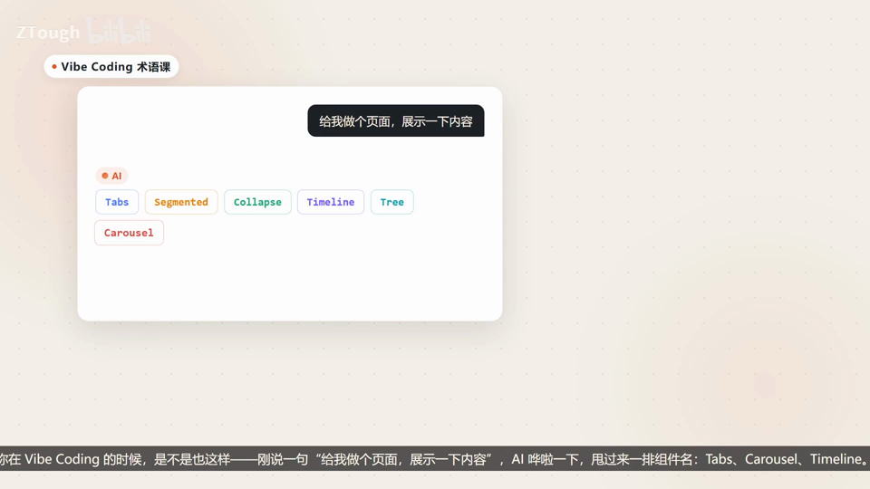
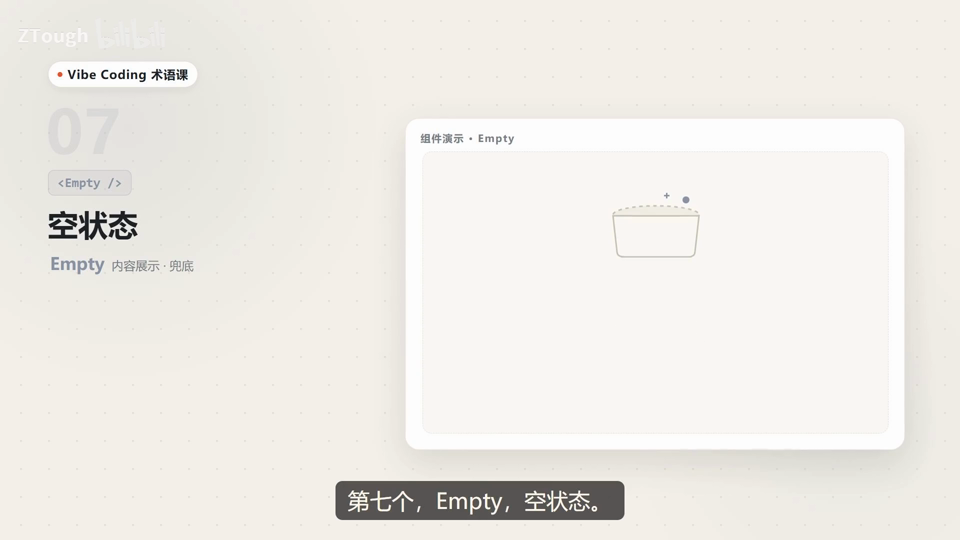
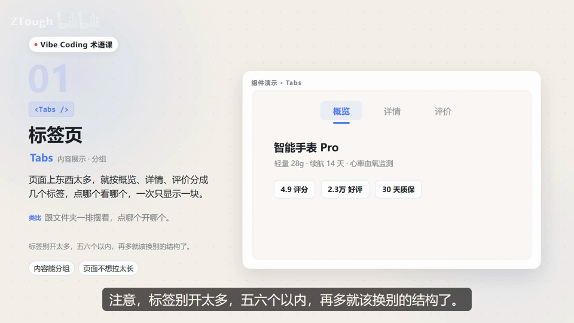

# Vibe Coding 术语课 第07 集｜Vibe Coding 术语课：前端 UI 里的 7 个 "内容展示" 组件，一次讲清

> 主题：内容展示组件第二版：Tabs/Segmented/Collapse/Timeline/Tree/Carousel/Empty，分别管分组、单选、收纳、顺序、层级、轮播、兜底

> 视频时长 2:56｜逐字稿见 `~/VibeCoding术语课/逐字稿/07_*.txt`｜术语 7 个

### 1. Tabs｜标签页

- **定义**：页面上东西太多，就按概览、详情、评价分成几个标签，点哪个看哪个，一次只显示一块。

- **要点**：
  - 适合：内容能分组、页面不想拉太长
  - 类比：跟文件夹一排摆着，点哪个开哪个
  - 演示：智能手表 Pro 的 概览/详情/评价 三个标签

- **给 AI 的句式**：一个页面内容太多要分组时说：“把内容按 概览/详情/评价 做成 Tabs 标签页，一次只显示一块”。

- **避坑**：标签别开太多，五六个以内；再多就该换别的结构了。

- **视频画面**：

  

### 2. Segmented｜分段控件

- **定义**：一排按钮，选中哪个，高亮块就滑到哪个，跟收音机选台一样，只能选一个。

- **要点**：
  - 适合：选项少、必须单选
  - 类比：跟 Tabs 长得像但更轻，只切换同一块区域的显示口径
  - 演示：周/月/切换“每日订单量”统计口径

- **给 AI 的句式**：同一区域要切换显示口径时说：“加 Segmented 分段控件，周/月两档单选切换”。

- **视频画面**：

  

### 3. Collapse｜折叠面板

- **定义**：平时只露出标题，点一下才展开内容，再点一下收回去。

- **要点**：
  - 适合：FAQ 问答、设置分组、说明文档
  - 类比：像行李箱的夹层，合着省地方，用的时候拉开
  - 演示：如何开通会员？/支持退款吗？/发票怎么开？

- **给 AI 的句式**：问答/说明类内容不想占太多版面时说：“FAQ 用 Collapse 折叠面板，平时只露标题，点击展开”。

- **视频画面**：

  

### 4. Timeline｜时间轴

- **定义**：一条线串起几个圆点，每个点是一件事，先后顺序一眼看清。

- **要点**：
  - 适合：物流轨迹、订单进度、项目里程碑
  - 演示：下单09:12→打包10:40→运输14:05→签收18:22

- **给 AI 的句式**：要表现事件先后顺序时说：“物流轨迹用 Timeline 时间轴，每个节点一件事”。

- **视频画面**：

  

### 5. Tree｜树形控件

- **定义**：专管有层级的数据，父节点点开，冒出一排子节点，一层套一层。

- **要点**：
  - 适合：组织架构、文件目录、多级分类
  - 类比：跟电脑里的文件夹目录一模一样
  - 演示：项目文档→设计稿/代码/素材 逐层展开

- **给 AI 的句式**：要展示嵌套层级时说：“文件目录用 Tree 树形控件，父节点可展开子节点”。

- **视频画面**：

  

### 6. Carousel｜走马灯

- **定义**：多张图轮着放，自动翻页，也能手动划，一次看一张。

- **要点**：
  - 适合：首页 Banner、图片轮播、广告位
  - 类比：像商场橱窗的滚动屏，翻来翻去不重样
  - 演示：新品上市/限时特惠/会员专享多张轮播

- **给 AI 的句式**：首页要放轮播图时说：“顶部 Banner 做成 Carousel 走马灯，自动轮播可手动划”。

- **避坑**：图片别放太多，超过五张，用户基本等不到看完。

- **视频画面**：

  

### 7. Empty｜空状态

- **定义**：数据还没来的时候，别让页面干巴巴空着，放个小插画，配一句“暂无数据”。

- **要点**：
  - 适合：购物车为空、搜索无结果、列表为空
  - 再给个“去添加”按钮，引导用户去操作
  - 演示：暂无数据＋小插画＋去添加按钮

- **给 AI 的句式**：列表没数据时写：“空状态用 Empty 组件，放插画和‘暂无数据’，加一个去添加按钮”。

- **视频画面**：

  

  

---
> 本集串联：七个组件一次记住：Tabs 管分组、Segmented 管单选、Collapse 管收纳、Timeline 管顺序、Tree 管层级、Carousel 管轮播、Empty 管兜底。
