# Vibe Coding 术语课 第08 集｜Vibe Coding 术语课：Web 前端 10 个高频术语，三分钟讲明白

> 主题：天天见却不一定叫得上名字的 10 个前端界面词：image/file/video/icon/App Icon/quote/Chat UI/Filter/chart/sort

> 视频时长 2:45｜逐字稿见 `~/VibeCoding术语课/逐字稿/08_*.txt`｜术语 10 个

### 1. image｜图片

- **定义**：网页上的照片、插画、表情包，都是它。

- **要点**：
  - 想让 AI 加张图，说的就是它
  - 前端就一行  标签，加个 src 指路图片就出来了

- **给 AI 的句式**：“这里加一张商品图 image，用  引入”。

- **视频画面**：

  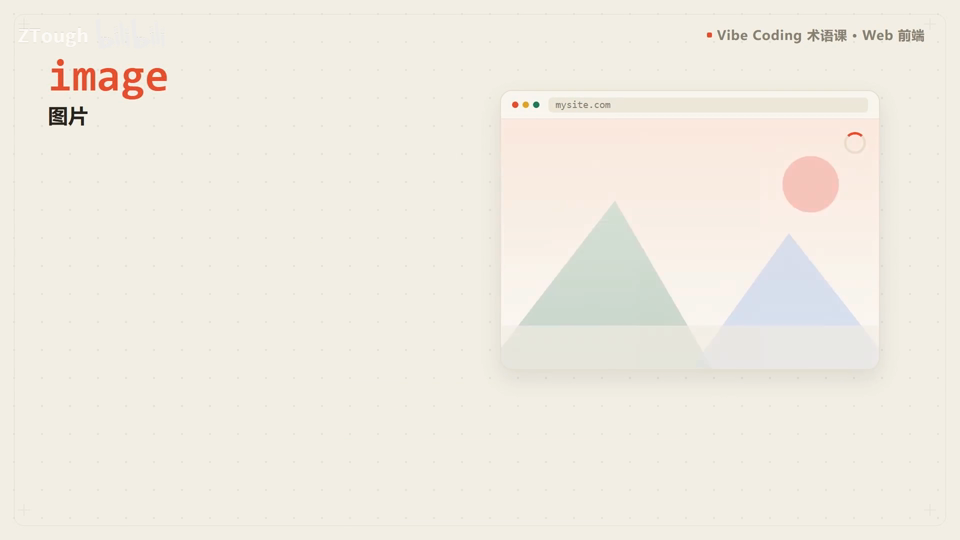

### 2. file｜文件

- **定义**：就是那个上传文件的按钮/区域，点一下弹出你电脑里的文件管理器，选好文件就传上去了。

- **要点**：
  - 演示：把文件拖到这里，或从电脑中选择文件
  - 报告.docx、视频.mp4、照片.jpg 都能传
  - 前端一行 input 标签、type 设成 file 搞定

- **给 AI 的句式**：要上传功能时说：“加一个 file 上传控件，支持拖拽和选择文件”。

- **视频画面**：

  

### 3. video｜视频

- **定义**：网页里内嵌的播放器：播放、暂停、进度条，控件全自带。

- **要点**：
  - 一个 video 标签加个 src 就能放，不用自己造轮子
  - 演示：播放条 00:17 / 04:56

- **给 AI 的句式**：“页面上内嵌播放这个视频，用 video 标签”。

- **视频画面**：

  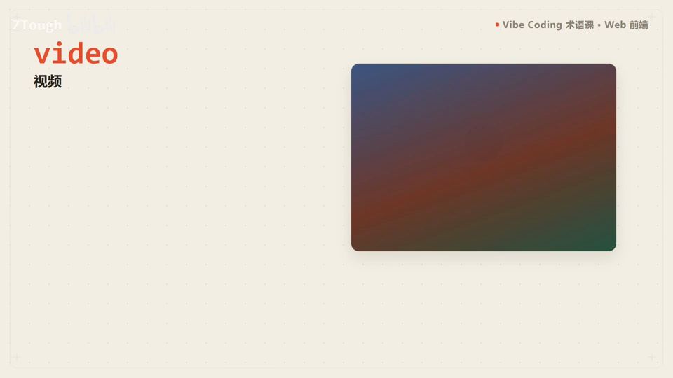

  

### 4. icon｜图标

- **定义**：搜索框的放大镜、设置里的齿轮都是它；矢量图，放大缩小都不糊。

- **要点**：
  - 前端一般直接引现成的图标库，不用自己画
  - 画面提到图标库：lucide、iconify

- **给 AI 的句式**：“按钮上加一个搜索 icon，从图标库引入”。

- **视频画面**：

  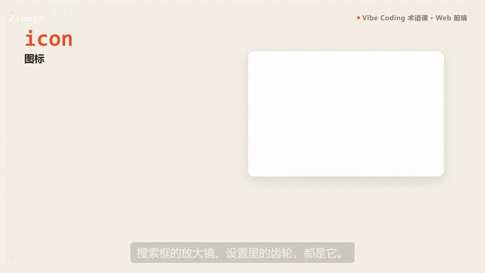

  

### 5. App Icon｜应用图标

- **定义**：手机桌面上那个方形 logo，代表一个应用。

- **要点**：
  - 开发时一个图标往往要做成好多尺寸，适配不同设备
  - 画面里的资源：asset/icon-512.png

- **给 AI 的句式**：要 PWA/桌面端 logo 时说：“准备一套 App Icon，含 512px 等多尺寸”。

- **视频画面**：

  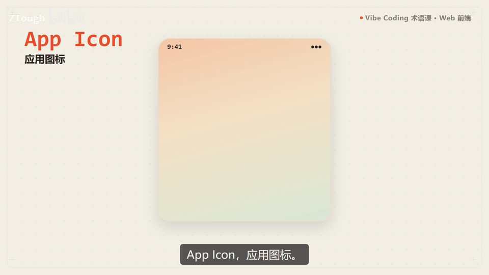

  

### 6. quote｜引用

- **定义**：别人的一段话，突出显示，左边一条竖线，一看就知道是引用。

- **要点**：
  - 对应标签叫 blockquote，样式现成
  - 演示：博客里引用名言 “Talk is cheap. Show me the code.”

- **给 AI 的句式**：“这段话做成 quote 引用块，左边一条竖线突出显示”。

- **视频画面**：

  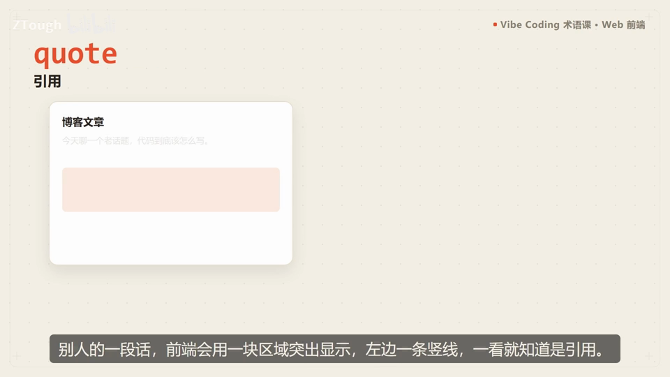

  

### 7. Chat UI｜聊天界面

- **定义**：现在最常见的界面，AI 助手、客服都是它：左边你右边机器人，气泡一来一回，底下是输入框。

- **要点**：
  - 想做个聊天应用，跟 AI 说一声界面直接给你搭好
  - 演示：AI 助手问答，输入框“输入你的问题…”

- **给 AI 的句式**：“做一个 Chat UI 聊天界面，消息气泡左右分列，底部输入框”。

- **视频画面**：

  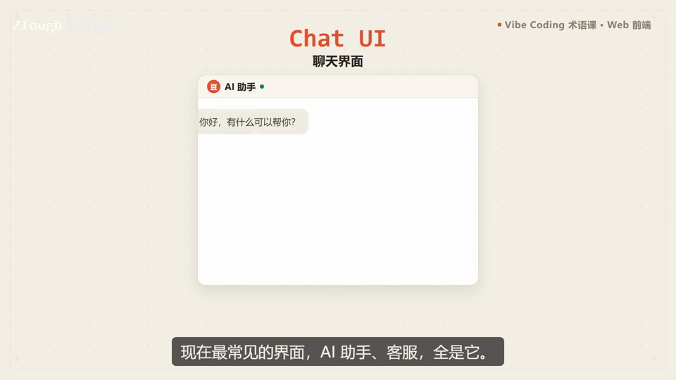

  

### 8. Filter｜筛选/滤镜

- **定义**：筛东西是它，加滤镜也是它——同一个词两种用法。

- **要点**：
  - 电商页面按价格、销量、评分筛东西
  - CSS 里给图片加模糊、变黑白也是它
  - 常和排序搭在一起

- **给 AI 的句式**：“列表加一组 Filter 筛选条件：价格/销量/评分”。

- **视频画面**：

  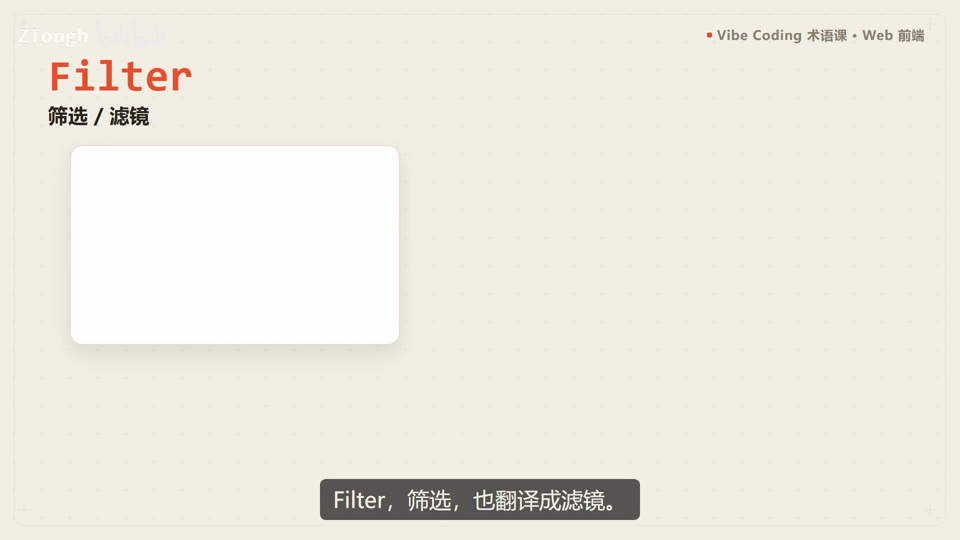

  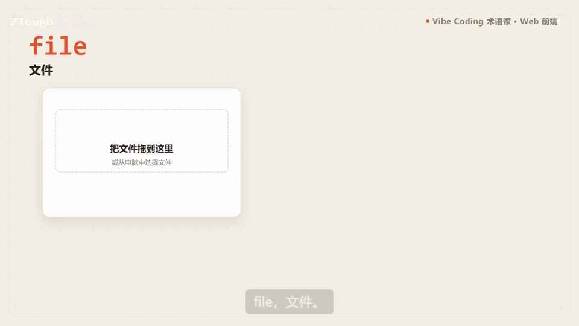

### 9. chart｜图表

- **定义**：把数字画成图形，一眼看懂。

- **要点**：
  - 柱状图、折线图、饼图都算 chart
  - 前端一般用现成的图表库，把数据丢进去它帮你画
  - 演示：本周数据 1-5 月

- **给 AI 的句式**：“这组统计数据画成 chart 柱状图”。

- **视频画面**：

  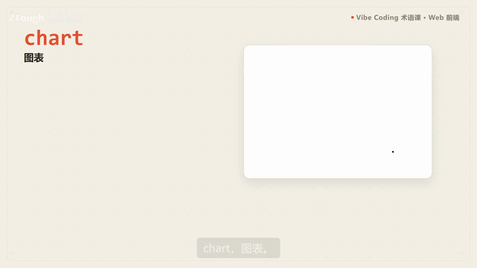

  

### 10. sort｜排序

- **定义**：让列表按价格从低到高、按时间从新到旧排。

- **要点**：
  - 界面上通常是个下拉框，或者两个小箭头
  - 演示：排序“价格从低到高”，帆布包 ¥29…蓝牙音箱 ¥359
  - 常和筛选搭在一起

- **给 AI 的句式**：“商品列表支持按价格 sort 排序”。

- **视频画面**：

  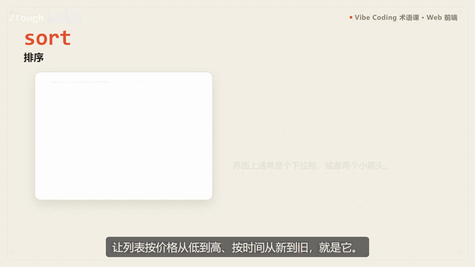

  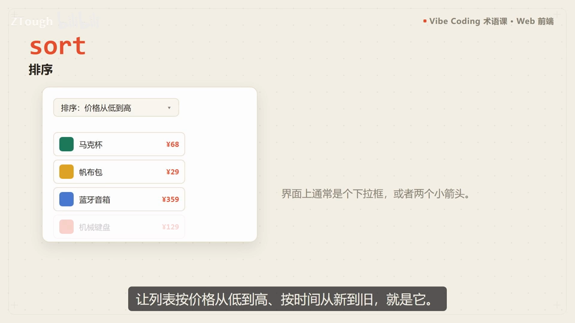

---
> 本集串联：结尾把十个术语整体列一遍：写代码的时候翻出来对照着看——image/file/video 是媒体三件套，icon/App Icon 管图标，quote/Chat UI 是内容块，Filter/chart/sort 管数据操作。
