# Vibe Coding 术语课 第09 集｜Vibe Coding 术语课：别再管所有弹窗都叫「弹窗」了｜前端：弹窗与提示 12 术语网页演示

> 主题：网页里“点一下啪地冒出来、过两秒又自己消失”的那一类组件，细数能凑出 12 个，别再管所有弹窗都叫弹窗

> 视频时长 4:45｜逐字稿见 `~/VibeCoding术语课/逐字稿/09_*.txt`｜术语 12 个

### 1. Alert｜警告提示

- **定义**：常驻在页面顶部、不会自己消失的提醒条，专门喊重要的事。

- **要点**：
  - 常驻不消失，是页面上的“常驻喇叭”
  - 黄条=提示：体验环境·数据每日 0 点重置
  - 红条=报错：提交失败·2 处填写有误，请检查后重试

- **给 AI 的句式**：页面上要有常驻提醒时说：“顶部放一个 Alert，提示体验环境数据每日 0 点重置”。

- **避坑**：与 Toast 相反：Alert 常驻不消失，适合重要提醒；轻量提醒别用它。

- **视频画面**：

  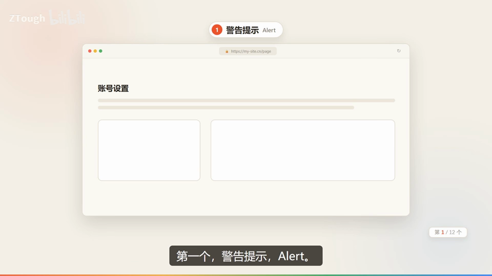

### 2. Toast｜轻提示

- **定义**：右下角冒出一句“保存成功”，过两秒自己消失的小纸条，什么都不用你管。

- **要点**：
  - 特点是轻、不打断你正在做的事，瞄一眼就行
  - 演示：点“保存”后右下角浮出“保存成功”自动消失

- **给 AI 的句式**：操作成功的瞬时反馈说：“点保存后弹一个 Toast‘保存成功’，两秒自动消失”。

- **视频画面**：

  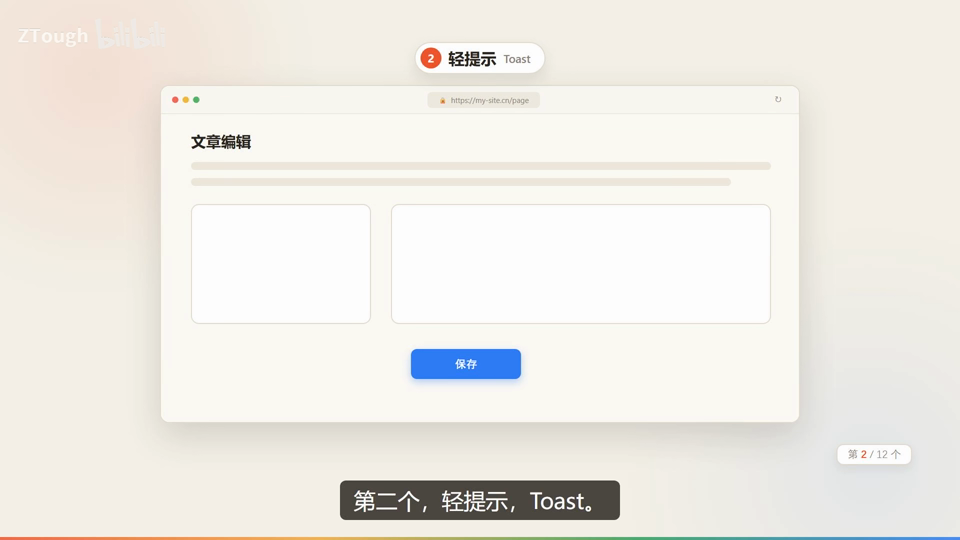

### 3. Notification｜通知

- **定义**：右上角铃铛点开的一堆系统消息——消息会攒着，等你点开，像收件箱。

- **要点**：
  - 跟 Toast 的区别：通知攒着等你看，Toast 一闪而过
  - 演示：审核未通过（封面临摹比例过高）/系统维护通知/视频已发布
  - 可点“查看原因”直接跳过去处理

- **给 AI 的句式**：系统消息要留存可回看时说：“右上角铃铛做 Notification 通知中心，消息攒着等用户点开”。

- **视频画面**：

  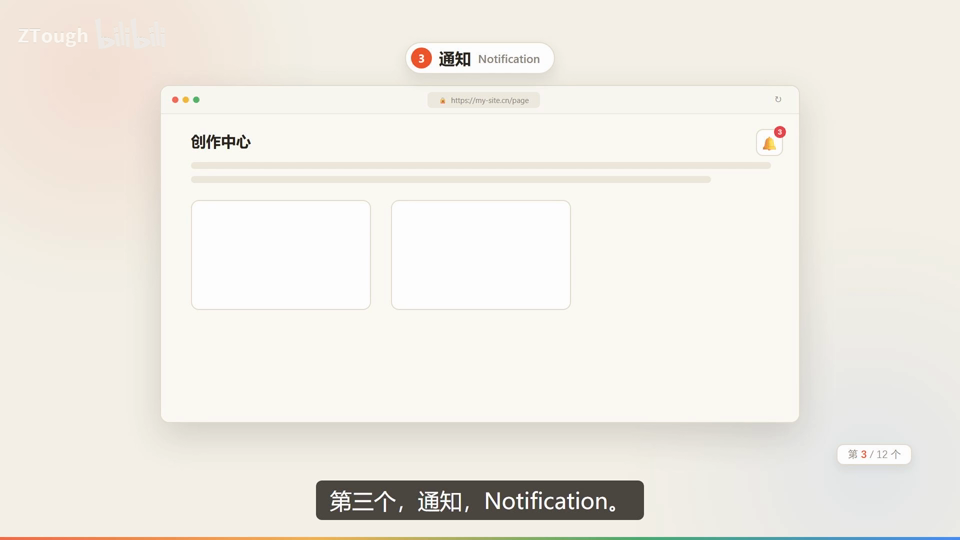

  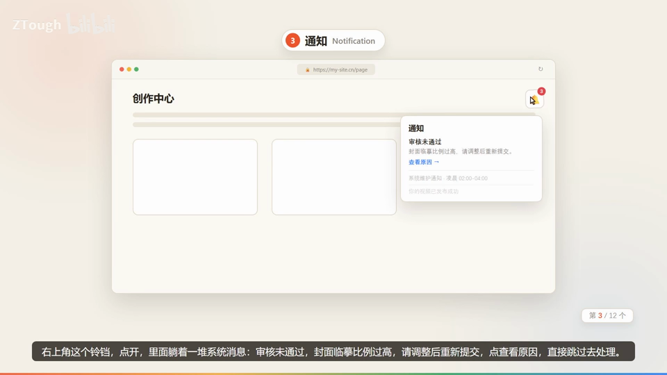

### 4. Modal｜弹窗

- **定义**：屏幕中间跳出个框，背后整个页面变灰点不了——模态弹窗，逼你先把手头这件事确认完。

- **要点**：
  - 演示：确认删除这个项目？删除后不可恢复（取消/确认删除二选一）
  - 重要、危险操作就得用弹窗拦一下

- **给 AI 的句式**：删除等危险操作说：“点删除后弹 Modal，确认删除这个项目？背后页面置灰不可点”。

- **避坑**：小确认别动不动就开大窗——轻量确认用 Popconfirm 气泡。

- **视频画面**：

  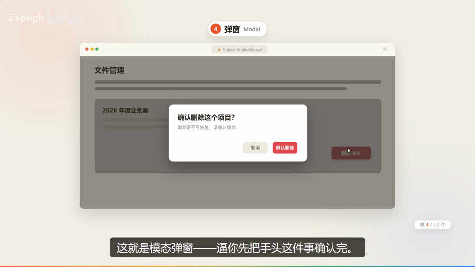

### 5. Drawer｜抽屉

- **定义**：从屏幕边缘（右侧）滑出来的一块面板，背后的列表还看得见，不遮住全部。

- **要点**：
  - 演示：点任务行，右侧滑出任务详情（任务名称/截止日期/备注，关闭/保存）
  - 关键：它只是从边上抽出一层，不遮住全部内容

- **给 AI 的句式**：要看详情同时保留上下文时说：“点任务行从右侧滑出 Drawer 抽屉显示详情，背后列表保持可见”。

- **视频画面**：

  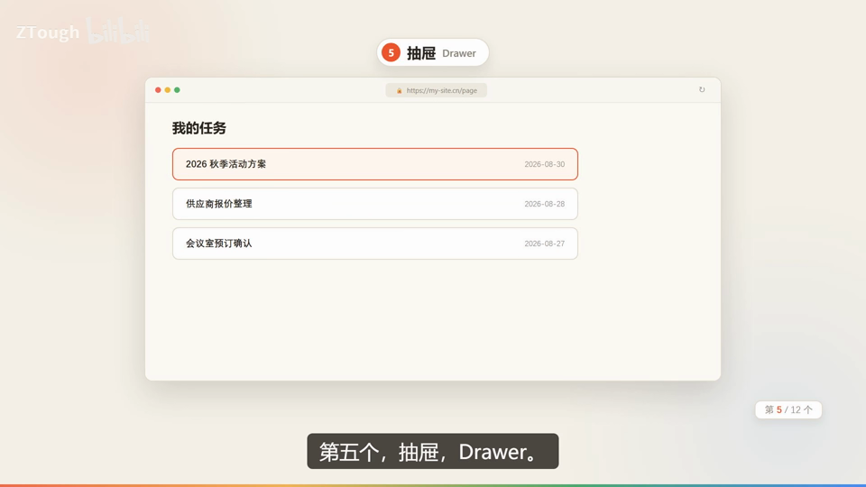

  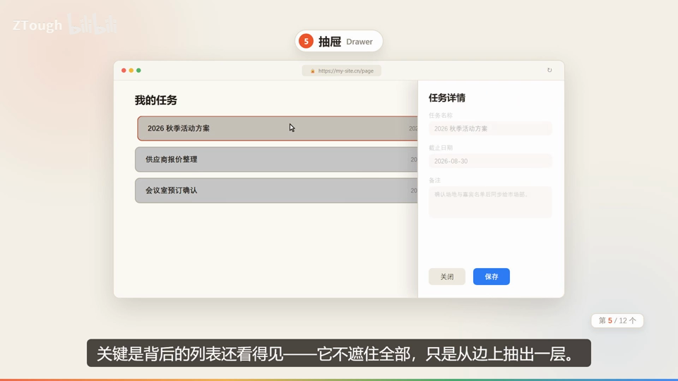

### 6. Popconfirm｜气泡确认框

- **定义**：不弹大窗，就在按钮旁边冒出一句“确认删除这条记录？”的小气泡，取消/确定点完就完事儿。

- **要点**：
  - 适合轻量二次确认
  - 演示：删除按钮旁弹出 取消/确定

- **给 AI 的句式**：删除某一行时写：“行内删除加 Popconfirm 气泡确认框，就在按钮旁边确认”。

- **避坑**：小确认用气泡，别动不动就开大窗（Modal）。

- **视频画面**：

  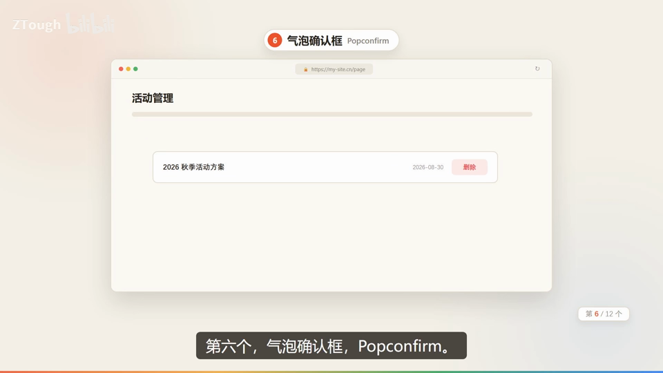

  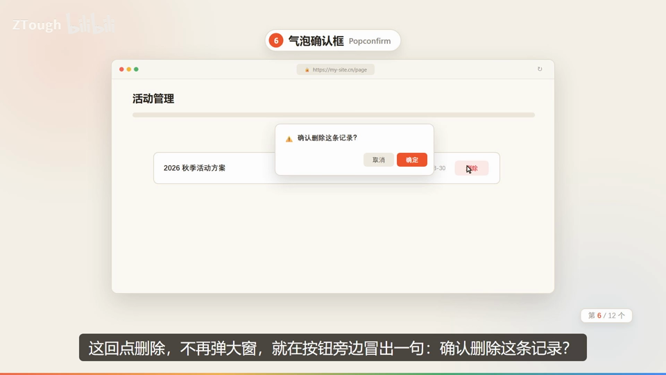

### 7. Popover｜气泡卡片

- **定义**：主动点开后浮出的一张详情小卡片，比如点一下头像，旁边浮出名字、职位、城市、查看主页。

- **要点**：
  - 演示：头像旁浮卡显示“产品经理·深圳·查看主页”
  - 区别：Tooltip 是悬停看一行字，Popover 是你主动点开的一张详情卡

- **给 AI 的句式**：点头像看资料时说：“点头像弹出 Popover 卡片，显示职位/城市/查看主页”。

- **视频画面**：

  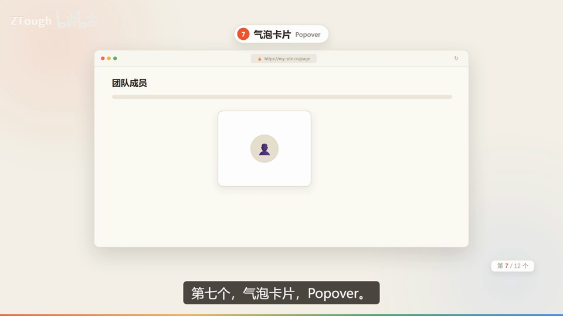

### 8. Tooltip｜文字提示

- **定义**：鼠标放上去，图标旁边飘出一行小字，解释这个按钮是干嘛的；鼠标一离开马上消失。

- **要点**：
  - UI 里最安静的存在：不点不弹不打扰
  - 演示：刷新/导出按钮旁悬停显示“查看操作帮助”

- **给 AI 的句式**：给图标按钮加解释时说：“悬停显示 Tooltip 文字提示，说明按钮作用”。

- **视频画面**：

  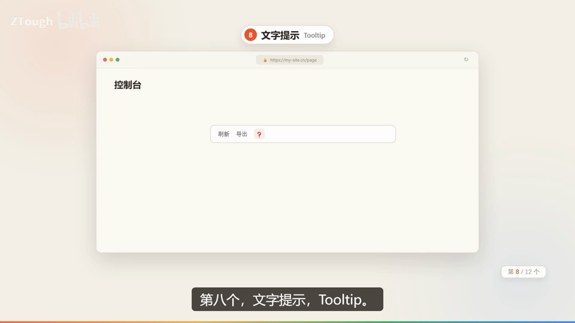

  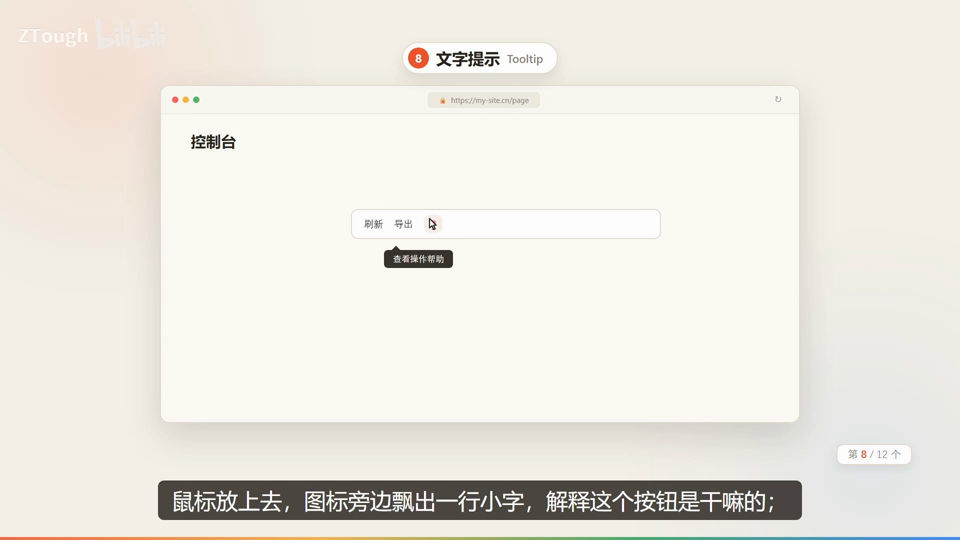

### 9. Progress｜进度条

- **定义**：一条从 0 爬到 66% 的进度条，给等待中的用户一个反馈。

- **要点**：
  - 上传文件最怕没反馈：传没传完、卡没卡死，用户心里要有底
  - 演示：上传中心“设计终稿_v8.zip 上传中 66%”
  - 凡是需要等待的，都值得配一条进度条

- **给 AI 的句式**：上传/下载时说：“上传时显示 Progress 进度条，百分比实时更新”。

- **视频画面**：

  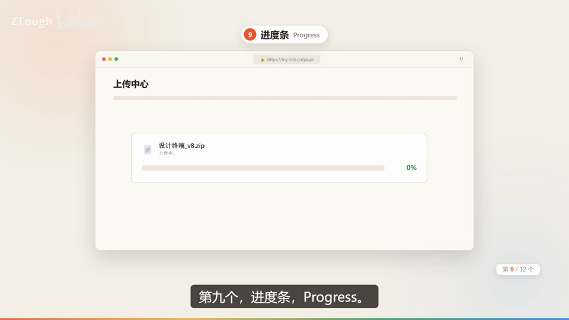

### 10. Skeleton｜骨架屏

- **定义**：内容还在加载，先摆出一排灰色占位框，等数据真到了，内容“啪”地填进去。

- **要点**：
  - 别让用户盯着空白干等，先占好座
  - 演示：文章列表加载时显示灰色占位块

- **给 AI 的句式**：页面数据加载慢时说：“加载完成前先显示 Skeleton 骨架屏占位，数据到了再替换”。

- **视频画面**：

  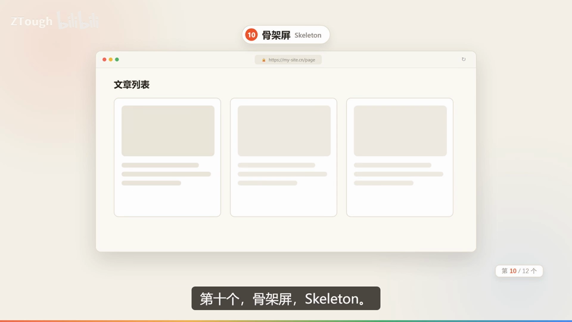

### 11. Result｜结果页

- **定义**：提交、付款这种大事做完后，先给一个明确的结果页，做完事有交代用户才安心。

- **要点**：
  - 演示：提交成功——审核结果将在 1-3 个工作日内通知你
  - 再给个下一步按钮：返回首页

- **给 AI 的句式**：表单提交成功后说：“跳转 Result 结果页，显示提交成功，再给一个返回首页按钮”。

- **视频画面**：

  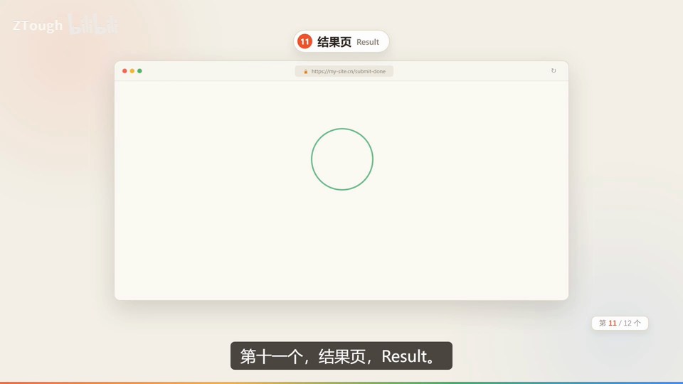

  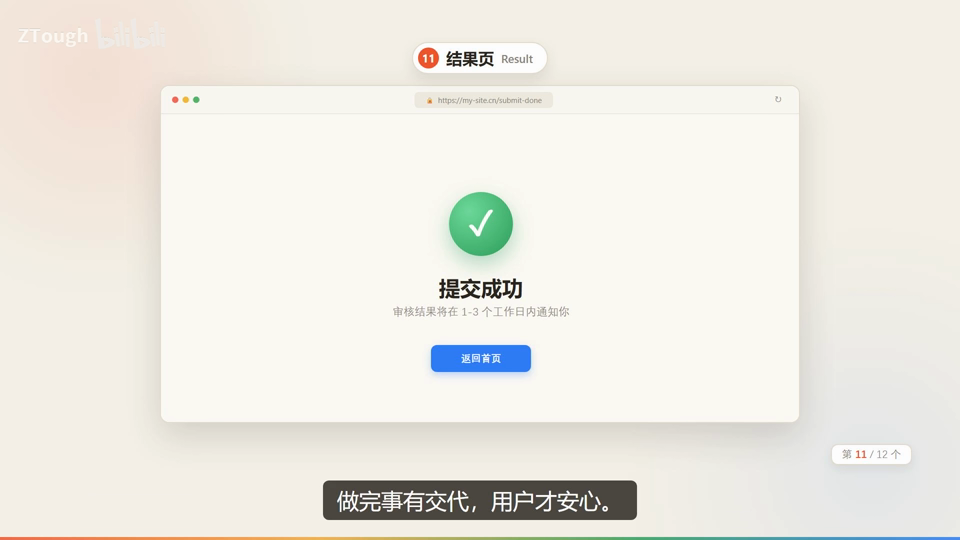

### 12. Spinner｜旋转加载指示器

- **定义**：加载慢的时候给个转圈，旁边写“正在保存…”，是所有反馈里最朴素的一个。

- **要点**：
  - 可要是没了它，用户真会以为程序卡死了
  - 演示：文档中心“正在保存…”转圈
  - 转圈虽小，必不可少

- **给 AI 的句式**：异步等待中说：“保存期间显示 Spinner 转圈＋‘正在保存…’”。

- **视频画面**：

  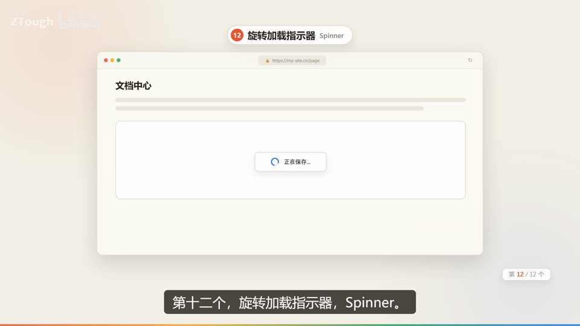

  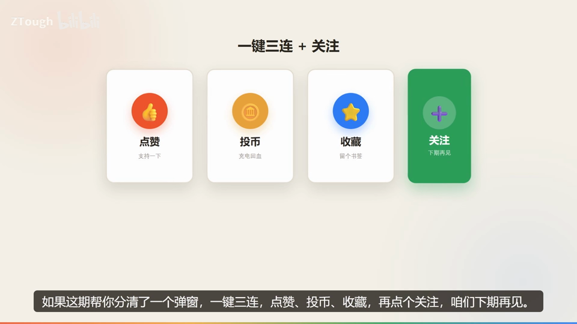

---
> 本集串联：12 个到齐了：常驻喊话的是 Alert、一闪而过的是 Toast、攒着看的是 Notification、拦你一下的是 Modal、边上抽出来的是 Drawer、按钮旁小气泡是 Popconfirm、详情卡是 Popover、悬停科普的是 Tooltip、爬进度的是 Progress、站位的是 Skeleton、给交代的是 Result、一直转圈的是 Spinner。
