# Vibe Coding 术语课 第10 集｜Vibe Coding 术语课：前端导航 9 个组件，大白话一次讲清

> 主题：前端导航类组件九件：用户怎么找到内容的 Search/Breadcrumb/Pagination/BackTop/Steps/Anchor/Dropdown/Skiplink/Menu

> 视频时长 3:43｜逐字稿见 `~/VibeCoding术语课/逐字稿/10_*.txt`｜术语 9 个

### 1. SEARCH｜搜索

- **定义**：内容一多，用户懒得一层层翻，直奔搜索框输关键词，它马上把沾边的都捞出来。

- **要点**：
  - 像问询台：输几个关键词，从一大堆内容里捞结果
  - 内容攒到靠人工翻都找不到的时候，就该装它
  - 演示：输入“退款”出现退款政策、订单退款进度

- **给 AI 的句式**：“内容多了，顶部加 SEARCH 搜索框，支持按名称/关键词检索”。

- **视频画面**：

  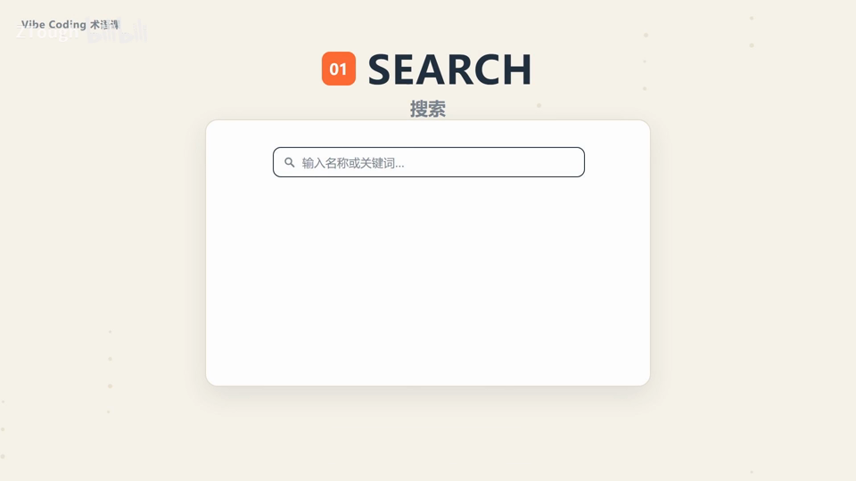

  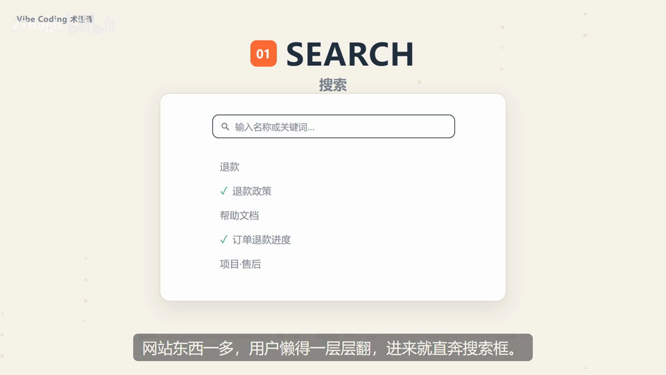

### 2. BREADCRUMB｜面包屑

- **定义**：网页顶部那排“首页>分类>当前页”，标出你现在在哪个位置，还能一层层点回去。

- **要点**：
  - 名字来自童话：小孩沿路撒面包屑好认路回家
  - 页面层级深的网站离不开它
  - 不然用户逛着逛着就不知道自己在哪儿了

- **给 AI 的句式**：“详情页顶部加 BREADCRUMB 面包屑：首页>分类>当前页，可逐级点回”。

- **视频画面**：

  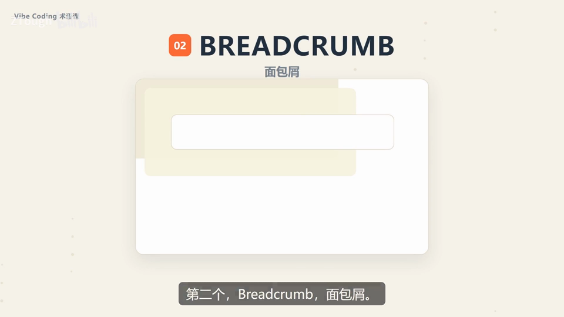

  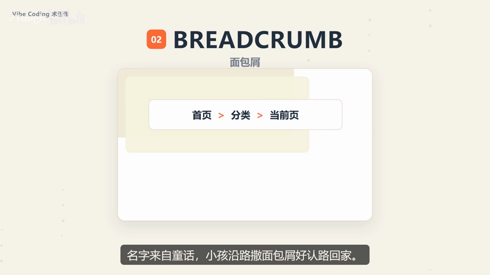

### 3. PAGINATION｜分页

- **定义**：一个页面塞不下几千条数据，就切成很多页，底部给你一排 123 这样的翻页按钮。

- **要点**：
  - 用它的关键是别让用户迷路：现在在第几页、下一页是什么要一眼能看见
  - 最怕翻完一页内容整个变样

- **给 AI 的句式**：“列表数据量大，底部加 PAGINATION 分页，显示当前页和总页数”。

- **视频画面**：

  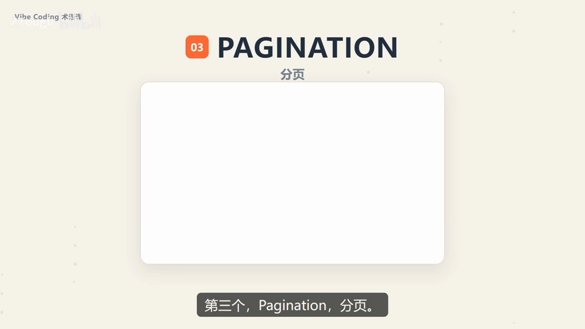

  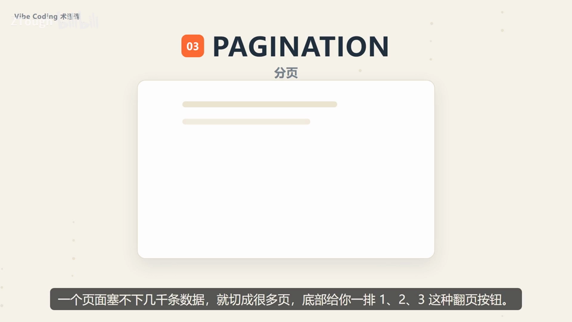

### 4. BACKTOP｜回到顶部

- **定义**：页面特别长、一路滚到底后，右下角冒出来的向上小按钮，点一下“蹭”地回到顶部。

- **要点**：
  - 是导航里最省心的一个
  - 页面够长，就值得放一个
  - 省得手动再滚 10 分钟

- **给 AI 的句式**：“长页面右下角加 BACKTOP 回到顶部按钮，滚动出现”。

- **视频画面**：

  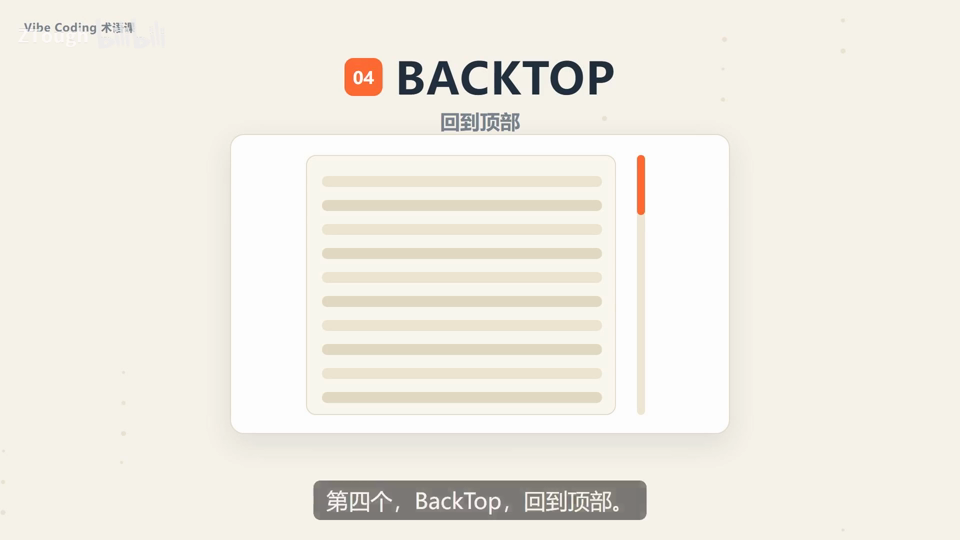

### 5. STEPS｜步骤条

- **定义**：把第一步、第二步、第三步排成一条线摆在那，告诉你现在走到哪一步、后面还剩几步。

- **要点**：
  - 适合下单、注册、填资料这类多步流程
  - 用户心里有数，才愿意把整个流程走完
  - 演示：填写信息→确认订单→完成支付

- **给 AI 的句式**：“下单流程用 STEPS 步骤条：填写信息→确认订单→完成支付，高亮当前步”。

- **视频画面**：

  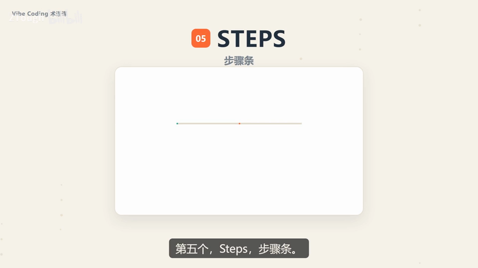

  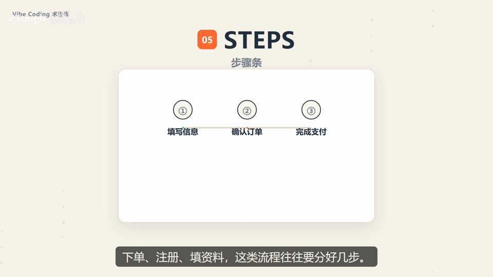

### 6. ANCHOR｜锚点

- **定义**：一个页面特别长、讲了好几个话题时，在页面右边竖一个小目录，点一下直接跳到那一节。

- **要点**：
  - 像电梯里的楼层按钮，不用一层层爬
  - 演示：一、背景 / 二、方案设计 / 三、结论 电梯直达

- **给 AI 的句式**：“长文页面右侧加 ANCHOR 锚点目录，点击跳到对应章节”。

- **视频画面**：

  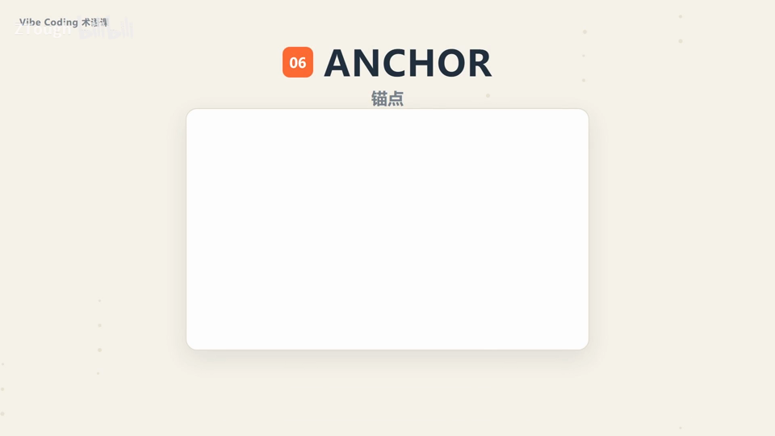

  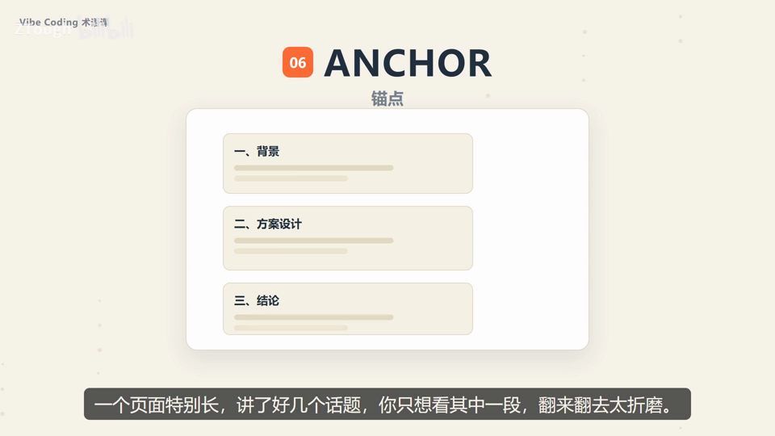

### 7. DROPDOWN｜下拉菜单

- **定义**：选项一多全摊开太占地方，就把它们收进一个小抽屉：鼠标移上去或点一下，选项才展开。

- **要点**：
  - 最常见的是头像旁边那个“更多操作”：设置、退出
  - 它的本事是收纳

- **给 AI 的句式**：“把 设置/退出 收进头像旁的 DROPDOWN 下拉菜单，悬停或点击展开”。

- **避坑**：重要的操作也别藏太深，得让用户找得到。

- **视频画面**：

  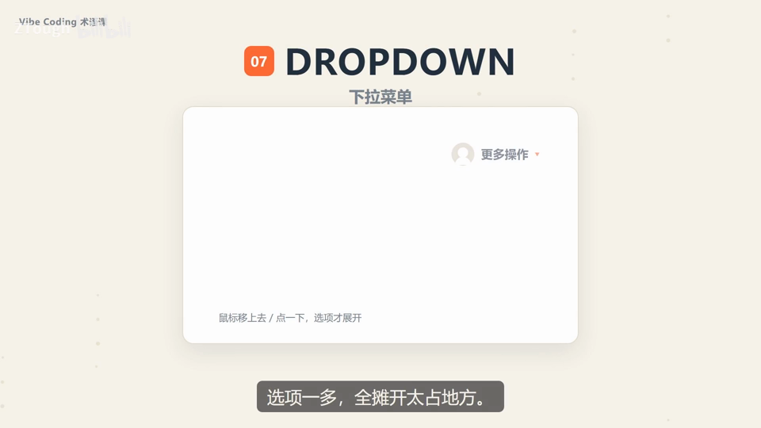

### 8. SKIPLINK｜跳过导航链接

- **定义**：放在页面最前面的一小段隐藏入口，按一下就直接跳到正文。

- **要点**：
  - 比较冷门但特别重要
  - 用键盘（Tab）操作网页的人，进页面不用一次次摸过导航
  - 这是做无障碍必备的细节

- **给 AI 的句式**：“页面最前面放一个 SKIPLINK 跳过导航链接，直达正文内容（无障碍）”。

- **视频画面**：

  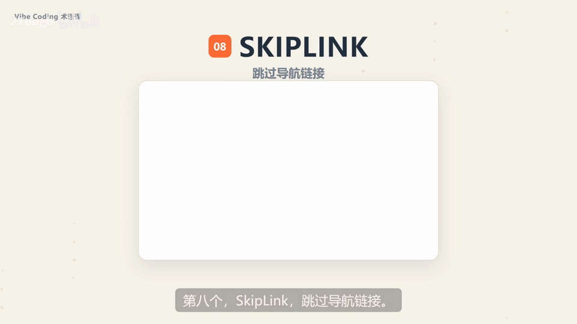

### 9. MENU｜导航菜单

- **定义**：顶部或侧边那一排入口：首页、产品、关于我们、联系——整个网站的骨架，靠它把页面串起来。

- **要点**：
  - 功能少的时候一行摆得下
  - 功能一多就得琢磨怎么分组、怎么收纳
  - 其他导航组件都长在这条栏上（画面原文）

- **给 AI 的句式**：“站点顶部做一排 MENU 导航菜单：首页/产品/关于我们/联系，产品下挂子项”。

- **视频画面**：

  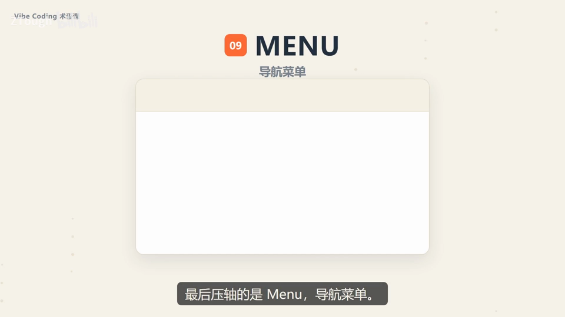

  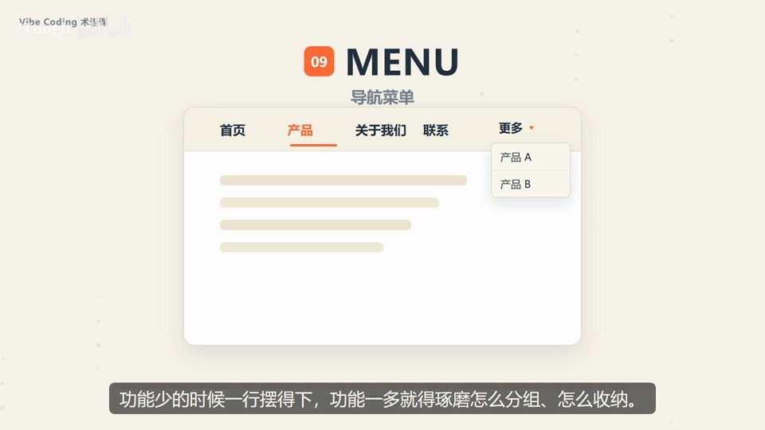

---
> 本集串联：九个导航组件齐了：搜索、面包屑、分页、回到顶部、步骤条、锚点、下拉菜单、跳过导航链接，还有压轴的导航菜单——以后 AI 写代码再碰上这些名字，就知道它们是干嘛的了。
