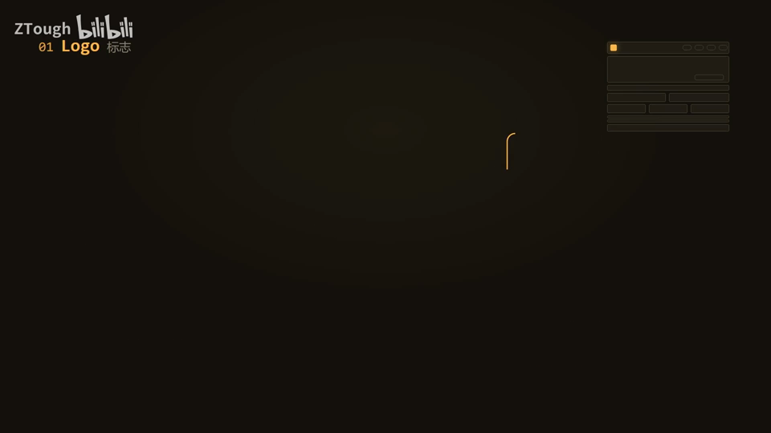
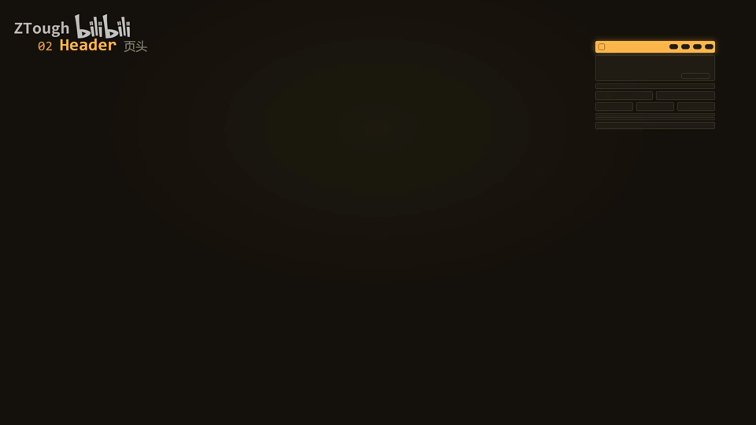
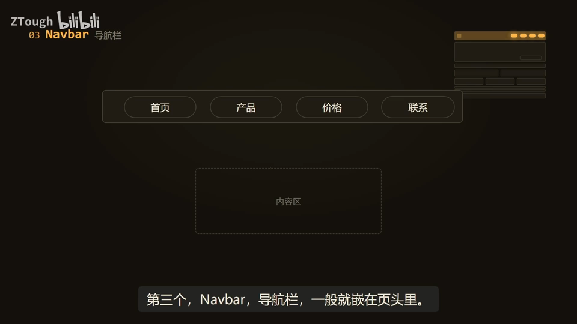
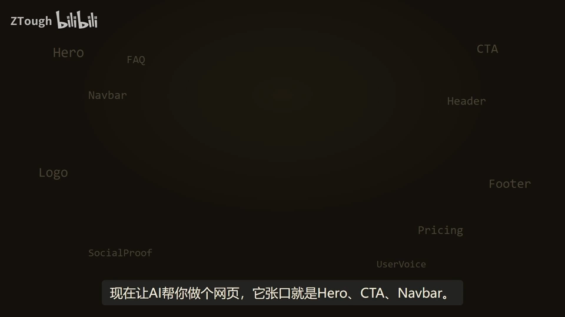
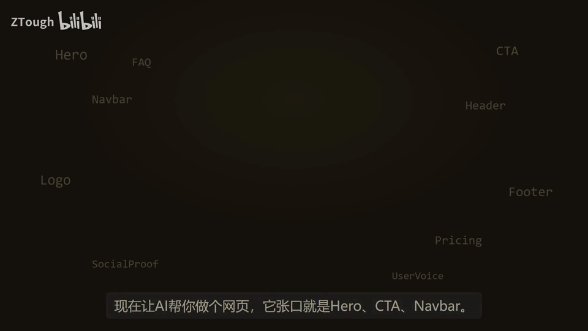
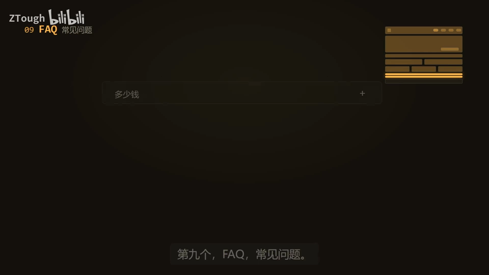
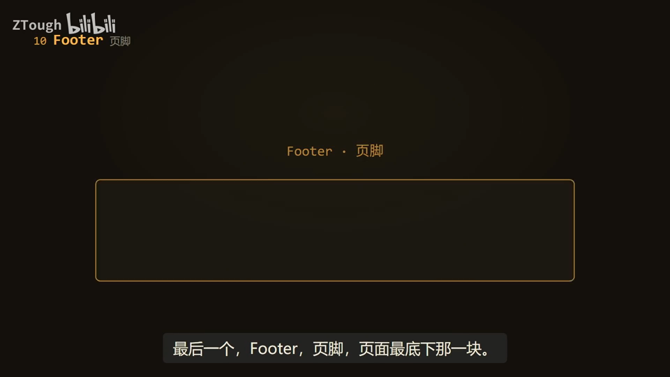
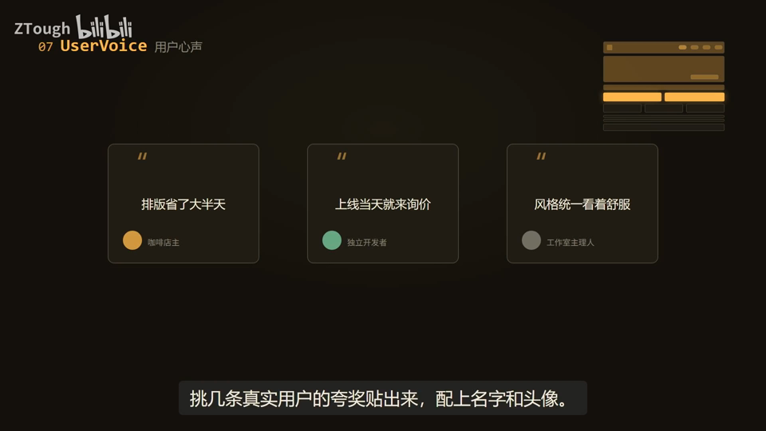

# Vibe Coding 术语课 第11 集｜Vibe Coding 术语课：Hero？CTA？Navbar？一次讲透网页 10 大件

> 主题：网页 10 大件（页面级大区块）：Logo→Header→Navbar→Hero→CTA→SocialProof→UserVoice→Pricing→FAQ→Footer，从招牌、门头、导航、首屏、催单按钮到口碑、价格、答疑、页脚，讲透一张页面从上到下的大骨架，好按顺序给 AI 提需求

> 视频时长 3:45｜逐字稿见 `~/VibeCoding术语课/逐字稿/11_*.txt`｜术语 10 个

### 1. Logo｜标志

- **定义**：你这家店的招牌：一个图形或名字的特殊写法，让人隔老远就能认出你是谁。

- **要点**：
  - 画面注释：图形 / 文字 / 组合
  - 演示店名「夜灯铺」，给几版图形加文字的组合
  - 跟 AI 说“给我设计个 logo”，挑一个顺眼的用就行

- **给 AI 的句式**：给 AI 说“给我设计个 Logo（图形+文字组合，多出几版）”，挑顺眼的用。

- **视频画面**：

  

### 2. Header｜页头

- **定义**：页面最顶上那一横条，店名、导航按钮都钉在这一条里，相当于店门口的门头。

- **要点**：
  - 顾客一抬头就知道这是谁家、卖什么的
  - 演示：夜灯铺——店名、菜单都收在条里

- **给 AI 的句式**：需求里写“顶部做 Header 页头”，店名和导航按钮就都会钉在最上面那条里。

- **视频画面**：

  

### 3. Navbar｜导航栏

- **定义**：一般嵌在页头里的一排小按钮（首页/产品/价格/联系），就是店里的指示牌，想去哪个区点一下就带过去。

- **要点**：
  - 演示：首页 / 产品 / 价格 / 联系 + 内容区
  - 做的时候把要哪几项列成清单发给 AI 就行

- **给 AI 的句式**：给 AI 需求时把栏目列成清单：“Navbar 导航栏放 首页/产品/价格/联系 这几项”。

- **视频画面**：

  

### 4. Hero｜首屏

- **定义**：网页打开后不用滚动就能看到的第一屏，整页最金贵的地方，因为顾客第一眼就看它。

- **要点**：
  - 把最大的字、最想说的一句话放这，再配一张大气点的图
  - 画面注释：一眼就知道你是谁 / 用一句话说清你卖什么
  - 往下滚才看得到的部分叫内容区

- **给 AI 的句式**：跟 AI 说“首屏（Hero）要够震撼、一句话说清卖什么、配大图”，它就明白。

- **视频画面**：

  

### 5. CTA｜行动召唤

- **定义**：全页最显眼的一颗扣子（免费试用/立即购买），放在最顺手的位置，就为了让你别犹豫、一点就下单。

- **要点**：
  - 直译“行动召唤”，其实就是那种特别显眼的按钮
  - 演示：免费试用
  - 画面注释：全页最显眼的一颗扣子

- **给 AI 的句式**：需求里写“页面放一个显眼 CTA 按钮：免费试用”，AI 会把它做得最突出。

- **避坑**：这种按钮别贪多：一页里一两个最显眼的就够了，多了反而没人点。

- **视频画面**：

  

### 6. SocialProof｜社会证明

- **定义**：晒合作过哪些大牌、多少人在用（如“100,000+ 团队正在用”），人是会随大流的，看到这么多人选心里就踏实。

- **要点**：
  - 典型做法：一行合作品牌的标志 + 一句“10万团队都在用”
  - 演示数字：35,714+ / 100,000+ 团队正在用
  - 帮新顾客建立信任

- **给 AI 的句式**：给 AI 说“加 SocialProof 社会证明：一排合作品牌 Logo + 10万团队正在用”。

- **视频画面**：

  

### 7. UserVoice｜用户心声

- **定义**：也叫用户评价：挑几条真实用户的夸奖贴出来，配上名字和头像——自己夸自己 100 句顶不过老顾客说一句。

- **要点**：
  - 演示：咖啡店主“排版省了大半天”、工作室主理人“风格统一看着舒服”、独立开发者“上线当天就来询价”
  - 位置好、不用大，两三条就够

- **给 AI 的句式**：需求里写“放几条 UserVoice 用户评价（用户心声），配名字和头像”。

- **视频画面**：

  

### 8. Pricing｜定价区

- **定义**：把收费方案摆成一排对比（免费版/进阶版/专业版），一栏一栏对着看，中间档常标着“最受欢迎”。

- **要点**：
  - 演示：免费版 ¥0 / 进阶版 ¥49 / 专业版 ¥199
  - 中间档标“最受欢迎”是小套路
  - 最想卖的那档放中间，两边价格一衬它就显得不贵了

- **给 AI 的句式**：说“Pricing 定价区：免费版¥0、进阶版¥49、专业版¥199 三档并排对比，中间档标最受欢迎”。

- **视频画面**：

  

### 9. FAQ｜常见问题

- **定义**：把顾客最爱问的几个问题提前写好、一问一答折起来放在页面靠后位置，顾客自己点开就能看，省客服口水。

- **要点**：
  - 演示问题：多少钱 / 能不能退款 / 数据放哪
  - 示例答案：有免费版，付费版按年付更划算

- **给 AI 的句式**：需求里写“页面靠后加 FAQ 常见问题：多少钱、能不能退款、数据放哪，一问一答可展开”。

- **视频画面**：

  

### 10. Footer｜页脚

- **定义**：页面最底下那一块，位置不起眼但该有的都有：联系方式、友情链接、备案号、版权声明，相当于店门口贴的那张纸。

- **要点**：
  - 平时没人细看，真要找信息的人一定会翻到这儿
  - 演示：© 2026 保留所有权利

- **给 AI 的句式**：需求里写“Footer 页脚：联系方式、友情链接、备案号、版权声明”。

- **视频画面**：

  

  

---
> 本集串联：回头看一个网页：招牌和门头（Logo、Header）在最上面，Navbar 导航带你走，Hero 首屏负责留人，CTA 按钮负责催单，SocialProof 口碑和 Pricing 价格负责说服，FAQ 提前答疑，最后 Footer 页脚收尾——下次让 AI 做页面，按这个从上到下的顺序提要求，它做出来的就是你想要的。
