# Vibe Coding 术语课 第12 集｜Vibe Coding 术语课：跟 AI 要页面，先学会这 9 个网页布局词

> 主题：9 个网页布局骨架词：Card Grid/瀑布流/分屏/顶部导航/文档三栏/响应式/单页滚动/左侧栏/居中窄栏——补一个布局词，页面立刻照你的意思长（像点菜一样指挥 AI）

> 视频时长 3:10｜逐字稿见 `~/VibeCoding术语课/逐字稿/12_*.txt`｜术语 9 个

### 1. Card Grid｜卡片网格

- **定义**：把内容切成一排排大小差不多的卡片，像超市货架：屏幕宽就多摆几列，变窄自动换行。

- **要点**：
  - 适合图片、商品、视频这类内容，立刻整整齐齐摆好
  - 画面提示词：说“用卡片网格排版”
  - 开场示例：“帮我做个卡片网格的图库页”

- **给 AI 的句式**：“用卡片网格排版图片/商品/视频”，或“帮我做个卡片网格的图库页”。

- **视频画面**：

  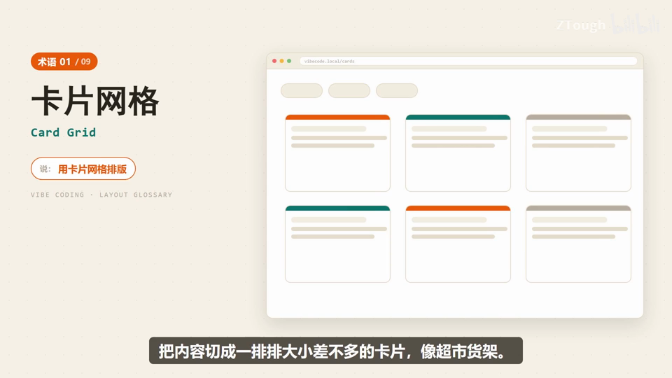

### 2. Masonry｜瀑布流

- **定义**：图片站最爱的排法：卡片高矮不一样但不硬裁齐，下面自动续新卡，像水一样往下淌。

- **要点**：
  - 说“瀑布流”，AI 就知道图片保持原样、绝不强行剪裁
  - 演示站 vibecode.local/pins，新卡片从下面补进来

- **给 AI 的句式**：“瀑布流排版：图片保持原样、高矮不一地往下淌”。

- **视频画面**：

  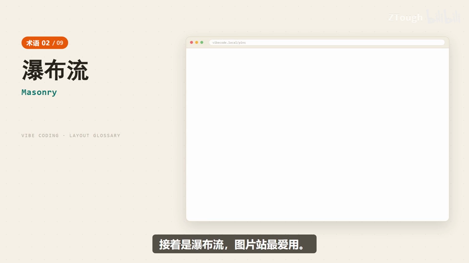

  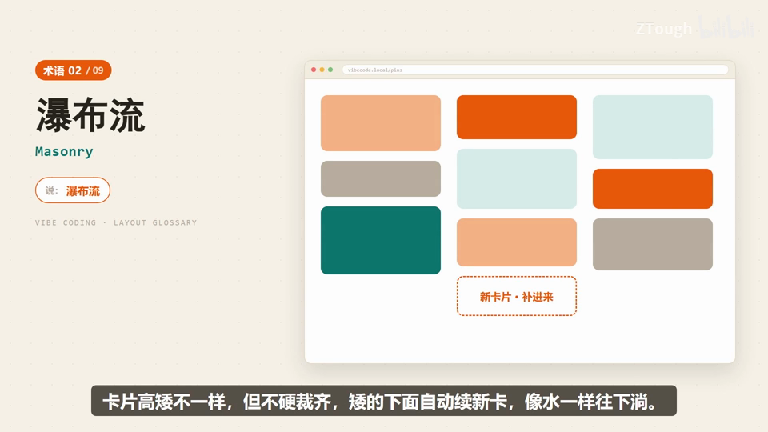

### 3. Split-screen｜分屏布局

- **定义**：首页左右各一半：左边放品牌介绍、右边直接给登录入口，对比感拉满；手机上放不下就自动改成上下叠。

- **要点**：
  - 说“分屏布局”，AI 会把两块内容对称安排得明明白白
  - 演示：ATELIER OS 登录页——左品牌介绍、右登录/工作台入口

- **给 AI 的句式**：“分屏布局：左边品牌介绍，右边登录入口”。

- **视频画面**：

  

  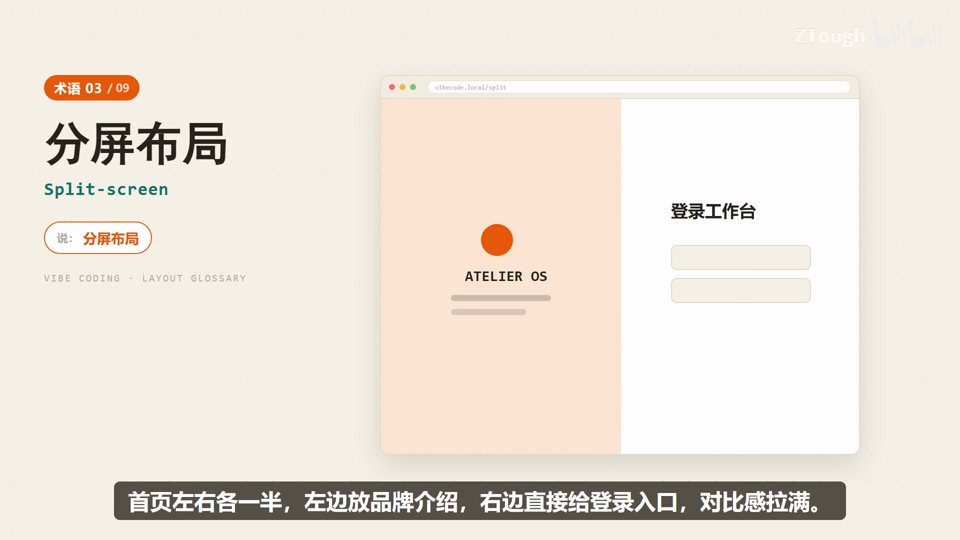

### 4. Top Nav｜顶部导航

- **定义**：最经典的布局架子：上面横一条导航栏，下面全是内容区，用户一进来就知道往哪走。

- **要点**：
  - 官网、后台、工具站十有八九长这样
  - 演示：ViteHub——首页 / 关于 / 功能 / 联系 + 下方内容区
  - 画面提示词：说“顶部导航布局”

- **给 AI 的句式**：“顶部导航布局：导航栏在顶、下面是内容区”。

- **视频画面**：

  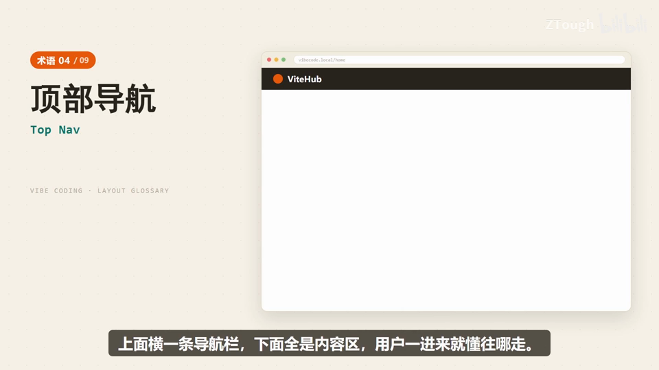

  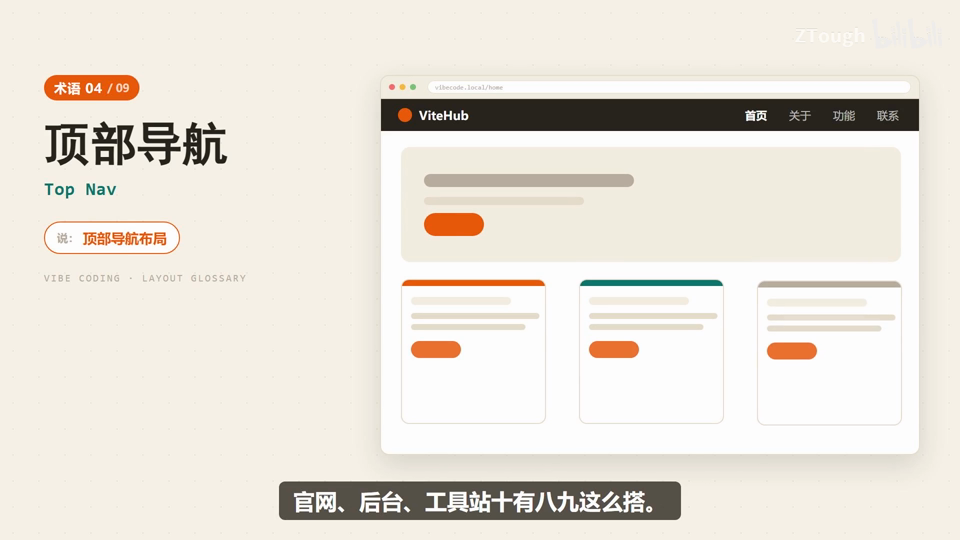

### 5. Doc Layout｜文档三栏

- **定义**：技术网站的标配：左边目录、中间正文、右边本页大纲，一屏看到三层结构，翻文档特别舒服。

- **要点**：
  - 画面注释：目录（快速上手/基础概念/进阶用法/常见问题）| 正文 | 大纲
  - 说“三栏文档布局”，AI 会给出教科书式的阅读骨架

- **给 AI 的句式**：“三栏文档布局（Doc Layout）：左目录、中正文、右本页大纲”。

- **视频画面**：

  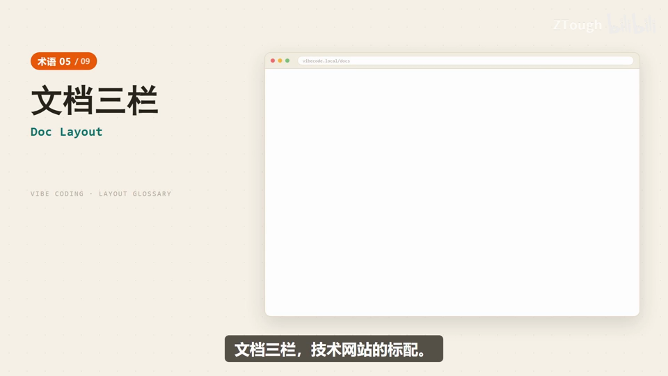

  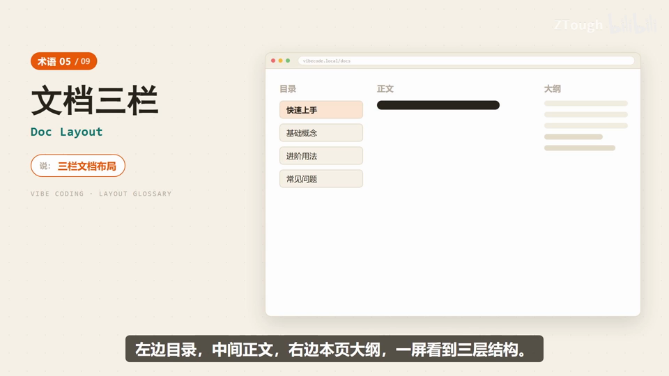

### 6. Responsive｜响应式设计

- **定义**：不是一种布局，而是页面会跟着屏幕变形：同一个页面，电脑上三列排开，手机上收成一列，操作照样完成。

- **要点**：
  - 画面注释：电脑 / 平板 / 手机
  - 说“做响应式”，页面在手机、平板、电脑上都看得舒服

- **给 AI 的句式**：“做响应式：手机、平板、电脑上都要好看好用”。

- **视频画面**：

  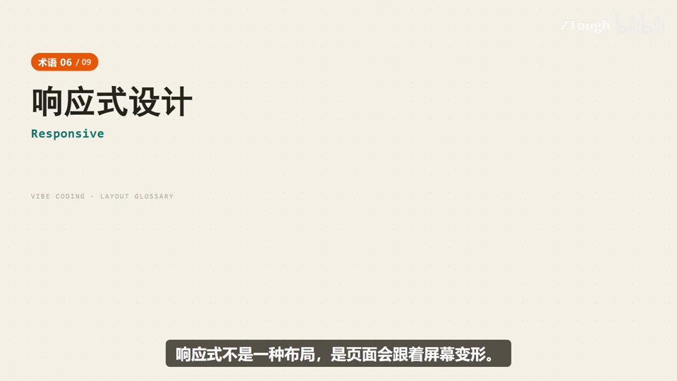

  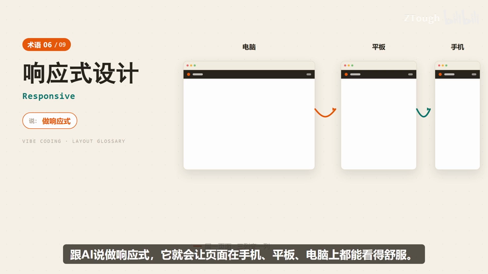

### 7. Single Page｜单页滚动

- **定义**：把内容全塞进一个长页面，往下滚就是全部（画面注释“往下滚，就是全部”），产品介绍、活动页最常用。

- **要点**：
  - 顺着滚一遍像听一个完整故事（一镜到底）
  - 说“单页滚动”，AI 会按阅读顺序帮你排好

- **给 AI 的句式**：“单页滚动：一个长页面按阅读顺序一镜到底”。

- **视频画面**：

  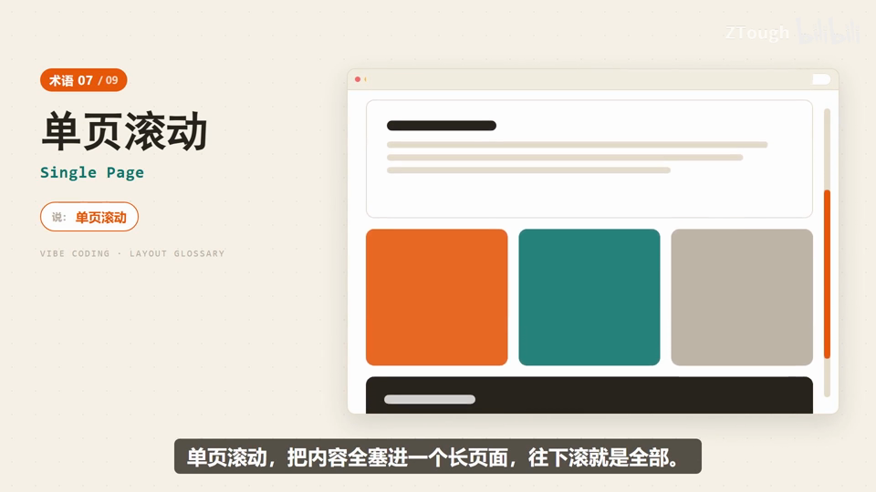

### 8. Sidebar｜左侧栏

- **定义**：左边一列功能菜单、右边一大块内容区，后台管理系统的标配：找设置、报表全靠左边这列导航。

- **要点**：
  - 演示菜单：仪表盘 / 数据报表 / 用户管理 / 系统设置
  - 说“左侧栏布局”，AI 就知道你要的是工作台
  - 画面提示词：说“左侧栏布局”

- **给 AI 的句式**：“左侧栏布局（后台）：左边功能菜单，右边内容工作台”。

- **视频画面**：

  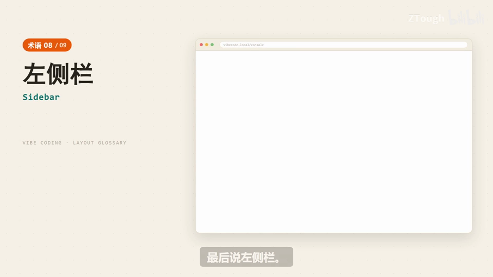

  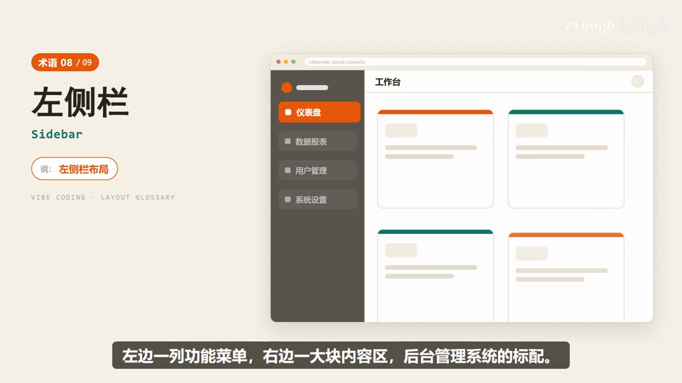

### 9. Centered Column｜居中窄栏

- **定义**：内容不铺满全屏，在中间窄窄一条、两边留白，像读博客一样舒服；限宽 600-720px。

- **要点**：
  - 画面注释：限宽 600-720px / 留白
  - 演示：生活随笔博客
  - 说“居中窄栏”，AI 会把内容框在中间一栏、限个宽度，文字读起来特别顺

- **给 AI 的句式**：“居中窄栏：正文限宽 600~720px、两侧留白，像博客”。

- **视频画面**：

  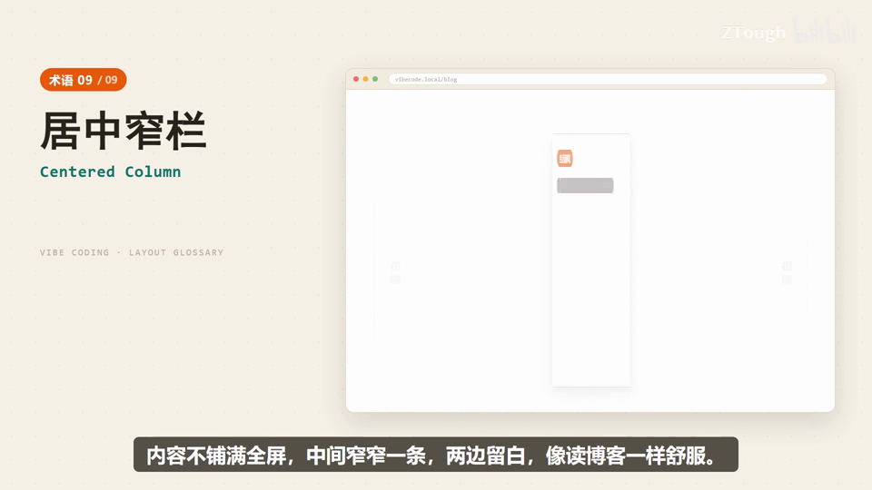

  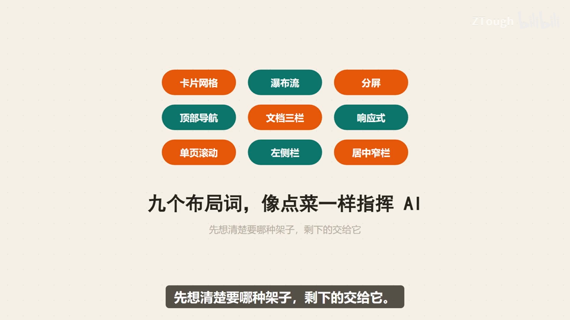

---
> 本集串联：九个布局词像点菜一样指挥 AI：卡片网格、瀑布流、分屏、顶部导航、文档三栏、响应式、单页滚动、左侧栏、居中窄栏——先想清楚要哪种架子，剩下的交给它，页面就照做了。
