# Vibe Coding 术语课 第13 集｜Vibe Coding 术语课：CSS 布局与文字篇

> 主题：CSS 布局与文字 14 个技术术语：居中/盒模型/内边距/外边距/Flex/Grid/间距/定位/层级/溢出/吸顶/排版/衬线与无衬线/文本截断——解决“水平垂直居中要写多少行”这类让新手崩溃的 CSS 问题

> 视频时长 6:21｜逐字稿见 `~/VibeCoding术语课/逐字稿/13_*.txt`｜术语 14 个

### 1. Centering｜居中

- **定义**：把元素放到容器的正中间（水平垂直居中），最省事是 Flex，Grid 用 place-items 一行搞定。

- **要点**：
  - 父元素写 display:flex + justify-content:center + align-items:center，子元素直接居中
  - Grid 更简单：place-items:center 一行搞定（画面注释 /*一行搞定*/）
  - 绝对定位（Absolute）也行，但要配合 transform 往回拉一半
  - 片头提问：水平垂直居中到底要写多少行代码？

- **给 AI 的句式**：需求里写“这个元素要在容器里水平垂直居中（Flex 写法）”，AI 直接给出三行样式。

- **视频画面**：

  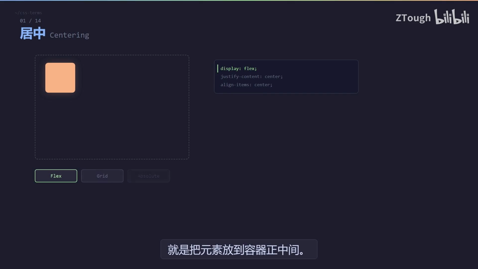

### 2. Box Model｜盒模型

- **定义**：CSS 的地基：每个元素都是一个盒子，从里到外四层——内容(content)、内边距(padding)、边框(border)、外边距(margin)。

- **要点**：
  - 画面注释：Content 内容 / Border 边框
  - 最容易踩的坑：设了 width:320，加 padding 和 border 后实际占宽会变大
  - 实际宽度 = content + padding×2 + border×2（画面算式：320 + 24×2 + 4×2 = 376px）
  - 画面结论：设了 width 不代表实际占这么宽

- **给 AI 的句式**：对 AI 说“用标准盒模型，注意 width 指内容区宽度、别被 padding/border 撑破布局”即可避开此坑。

- **避坑**：设了 width 不代表实际就占这么宽：加了 padding 和 border 后实际宽度会变大，算清楚这四层布局才不会乱。

- **视频画面**：

  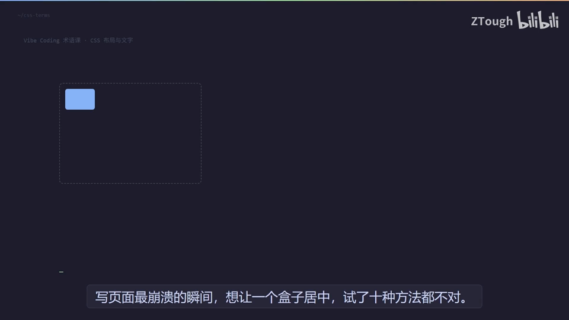

### 3. Padding｜内边距

- **定义**：内容与边框之间的距离（往里撑），越大内容越往里缩、呼吸感越强，按钮卡片好不好看八成靠它调。

- **要点**：
  - 画面注释：内容与边框之间的距离；越大呼吸感越强
  - 16~24px 是舒服区间，给太少显得挤、给太多又空
  - 演示：padding 从 0 调到 48px 的盒子动画

- **给 AI 的句式**：“按钮/卡片的内边距（Padding）给到 16~24px，别太挤”。

- **视频画面**：

  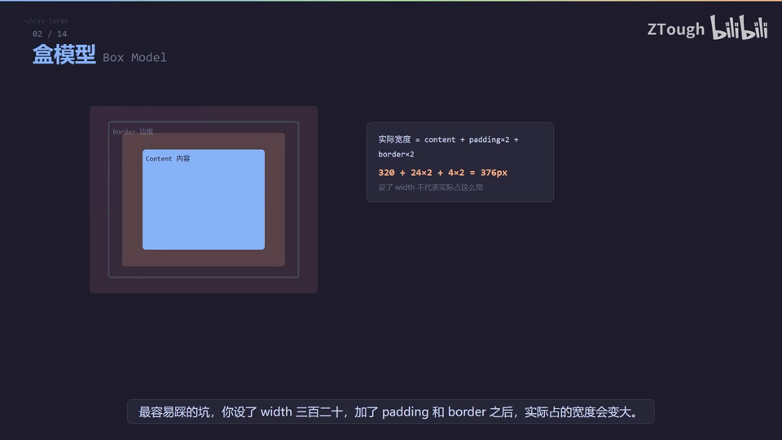

### 4. Margin｜外边距

- **定义**：管元素和外面其他东西的距离（往外推）：padding 是往里撑，margin 是往外推。

- **要点**：
  - 画面注释：padding = 往里撑；margin = 往外推；管元素和外面的距离
  - 经典坑：Margin 重叠——上下两个 margin 不取和，只取较大的那个值

- **给 AI 的句式**：需求里说“这个元素与上一个之间拉开外边距（Margin）”。

- **避坑**：Margin 重叠陷阱：上下相邻元素的 margin 不会相加（mb:30px + mt:20px 实际只有 30px，取较大值）——遇到间距不对时先想想是不是重叠了。

- **视频画面**：

  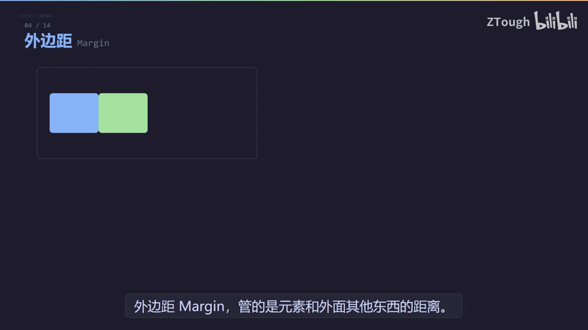

  

### 5. Flex｜弹性布局

- **定义**：一维布局利器：要么横着排要么竖着排，一次只管一个方向；父元素写 display:flex，子元素自动排成一行。

- **要点**：
  - justify-content 管主轴对齐：flex-start / center / space-between（space-between 让元素自动两端对齐）
  - align-items 管交叉轴对齐
  - 想竖着排：flex-direction 改成 column
  - demo 值：flex-start / center / space-between

- **给 AI 的句式**：“这一排按钮用 Flex 弹性布局：两端对齐（space-between）、垂直居中”。

- **视频画面**：

  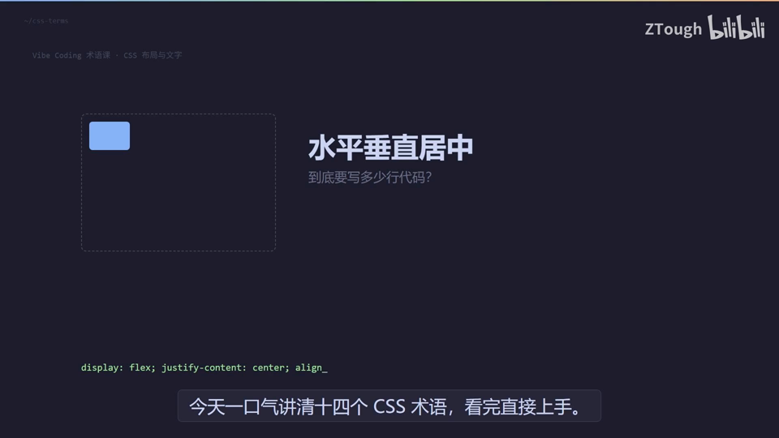

  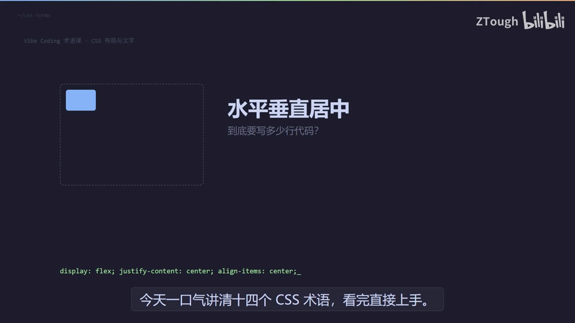

### 6. Grid｜网格布局

- **定义**：二维布局：行和列同时控制，把容器切成格子，元素往格子里放就行；repeat(3,1fr) 就是平均分三列。

- **要点**：
  - 画面注释：二维布局：行和列同时控制
  - 1fr = 弹性单位，自动按比例分配
  - 配 auto-fit + minmax：屏幕窄了自动变少列（画面演示：窄屏自动变 2 列），响应式一句话搞定
  - gap: 14px 控制格子间距

- **给 AI 的句式**：“用 Grid 网格布局做卡片区：三列、等分（repeat(3, 1fr)）、自动响应式换列”。

- **视频画面**：

  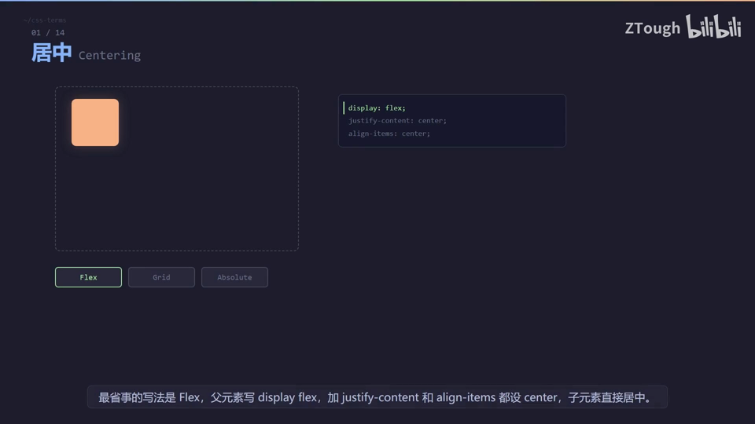

  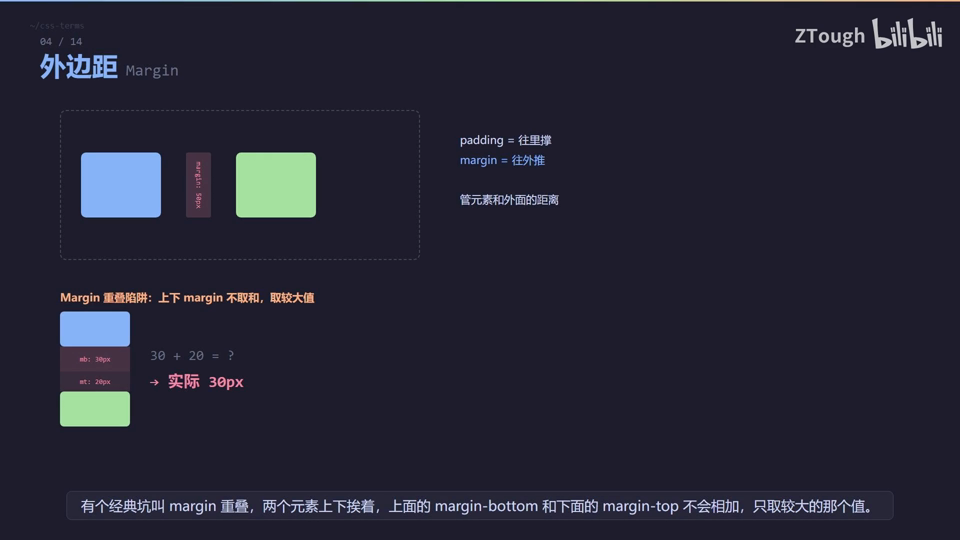

### 7. Space｜间距

- **定义**：说白了就是元素之间留多少空：Flex 和 Grid 里直接写 gap，比一个个加 margin 干净多了。

- **要点**：
  - 间距不是随便给的：按倍数走 4/8/12/16/24/32，整页节奏感就统一了
  - 太挤看着累，太散找不到重点（画面演示：刚好 / 太挤 / 太散）
  - 16px 是万能起步值
  - 画面注释：gap 比 margin 干净

- **给 AI 的句式**：“元素之间用 gap:16px 统一间距，间距按 4 的倍数走”。

- **视频画面**：

  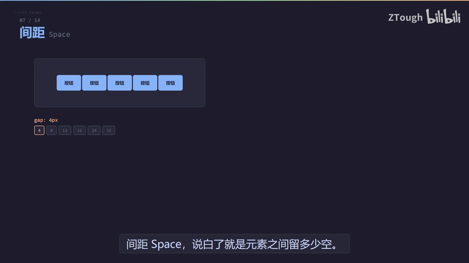

  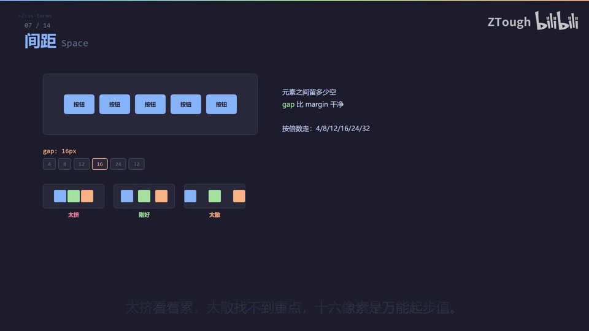

### 8. Position｜定位

- **定义**：控制元素放在哪、跟不跟着滚动：relative 相对自己原位挪、absolute 脱离文档流找最近的已定位祖先、fixed 直接钉在浏览器窗口。

- **要点**：
  - static：默认，在文档流里，无法用 top/left 定位
  - relative：相对自身原位置偏移（画面注释：不影响其他元素）
  - absolute：脱离文档流，相对最近已定位祖先；父元素记得加 position:relative
  - fixed：固定在浏览器窗口，页面怎么滚它都不动（如回到顶部按钮）

- **给 AI 的句式**：“这个角标用 absolute 定位到容器右上角（父容器记得 relative）”；“回到顶部按钮用 fixed 钉在窗口右下角”。

- **避坑**：用 absolute 时父元素要加 position:relative，否则它会跑到更外层（最近已定位祖先）去。

- **视频画面**：

  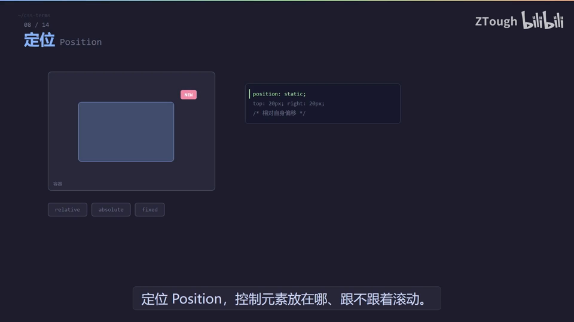

### 9. Z-Index｜层级

- **定义**：决定谁压在谁上面：数值越大越靠上，弹窗被内容挡住了？拉高 z-index 就行。

- **要点**：
  - 画面注释：谁压在谁上面 / 数值越大越靠上
  - 演示：z-index: 3 的悬浮层
  - 前提：元素必须设置了 position（relative/absolute/fixed 都行）才生效

- **给 AI 的句式**：“弹窗被其他内容挡住，给弹窗加高 z-index（如 99）”。

- **避坑**：z-index 的前提是必须设置了 position：static + z-index:99 无效，relative/absolute/fixed + z-index 才生效——这是新手最常踩的坑之一。

- **视频画面**：

  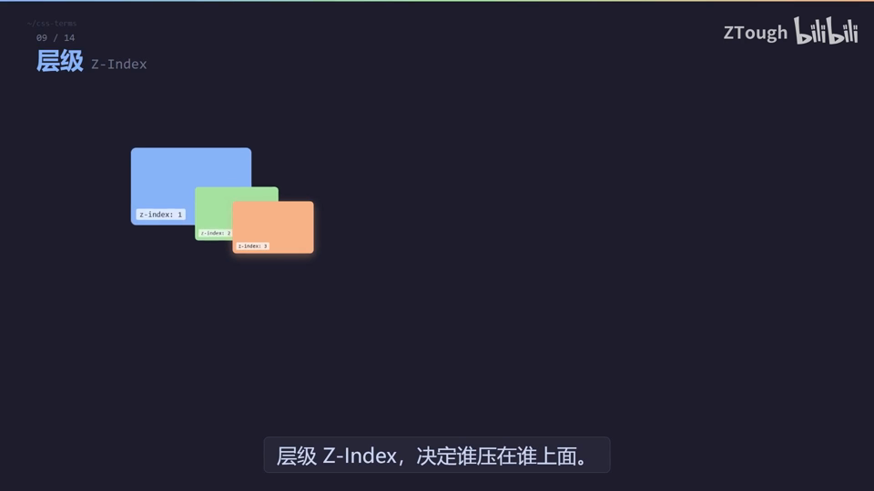

  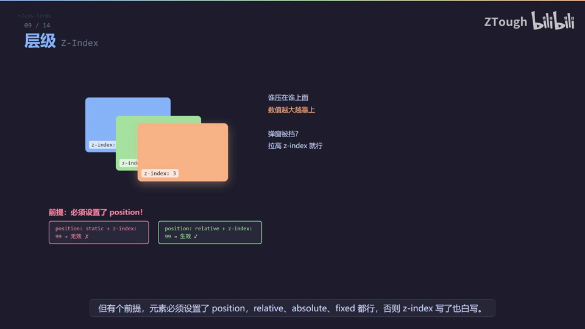

### 10. Overflow｜内容溢出

- **定义**：盒子装不下内容了怎么办：visible 直接溢出来难看、hidden 超出裁掉、scroll 加滚动条、auto 最智能——溢出才出现滚动条。

- **要点**：
  - visible：直接溢出，难看
  - hidden：超出部分裁掉干净（但看不到了）
  - scroll：加滚动条能滑着看
  - 卡片里文字不确定多长时，用 overflow:hidden 配合 text-overflow 准没错

- **给 AI 的句式**：“文字多了别撑破卡片：容器加 overflow:hidden（或 auto，溢出才出滚动条）”。

- **视频画面**：

  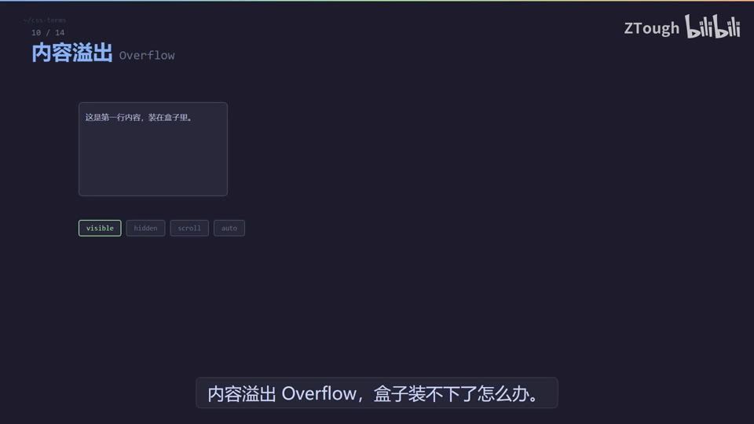

  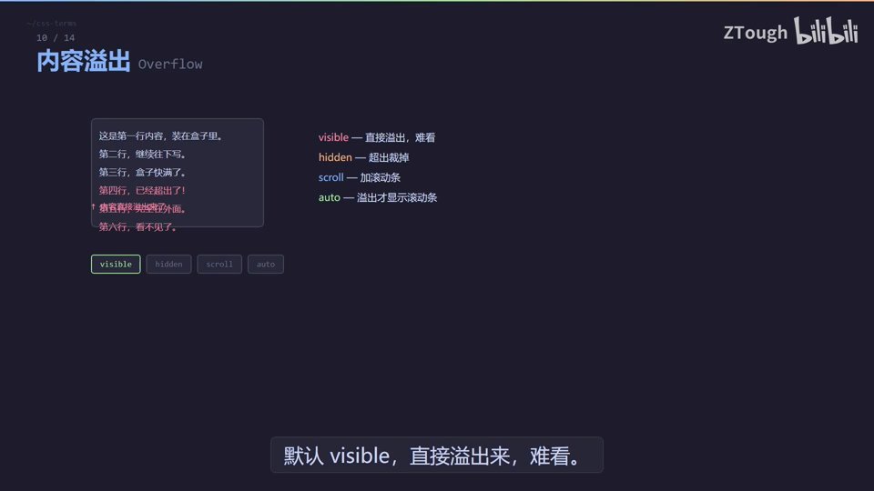

### 11. Sticky｜吸顶

- **定义**：滚动到一定位置就粘在顶部不动：导航栏、通讯录字母索引、表格表头都靠它，比 fixed 聪明——只在父容器范围内吸顶，滚出父容器就跟着走。

- **要点**：
  - 最常见场景：页面导航栏，往下滚时一直钉在最上面
  - 画面演示：Nav 导航栏 + 分组标题（分组A/B/C）都粘在顶部
  - 画面注释：比 fixed 聪明——只在父容器范围内吸顶 / 滚出父容器就跟着走

- **给 AI 的句式**：“导航栏做吸顶（Sticky）：滚动时始终钉在顶部”。

- **避坑**：别拿 fixed 硬做吸顶：sticky 只在父容器范围内吸顶，fixed 会一直钉在窗口上不跟容器走。

- **视频画面**：

  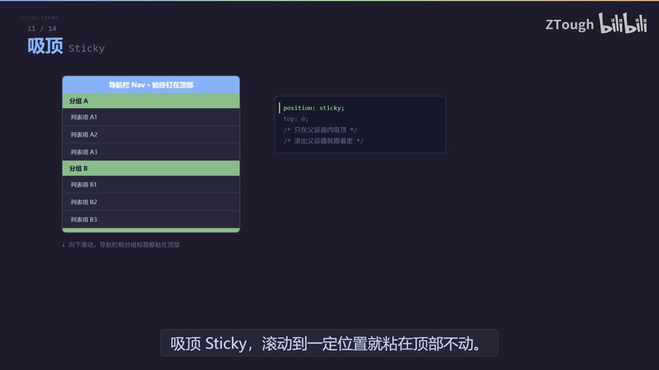

  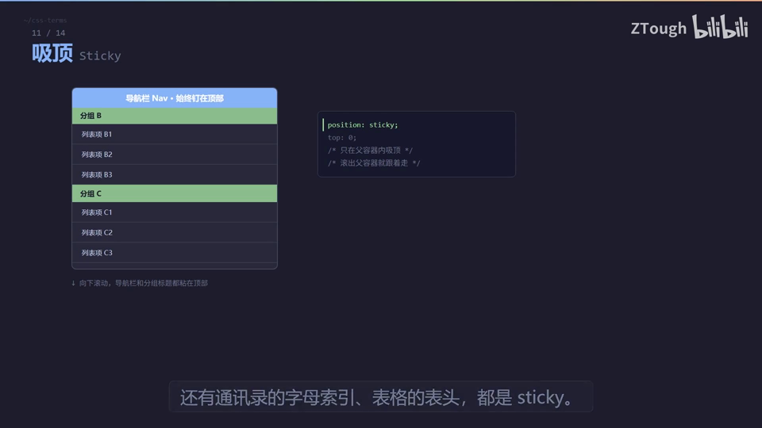

### 12. Typography｜排版

- **定义**：不是选个字体那么简单，核心是建立文字层级：标题最大最粗、正文中等字号、辅助信息最小最灰，用户扫一眼就知道先看什么。

- **要点**：
  - H1 标题：最大最粗，告诉人这页讲什么
  - Body 正文：中等字号、行高 1.6 左右读着不累
  - Caption 辅助：最小最灰（如时间、来源）
  - 所有文字一样大，那叫没排版；三级分明，一眼看出重点

- **给 AI 的句式**：“标题/正文/辅助文字做好层级：标题 38px/800，正文 18px、行高 1.6，辅助 14px 灰色”。

- **视频画面**：

  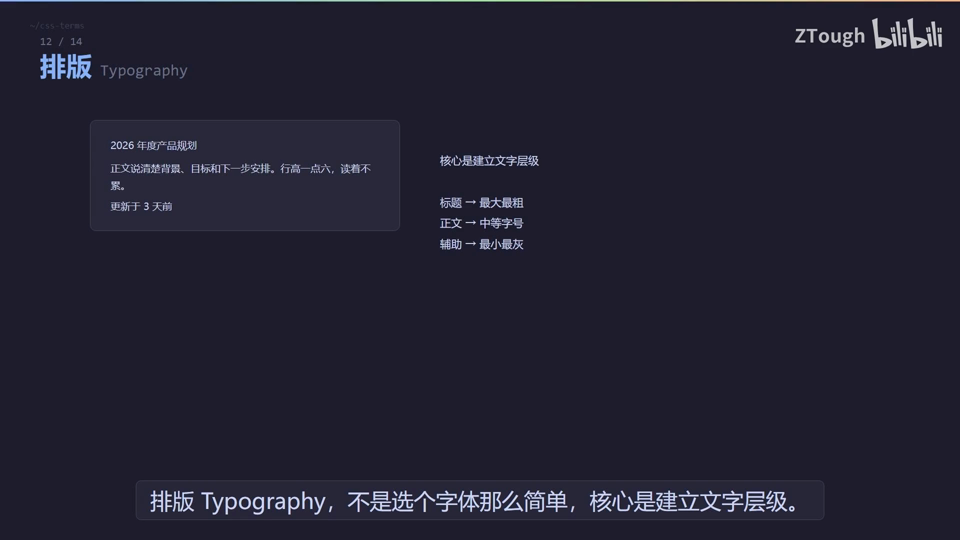

  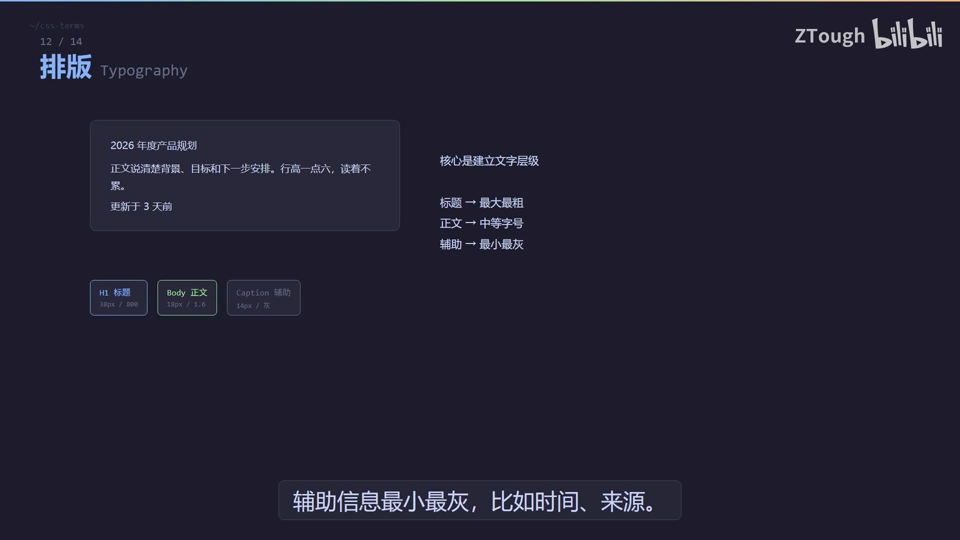

### 13. Serif & Sans｜衬线与非衬线

- **定义**：看笔画末端有没有装饰角：Serif 衬线体（宋体/Times New Roman）笔画末端有装饰角，正式优雅有印刷感；Sans-Serif 无衬线体（黑体/Helvetica）笔画干净，屏幕更清晰。

- **要点**：
  - Serif 衬线体：正式、优雅、印刷感，适合印刷品和标题
  - Sans-Serif 无衬线体：现代、清晰、屏幕友好
  - 网页/APP/界面基本都用无衬线体
  - 选字体先想清楚：要印刷感还是要屏幕清晰

- **给 AI 的句式**：“页面字体用无衬线体（Sans-Serif，如系统黑体）；标题想有印刷感可以试衬线体”。

- **视频画面**：

  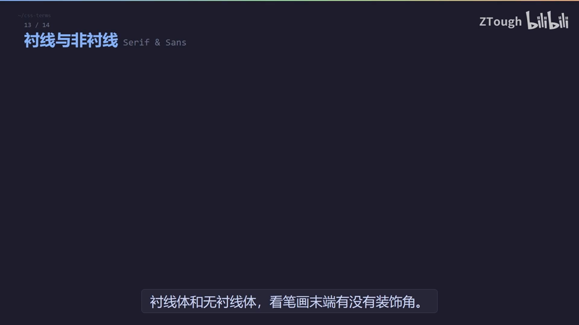

  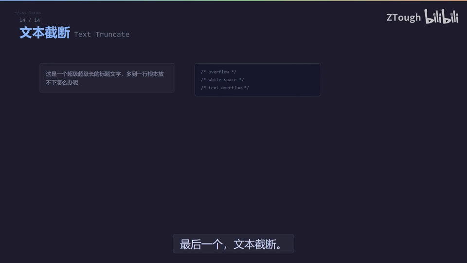

### 14. Text Truncate｜文本截断

- **定义**：标题太长卡片装不下时，三行代码把超出部分裁掉、强制不换行、末尾加省略号，用户看到的是一句干净的话加三个点。

- **要点**：
  - overflow:hidden 裁掉超出部分 + white-space:nowrap 强制不换行 + text-overflow:ellipsis 加省略号
  - 想截两行：多行截断用 -webkit-line-clamp: 2
  - 列表页、卡片标题必备技能（画面注释）
  - 演示：超长标题在卡片里变成“…”，正文超两行自动截断加省略号

- **给 AI 的句式**：“卡片标题超长时做单行文本截断，超出显示省略号（多行则 clamp 两行）”。

- **视频画面**：

  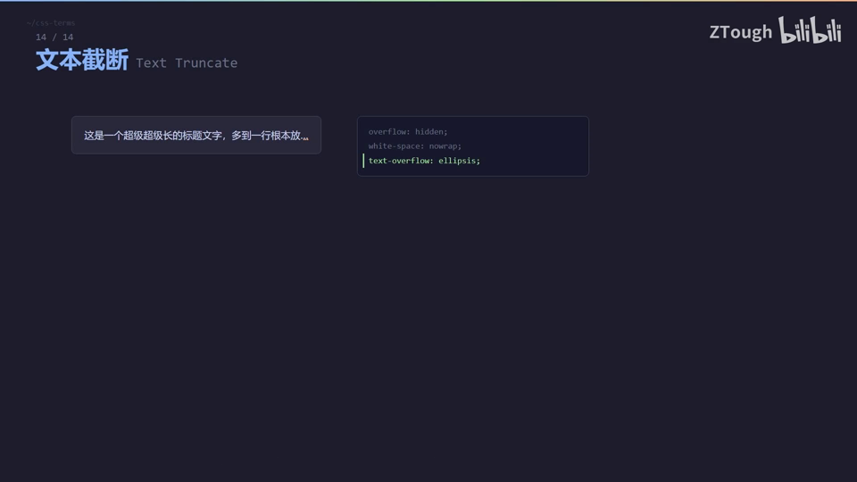

  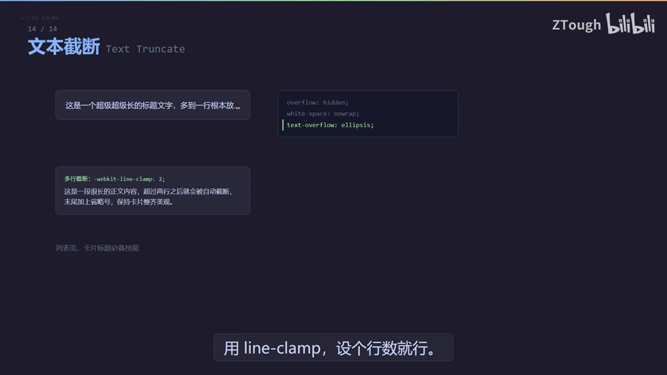

---
> 本集串联：14 个术语搞定：盒模型是地基，Flex 和 Grid 是布局左右手；间距与居中负责排得舒服，定位和层级（Position/Z-Index/Sticky/Overflow）管谁在哪，排版和截断（Typography/衬线体/Text Truncate）管文字好不好看——收藏起来，写 CSS 的时候翻。
