# Vibe Coding 术语课 第14 集｜Vibe Coding 术语课：前端 UI 外观篇，11 个词让 AI 听懂你要什么

> 主题：给 AI 描述「界面好不好看」的 11 个视觉词：视觉层级/对比度/圆角/圆角气质/阴影/分割线/透明度/渐变/毛玻璃/深色模式，外加设计令牌统管取值。

> 视频时长 4:28｜逐字稿见 `~/VibeCoding术语课/逐字稿/14_*.txt`｜术语 11 个

### 1. Visual Hierarchy｜视觉层级

- **定义**：页面元素按重要程度排出的“先看哪、再看哪”顺序——用大小、颜色设计出来的视线引导。

- **要点**：
  - 眼睛先看哪，是设计出来的
  - 标题最大最显眼，说明文字小一点、灰一点
  - 按钮用颜色跳出来
  - 什么都一样大 = X 没有层级，用户不知道该看哪

- **给 AI 的句式**：写：“标题、正文、按钮把视觉层级拉开：主标题最大，说明文字小且灰，重点按钮用颜色跳出来”。

- **避坑**：别把所有文字做成一样大一样黑——没有层级，用户不知道该看哪(画面：X没有层级)。

- **视频画面**：

  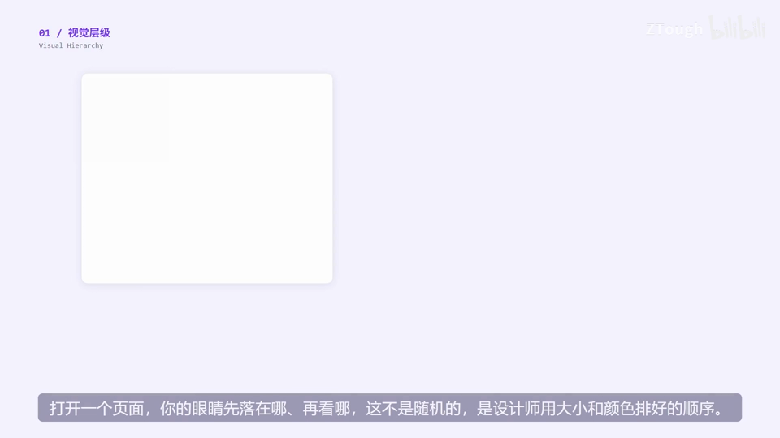

  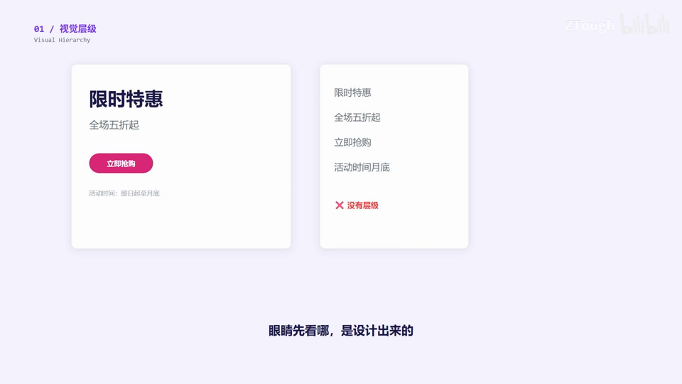

### 2. Contrast｜对比度

- **定义**：文字与背景之间的明暗差距——差得够远，才读得舒服。

- **要点**：
  - 对比度=两者差距
  - 浅灰字配浅灰底，眼睛得使劲找
  - 正文和背景的对比一定要够
  - 别为了“高级感”把字弄成半透明

- **给 AI 的句式**：写：“正文与背景对比度拉够，灰字配灰底的模糊配色不要，保证清晰易读”。

- **避坑**：别为高级感把正文做成浅灰配浅灰或半透明——看不清(字幕原文)。

- **视频画面**：

  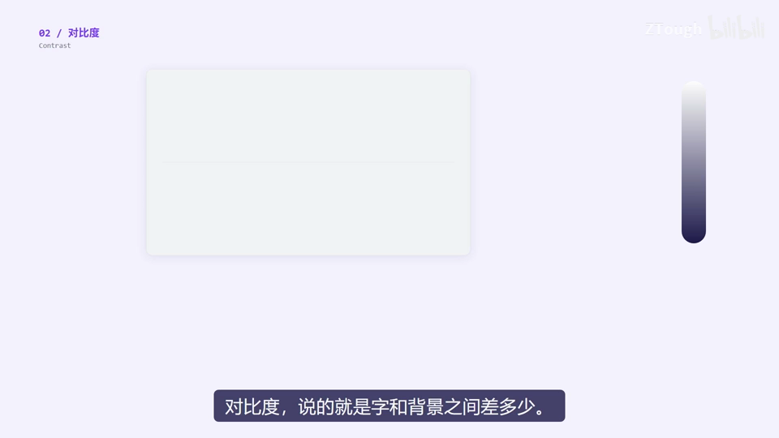

  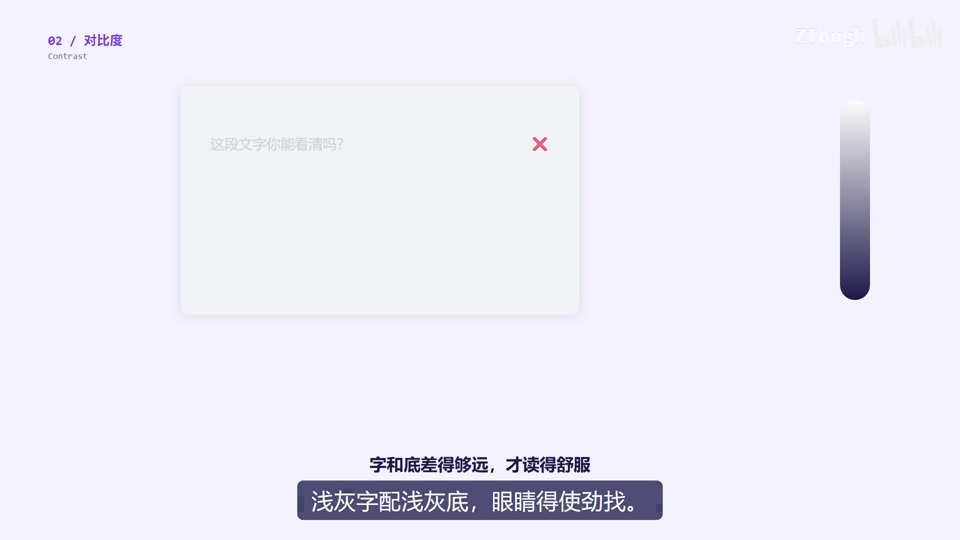

### 3. Border Radius｜圆角

- **定义**：把方形尖角磨圆的弧度值——直角严肃、圆角亲和。

- **要点**：
  - 直角→圆角，气质从严肃变友好；圆一点就亲和一点
  - 演示刻度：0px / 16px / 40px / 80px
  - 磨太少没感觉，磨太多变成胶囊型
  - 一般按钮用 8~16px 挺舒服

- **给 AI 的句式**：给 AI 具体数值：“按钮圆角用 8px、卡片 16px，气质做得友好一点”。

- **避坑**：圆角别乱磨——太少没感觉，太多(如 80px)会变成胶囊型。

- **视频画面**：

  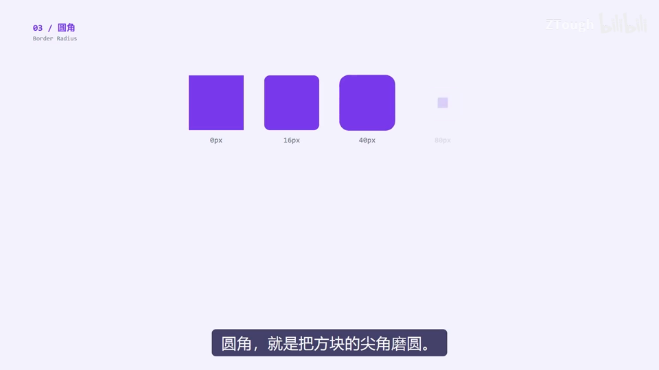

### 4. Corner Feel｜圆角的气质

- **定义**：全站圆角统一后形成的整体性格——小元素小圆角、大卡片大圆角，比例一致。

- **要点**：
  - 最忌“各圆各的”(X各圆各的)——像拼凑的
  - 定一个全站通用值(✓全站统一 r=12)
  - 小元素小圆角、大卡片大圆角，比例要一致
  - 圆角统一了，界面才有自己的性格

- **给 AI 的句式**：写：“全站圆角统一一套数值体系：按钮 8px、卡片 16px，按元素大小成比例，别各圆各的”。

- **避坑**：按钮 4px、卡片 20px 混着放像拼凑的——圆角要全站统一(字幕原文)。

- **视频画面**：

  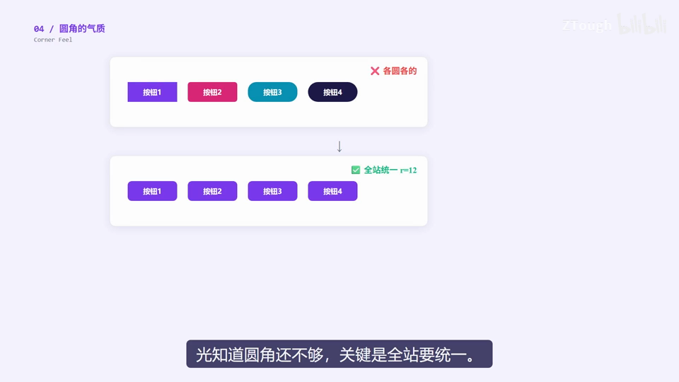

  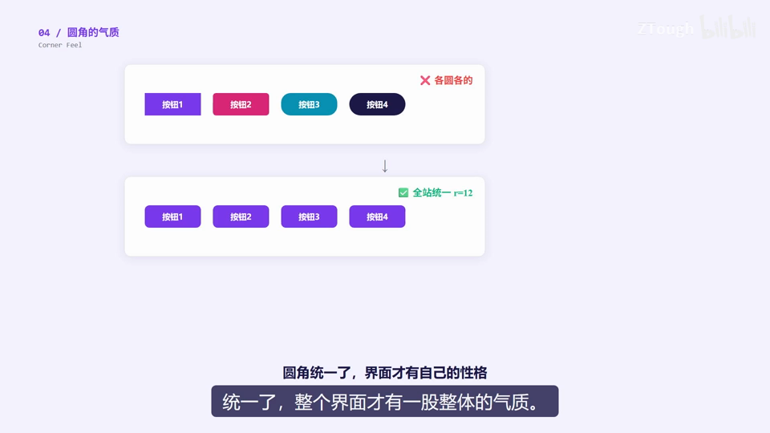

### 5. Shadow｜阴影

- **定义**：给元素加投影让它看起来浮在页面上——阴影越重，离你越近(层级越高)。

- **要点**：
  - 三级示意：贴在纸上→微微浮起→弹出来了
  - 阴影越重，离你越近
  - 弹窗(如确认删除)=最重阴影，告诉用户它现在在最上面
  - 所有东西都加一样的阴影=等于没加

- **给 AI 的句式**：写：“卡片加一层淡阴影微微浮起，弹窗用最重的阴影压在最上层，拉开层级”。

- **避坑**：别给所有元素加一样深的阴影——层级感消失，等于没加。

- **视频画面**：

  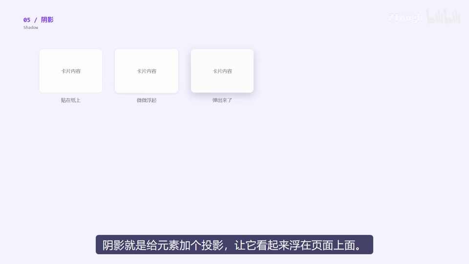

  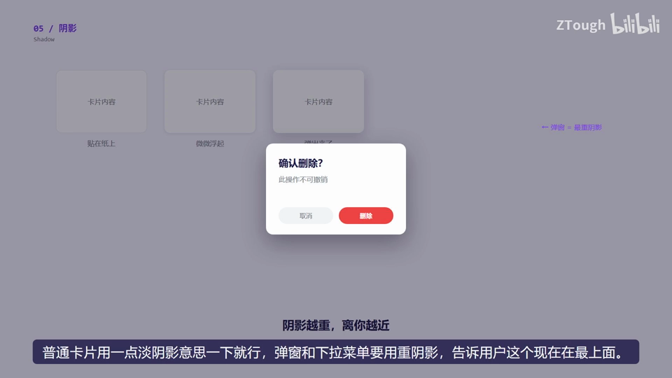

### 6. Divider｜分割线

- **定义**：一条细分隔横线——内容太多分不开时，画条线让分组清楚。

- **要点**：
  - 没有分割线=一坨
  - 设置页里“通知设置”和“隐私设置”两组之间画一条
  - 内容太多分不开？画条线就清楚了
  - 间距够大时留白本身就是分割，线别到处画

- **给 AI 的句式**：写：“设置页把通知和隐私两个分组之间加一条 Divider 分割线隔开”。

- **避坑**：别到处划线——间距足够时用留白分组，线多了反而乱。

- **视频画面**：

  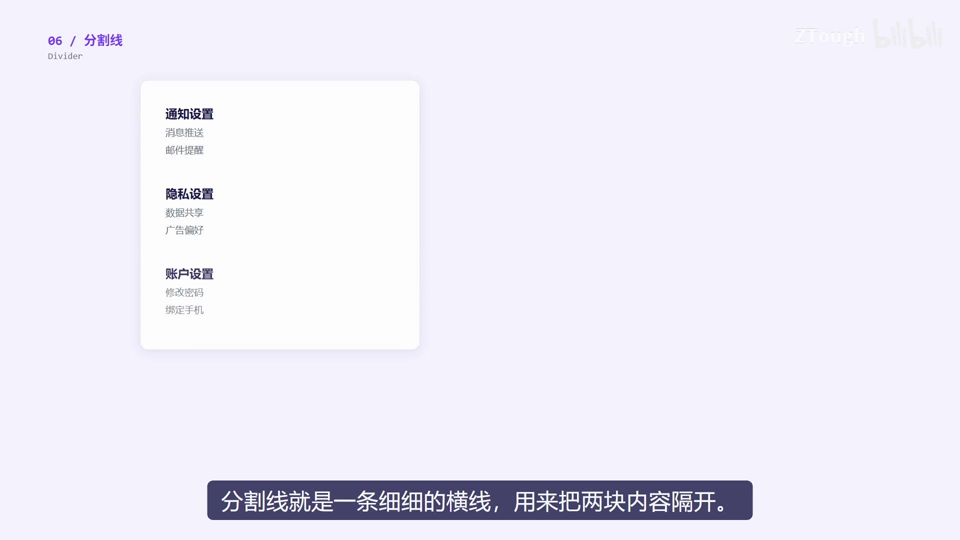

### 7. Opacity｜透明度

- **定义**：元素不透明程度——不重要的东西淡一点，注意力自然落在重要信息上。

- **要点**：
  - 100% 实色 / 50% 半透 / 15% 几乎看不见
  - 主内容实色，辅助淡一点，装饰再淡一点
  - 示例：产品名称实色、描述次之、次要信息(2024)最淡

- **给 AI 的句式**：写：“次要信息把 Opacity 降到 50%~60%，主内容保持 100% 实色”。

- **视频画面**：

  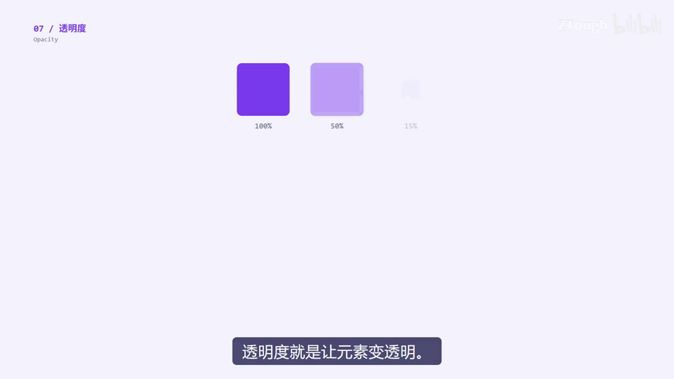

  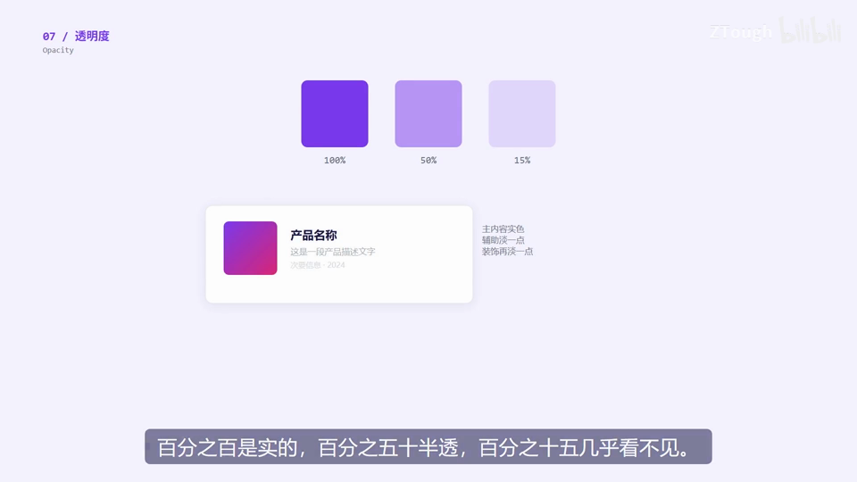

### 8. Gradient｜渐变

- **定义**：一个颜色慢慢过渡成另一个颜色——纯色太闷，给它加个方向。

- **要点**：
  - 线性·横向 / 线性·纵向 / 径向(从中心往外扩散)
  - 纯色太闷？给它加个方向
  - 按钮、头图用渐变=视觉焦点(渐变按钮示例)
  - 正文区域别用渐变，影响阅读

- **给 AI 的句式**：写：“主按钮做横向线性渐变(主色→辅色)，让它成为视觉焦点”。

- **避坑**：正文区域别用渐变——影响阅读(字幕原文)。

- **视频画面**：

  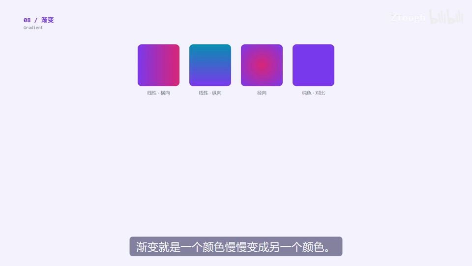

  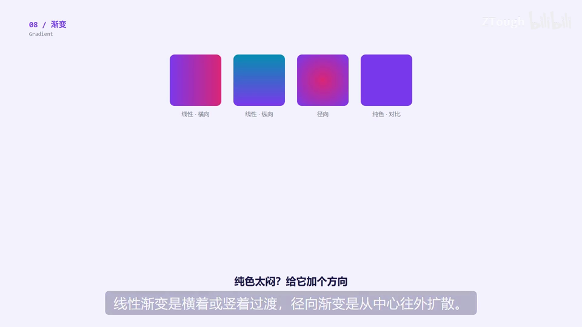

### 9. Backdrop Blur｜毛玻璃

- **定义**：半透明元素把背后内容模糊掉——后面的东西隐约可见但看不清，比纯白底有层次。

- **要点**：
  - 半透明加模糊，后面的东西隐约可见
  - 吸顶导航栏常见：滚动时内容透出来但不干扰阅读
  - 普通白底完全挡住后面内容 = X 没有层次感
  - 弹窗和悬浮面板也常用

- **给 AI 的句式**：写：“顶部导航栏做毛玻璃效果：半透明并把背后滚动内容模糊(backdrop blur)，隐约可见”。

- **避坑**：别用纯白底把后面内容完全挡住——没有层次感(画面：X没有层次感)。

- **视频画面**：

  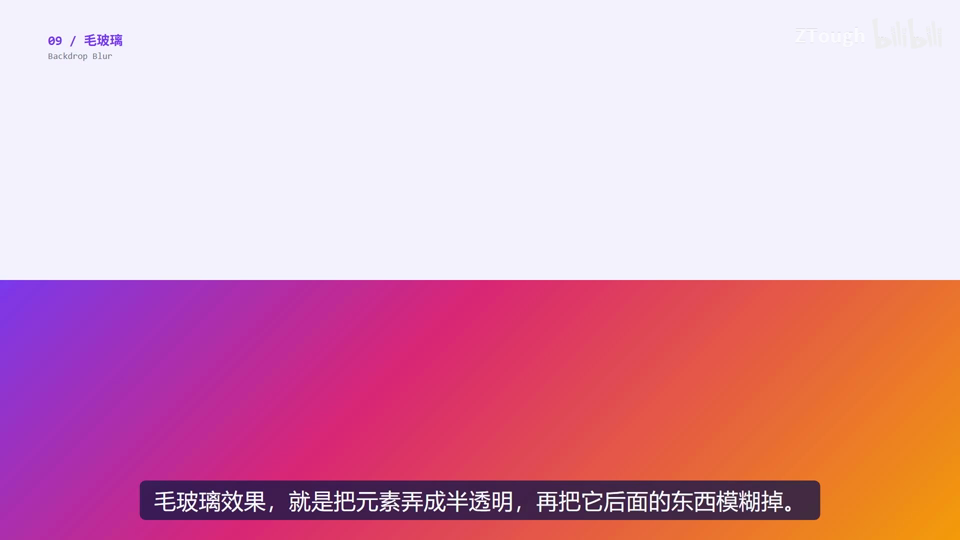

  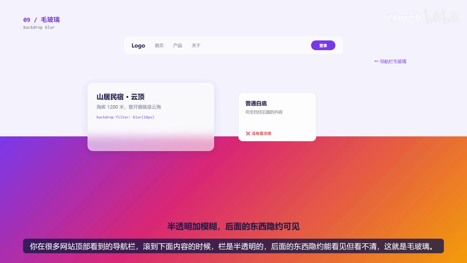

### 10. Dark Mode｜深色模式

- **定义**：黑底浅字的暗色主题——不是把白变黑那么简单，文字、阴影、边框都要配套调。

- **要点**：
  - 深色模式不是把白变黑那么简单
  - 文字用浅灰(不刺眼)，别用纯白
  - 阴影在深色背景上看不见→换成微弱发光
  - 边框调浅

- **给 AI 的句式**：写：“做深色模式：背景深色，正文浅灰不用纯白，卡片阴影改成微弱发光、边框调浅”。

- **避坑**：差的深色模式=纯黑底加白字，眼睛疼(字幕原文)——阴影在深色下看不见，要换发光。

- **视频画面**：

  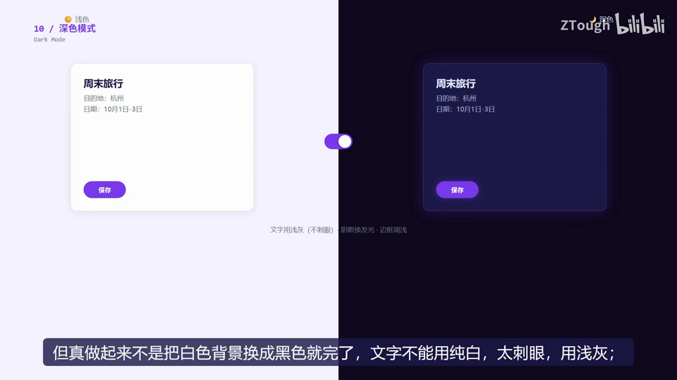

### 11. Design Token｜设计令牌

- **定义**：把颜色/圆角/字号/间距等值存成带名字的 CSS 变量(tokens.css)——引用同一个值，改一处全站跟着变。

- **要点**：
  - 令牌库 tokens.css：--color-primary / --color-secondary / --space-md / --radius-md / --font-lg
  - 引用同一个值：主按钮、卡片标题、标签都引用主色
  - 改一个地方，全站跟着变(--color-primary 从 #7C3AED 改为 #0891B2，全部同步变色)
  - 大团队都这么干，不然改个颜色得翻几百个文件

- **给 AI 的句式**：写：“颜色、圆角、间距定义成 Design Token(CSS 变量)，组件全部引用变量，以后换主题只改 tokens 一处”。

- **避坑**：别把颜色值散落写死在几百个文件里——换个颜色要翻遍全站(字幕原文)。

- **视频画面**：

  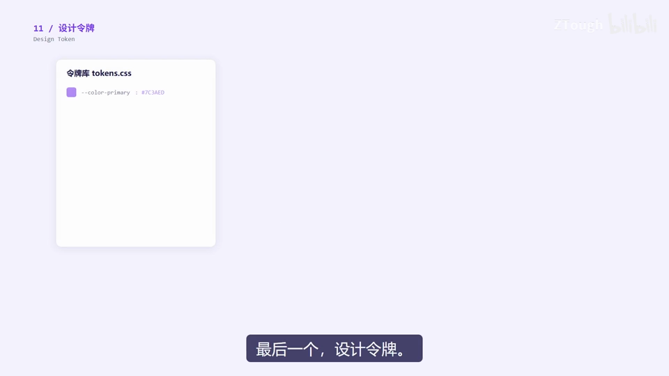

  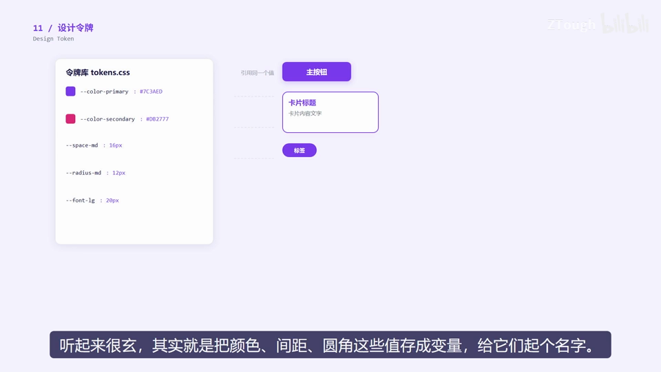

---
> 本集串联：收尾串联：11 个词按“先看哪→读得清→有气质→统管”串起来——视觉层级管视线顺序，对比度管可读性；圆角、圆角气质、阴影、分割线、透明度、渐变、毛玻璃、深色模式塑造外观风格；最后设计令牌把颜色/圆角/间距变量化，改一处全站同步。下期讲布局和排版。
