# Vibe Coding 术语课 第15 集｜Vibe Coding 术语课：前端交互黑话大全：12 个动画 + 鼠标术语一次讲清

> 主题：页面交互黑话 12 个：动画类 5 个(Transition/Animation/Easing/Spring/Fade In-Out)讲画面怎么动，鼠标交互类 7 个(Hover/Active/Focus/Drag/Disabled/Cursor/Selection)讲用户怎么点。

> 视频时长 4:43｜逐字稿见 `~/VibeCoding术语课/逐字稿/15_*.txt`｜术语 12 个

### 1. Transition｜过渡

- **定义**：一个状态变成另一个状态的过程(需要触发)——加了过渡，浏览器帮你把中间帧补上，平滑变过去。

- **要点**：
  - 需要一个触发条件(如鼠标悬停)
  - 无过渡=瞬间完成，啪一下就跳过去
  - 颜色、大小、位置都能平滑过渡
  - 示例：有过渡 transition: 0.3s

- **给 AI 的句式**：写：“hover 变色/位移加 transition 0.3s 平滑过渡，不要瞬间跳变”。

- **避坑**：Transition 要触发条件；Animation 能自己循环跑——两者别混用。

- **视频画面**：

  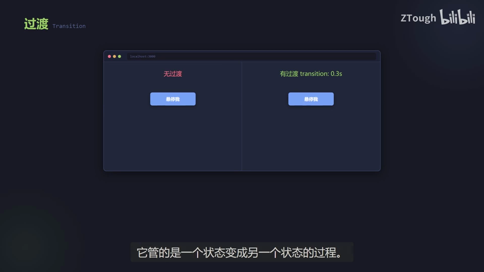

### 2. Animation｜动画

- **定义**：用关键帧定义起点/中间/终点、可自动循环的动画——不需要任何人触发，自己跑。

- **要点**：
  - 不需要触发，自己就能跑起来
  - @keyframes float 定 0%→50%→100% 关键帧
  - 示例：图标上下浮动 2s 循环无限次
  - 适合浮动、加载这类装饰性自运动

- **给 AI 的句式**：写：“给这个图标加上下浮动的 Animation：2s 一个循环、infinite，不用鼠标触发”。

- **视频画面**：

  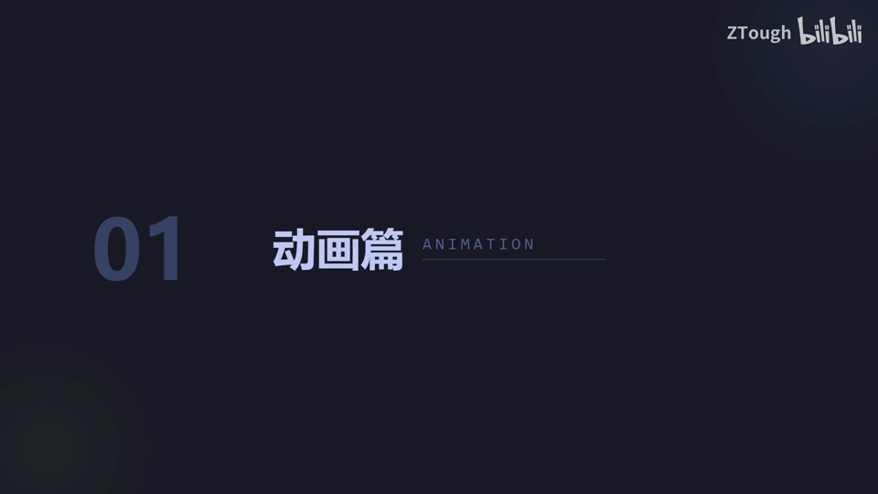

  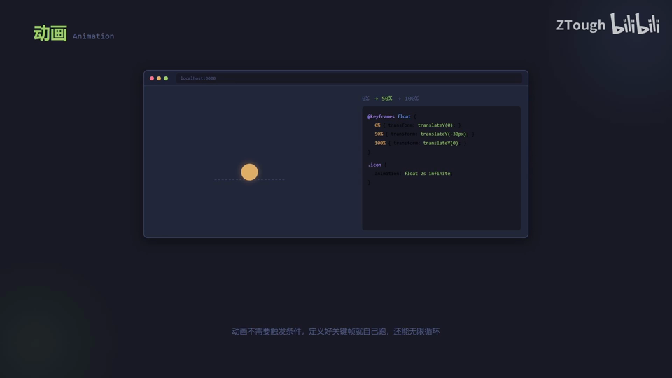

### 3. Easing｜缓动

- **定义**：动画的速度曲线(缓动函数)——同样从 A 到 B，决定是匀速、先慢后快还是两头慢。

- **要点**：
  - linear 匀速
  - ease-in 先慢后快
  - ease-in-out 两头慢、中间快
  - 用对了才像真实世界运动：有惯性、有停顿，不像机器死板

- **给 AI 的句式**：写：“过渡/动画用 ease-in-out 两头慢的缓动曲线，别用生硬的匀速”。

- **避坑**：缓动不用或乱用，动画就会机械死板像机器。

- **视频画面**：

  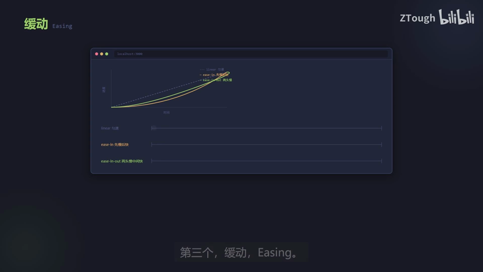

  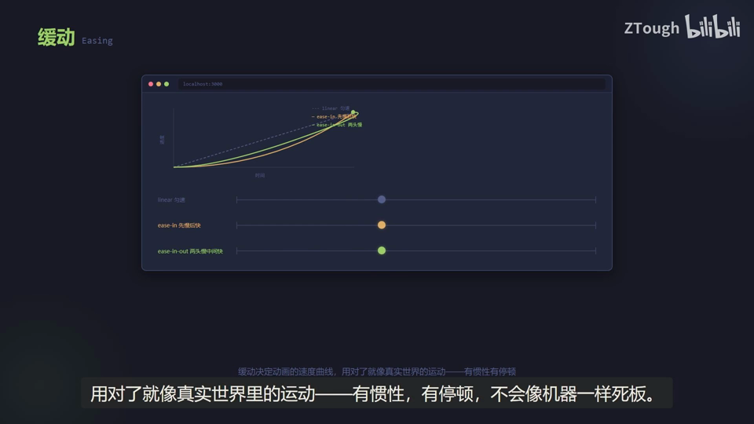

### 4. Spring｜弹性

- **定义**：带弹簧物理感的动画——普通动画到目标就停，弹性动画会冲过头(overshoot)再回弹收敛。

- **要点**：
  - 位移曲线 + overshoot 冲过头 → 回弹收敛
  - 手感参数示例：damping 8、stiffness 100
  - 弹窗落下先多走一截，再晃两下稳住
  - 弹窗出现、按钮点击用它会特别有手感

- **给 AI 的句式**：写：“弹窗/提示出现用 Spring 弹性动画，带一点 overshoot 冲过头再回弹的感觉”。

- **视频画面**：

  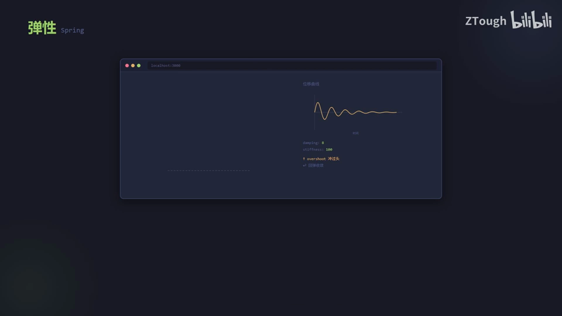

  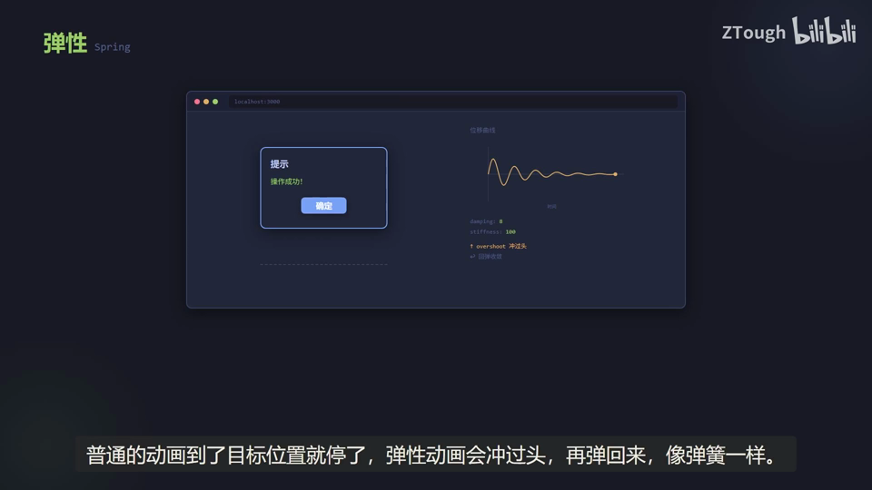

### 5. Fade In / Out｜渐入渐出

- **定义**：淡入(fade in)/淡出(fade out)——切换内容时旧的慢慢消失、新的慢慢出现，比硬切柔和。

- **要点**：
  - fade in 慢慢出现 / fade out 慢慢消失
  - 切换内容比直接硬切柔和得多
  - 通常配位移动画：旧的往上走，新的从下面上来，过渡有层次

- **给 AI 的句式**：写：“内容切换用 Fade In/Out：旧的淡出上移、新的从下方淡入，别硬切”。

- **视频画面**：

  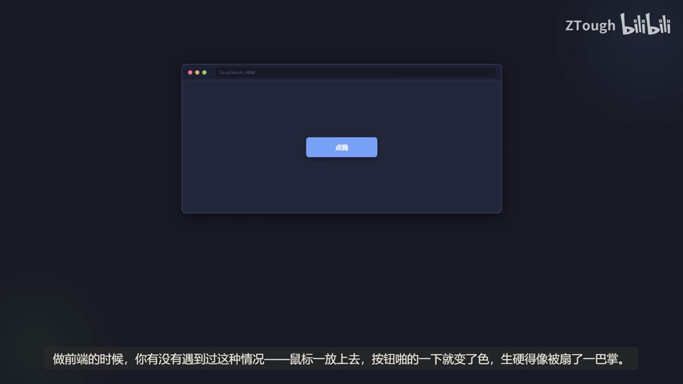

### 6. Hover｜悬停

- **定义**：鼠标指针放上去时的状态反馈——变个色、浮起来一点、阴影深一点，让用户知道这东西能点。

- **要点**：
  - 对照组：有悬停反馈 vs 无悬停反馈
  - 反馈方式：变个色、浮起来一点、阴影深一点
  - 没有悬停反馈的按钮像假按钮，用户不确定能不能按

- **给 AI 的句式**：写：“所有可点元素加 hover 反馈：变色 + 上浮一点 + 阴影加深”。

- **避坑**：没有 hover 反馈的按钮=假按钮，用户根本不确定能不能点(字幕原文)。

- **视频画面**：

  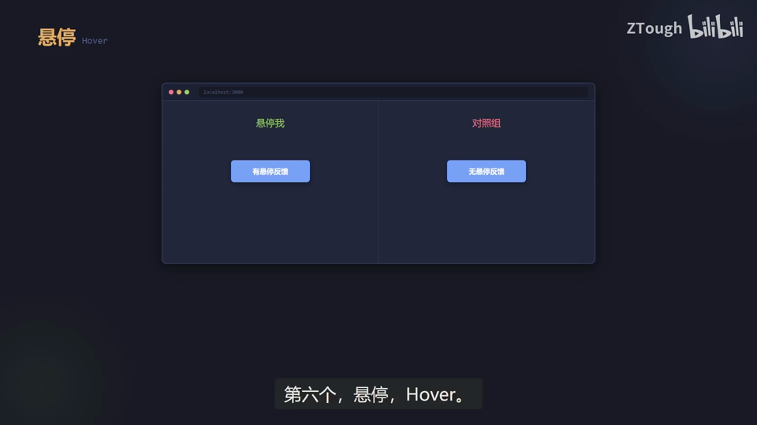

  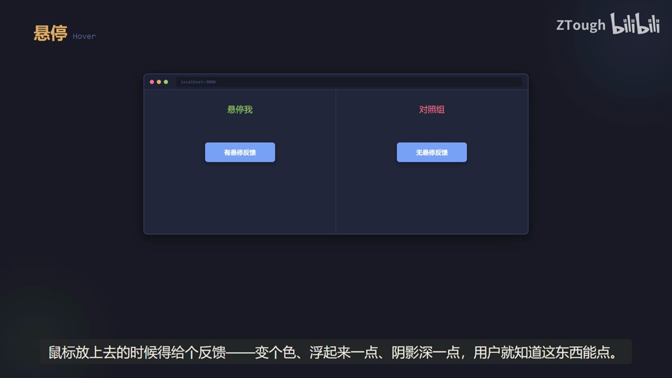

### 7. Active｜按下

- **定义**：鼠标点下去那一瞬间的状态——按钮得有被“按瘪”的实感。

- **要点**：
  - 按下瞬间要有被按瘪的感觉
  - 做法：往下挪一像素、阴影收一收
  - 只有 hover 没有按下=像按空气按钮：手指下去了界面纹丝不动

- **给 AI 的句式**：写：“按钮加 active 按下反馈：整体下移 1px、阴影减弱，有按下去的实感”。

- **避坑**：只做 hover 不做 active，按下毫无反应，像按空气按钮(字幕原文)。

- **视频画面**：

  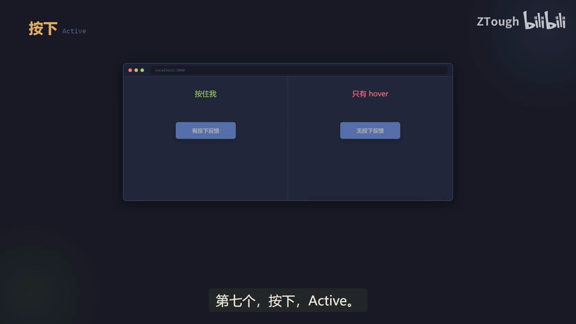

  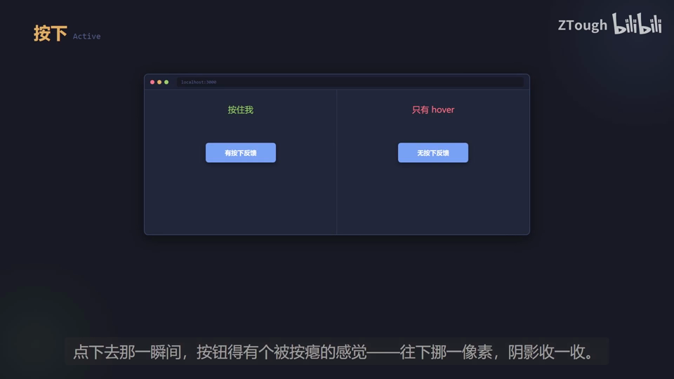

### 8. Focus｜聚焦

- **定义**：键盘焦点所在处的可见状态——用 Tab 键在表单里跳时，一个明显的焦点描边告诉用户当前停在哪。

- **要点**：
  - Tab 键依次聚焦输入框，要有焦点描边
  - 对照组：有焦点描边 vs 移除了 outline
  - 为好看移除 outline 又不补替代方案=键盘用户根本找不到自己在哪，只能瞎按

- **给 AI 的句式**：写：“输入框保留清晰的 focus 描边，键盘 Tab 到哪个控件要看得见”。

- **避坑**：别为美观移除 outline 却不给替代焦点样式——键盘用户(无障碍)直接迷路。

- **视频画面**：

  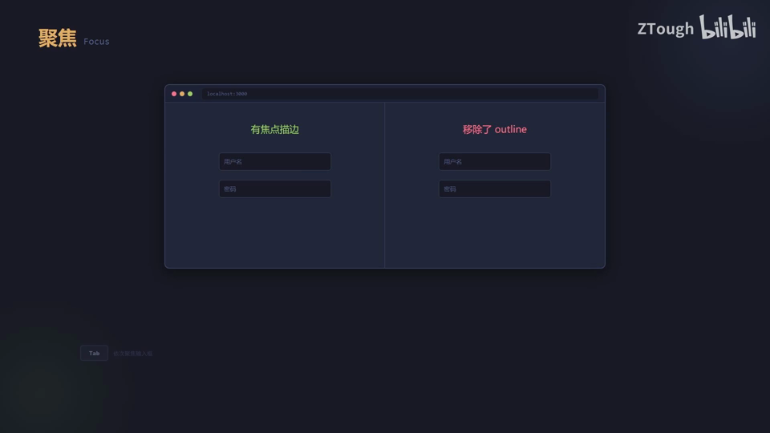

  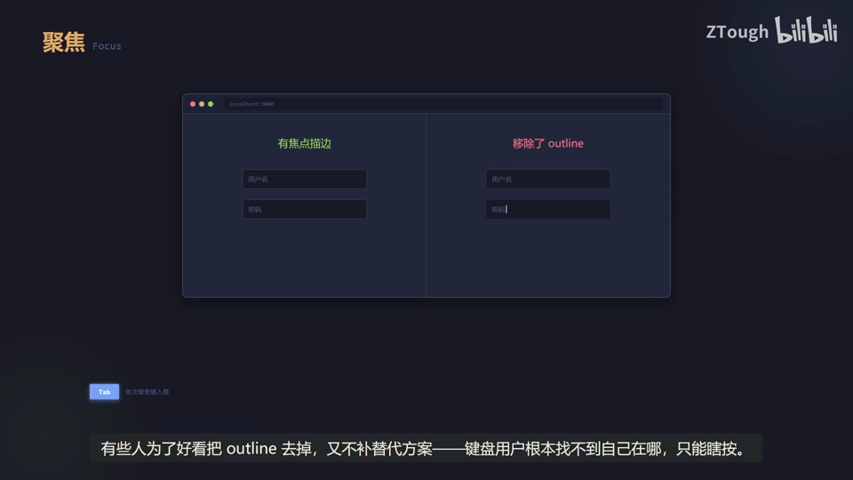

### 9. Drag｜拖拽

- **定义**：按住一个元素拖着走——松手放到新位置或回到原位。

- **要点**：
  - 按住→拖动→松手(放到新位置或回到原位)
  - 卡片排序、滑块调节这类交互都离不开拖拽
  - 拖动时给点旋转角度和阴影，像真的捏着一张卡片，手感更真实

- **给 AI 的句式**：写：“卡片做成可拖拽排序：拖起时带轻微旋转和阴影，松手落到新位置”。

- **视频画面**：

  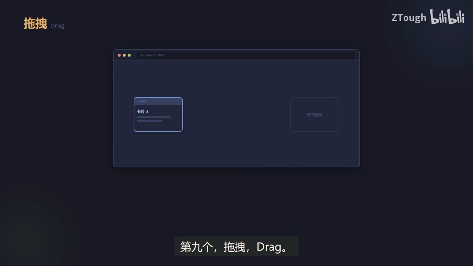

  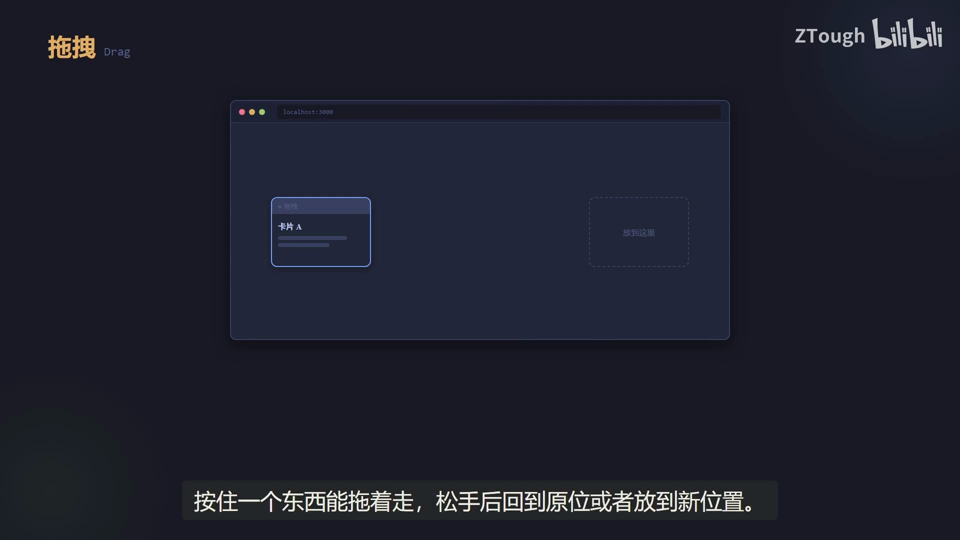

### 10. Disabled｜禁用

- **定义**：控件的不可用状态——置灰、点不动，鼠标指针也变成禁止符号，从视觉到交互都告诉用户“现在用不了”。

- **要点**：
  - 表单未填写完成→提交按钮暂不可用(灰、点不动)
  - 不只是颜色变灰，鼠标指针也得变成禁止符号
  - 从视觉到交互都告诉用户：这个现在用不了

- **给 AI 的句式**：写：“表单没填完时提交按钮用 disabled 置灰，鼠标放上去显示禁止光标”。

- **避坑**：只变灰不换光标，用户还以为页面卡了(字幕原文)。

- **视频画面**：

  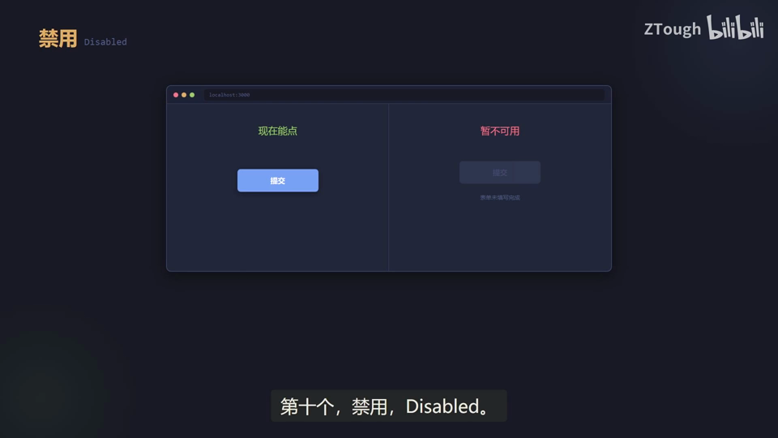

  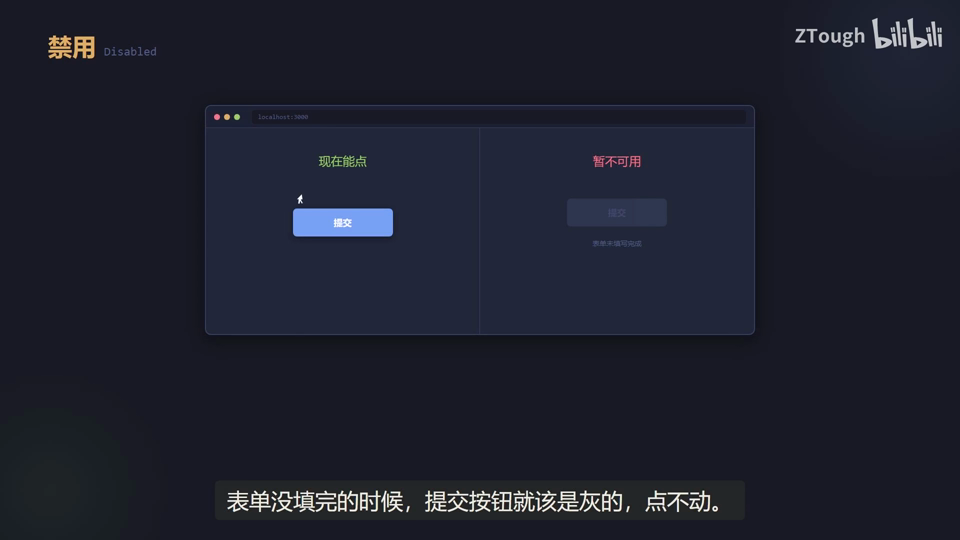

### 11. Cursor｜鼠标指针

- **定义**：鼠标光标形状(cursor)——指针暗示接下来能做什么操作。

- **要点**：
  - 普通文字=默认箭头指针(cursor: default)
  - 按钮=小手(cursor: pointer)
  - 输入框=文本光标
  - 按钮上显示文本光标，谁知道能不能点

- **给 AI 的句式**：写：“按钮加 cursor: pointer，鼠标移上去是小手而不是箭头”。

- **避坑**：指针搞反很让人困惑——可点按钮上却是文本光标(字幕原文)。

- **视频画面**：

  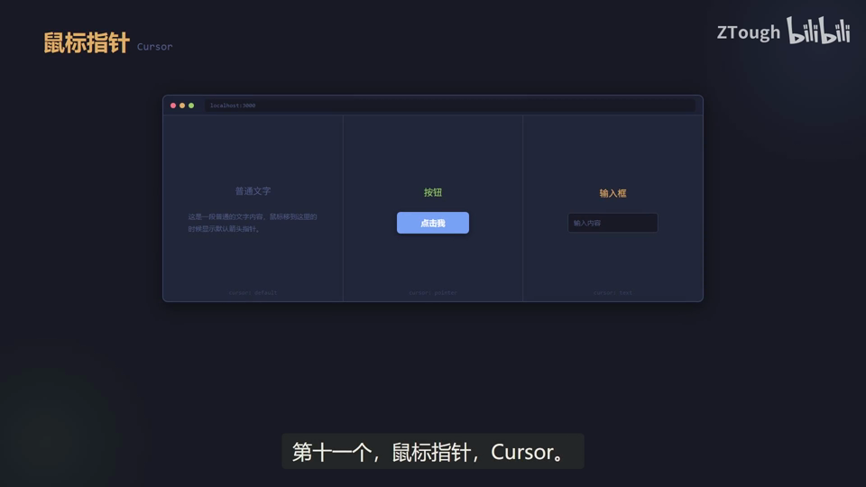

  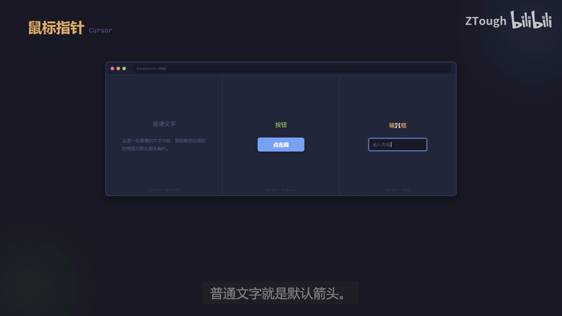

### 12. Selection｜选中高亮

- **定义**：鼠标拖动滑选文字时的高亮底色(::selection)——默认蓝可以换成品牌色。

- **要点**：
  - 鼠标拖动选中的那块底色就是选中高亮
  - 默认选中色 vs 品牌选中色(示例薄荷绿)
  - 细节虽小，但整个页面的精致感会提升不少
  - 用户会觉得“这个网站挺用心的”

- **给 AI 的句式**：写：“把文字选中高亮改成品牌色(::selection)，别用浏览器默认蓝”。

- **视频画面**：

  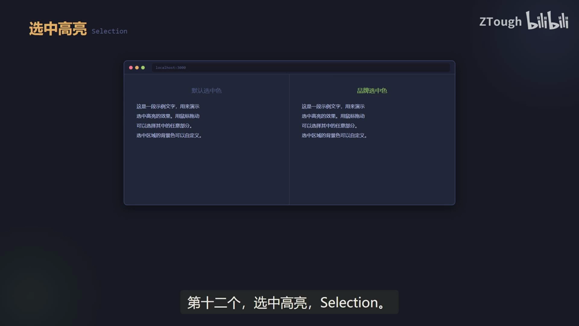

  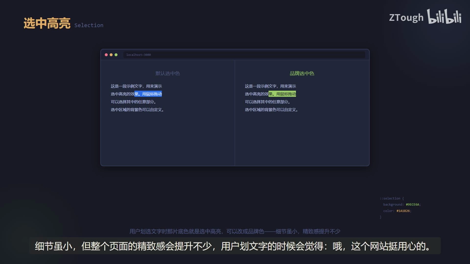

---
> 本集串联：收尾串联：12 个词分两类——过渡/动画/缓动/弹性/渐入渐出这 5 个管“画面怎么动”；悬停/按下/聚焦/拖拽/禁用/鼠标指针/选中高亮这 7 个管“用户怎么跟页面互动”。搞懂这 12 个词，前端交互黑话就听得懂一半。
