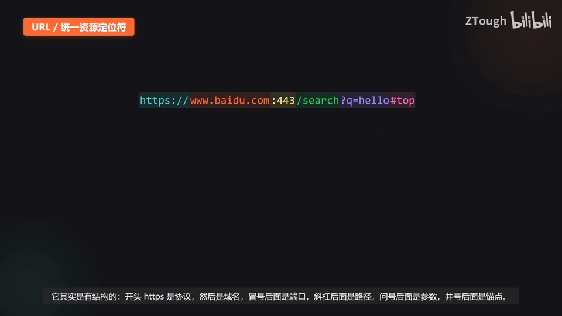
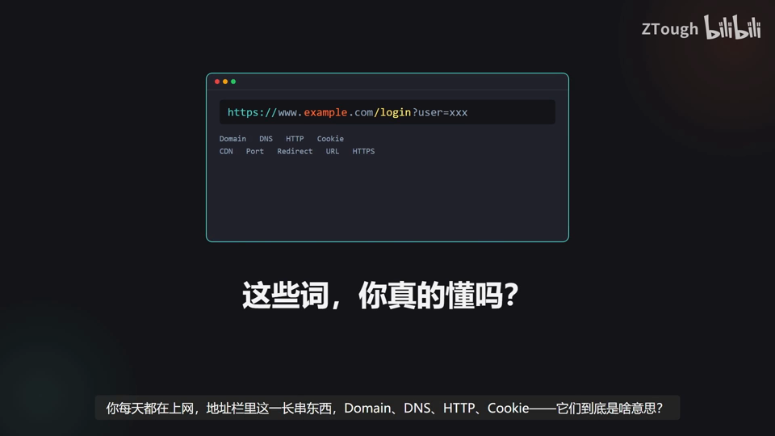
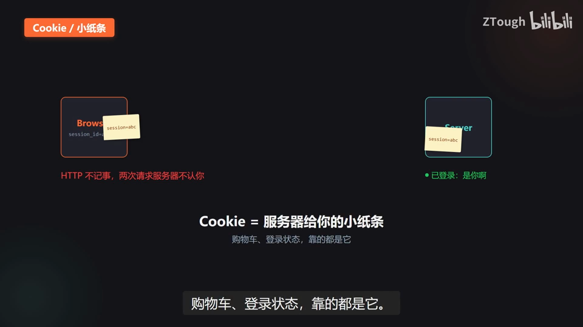
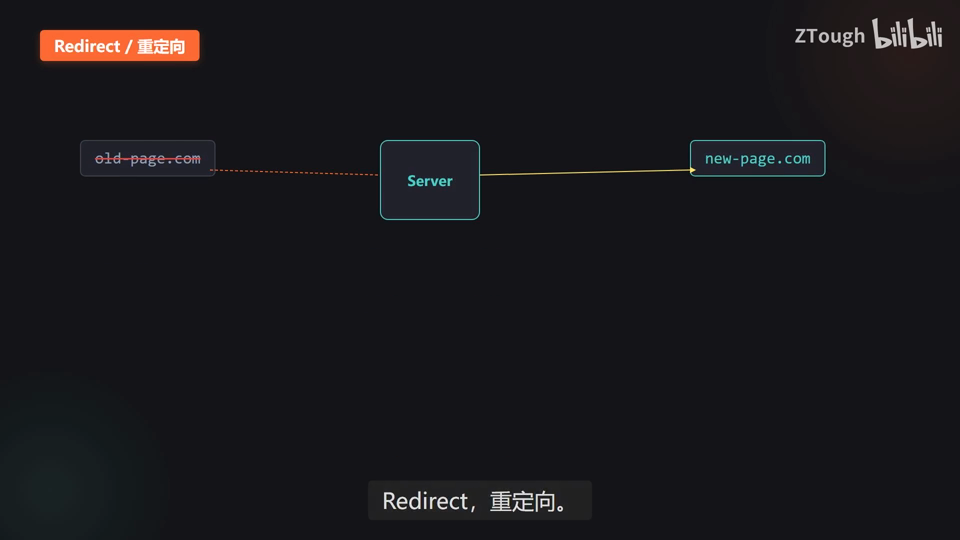
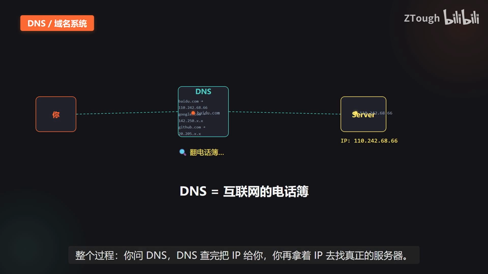

# Vibe Coding 术语课 第16 集｜VibeCoding 术语课｜网络与地址：从域名到重定向，9 个词搞懂互联网

> 主题：网络与地址 9 词一条链路：域名(Domain)→DNS 解析→URL 结构→HTTP/HTTPS 传输→Cookie 会话记忆→CDN 加速→端口分服务→重定向搬家。

> 视频时长 4:30｜逐字稿见 `~/VibeCoding术语课/逐字稿/16_*.txt`｜术语 9 个

### 1. Domain｜域名

- **定义**：网站的好记名字——代替难记的 IP 地址。

- **要点**：
  - 域名=网站的好记名字，代替难记的 IP 地址(如 110.242.68.66)
  - 每台服务器都有一串数字地址叫 IP
  - www.baidu.com 用点分段：www=子域、baidu=主体、com=后缀

- **给 AI 的句式**：页面/接口地址别写死 IP，需求里直接说域名(子域，如 api.example.com)。

- **视频画面**：

  

### 2. DNS｜域名系统

- **定义**：互联网的电话簿——把域名翻译成服务器 IP。

- **要点**：
  - 域名是给人记的，机器要的是 IP
  - 查法示例：baidu.com → 110.242.68.66
  - 流程：你问 DNS → DNS 查完把 IP 给你 → 你拿 IP 去找真正的服务器

- **视频画面**：

  

### 3. URL｜统一资源定位符

- **定义**：地址栏里那一长串——一份完整的「去哪里、拿什么」说明书。

- **要点**：
  - 结构：https + www.baidu.com + :443 + /search + ?q=hello + #top
  - 依次是：协议→域名→端口→路径→参数→锚点

- **给 AI 的句式**：给 AI 写跳转/资源地址时给完整 URL；开发用 localhost:端口，线上用 https 域名。

- **视频画面**：

  

### 4. HTTP｜超文本传输协议

- **定义**：浏览器和服务器之间的对话规则——Request 请求、Response 响应，一来一回。

- **要点**：
  - 浏览器发请求(要哪个页面)→服务器回响应(把内容给你)
  - 一来一回就完成一次交互
  - 打开一个网页=背后几十上百次请求响应

- **视频画面**：

  

### 5. HTTPS｜安全 HTTP

- **定义**：HTTP 加个 S(Security)——传输前把数据加密，明文变乱码，截获也看不懂。

- **要点**：
  - HTTP + S(Security 安全)
  - HTTP 明文：发送 password=123456，中间路由器能偷看
  - HTTPS 加密：发送 %$#@!*&^ 乱码，截获也看不懂
  - 地址栏左边的小锁 = HTTPS 的标志

- **给 AI 的句式**：凡涉及账号密码的页面/接口必须走 HTTPS，禁止明文 HTTP 传密码。

- **视频画面**：

  

### 6. Cookie｜小纸条

- **定义**：服务器塞给浏览器的小纸条(身份信息)——HTTP 不记事，靠它认出你。

- **要点**：
  - HTTP 不记事：两次请求，服务器根本不知道是同一个人
  - Cookie=服务器给你的小纸条(示例 session_id=abc123)
  - 浏览器存下来，下次请求把纸条带上，服务器一看：是你啊(已登录)
  - 购物车、登录状态，靠的都是它

- **视频画面**：

  

### 7. CDN｜内容分发网络

- **定义**：把网站的静态内容(图片/视频)提前复制到全国各地节点——就近取，不用跑源站。

- **要点**：
  - 源站在杭州、你在黑龙江：每次请求跑半个中国(远、慢)
  - CDN=把内容搬到你家门口(各地 CDN 节点，近、快)
  - 刷视频、看图片秒开，背后都是 CDN

- **视频画面**：

  

### 8. Port｜端口

- **定义**：一台服务器(一个 IP)上区分不同服务的“房间号”——IP 是大楼地址，端口是房间号。

- **要点**：
  - 一台服务器可同时跑网页、数据库、远程连接，共用 IP
  - 端口=服务器大楼里的房间号
  - 默认：HTTP :80、HTTPS :443、SSH :22、MySQL :3306
  - :8080 备用、:3000 开发常用

- **给 AI 的句式**：开发时让 AI 起本地服务写清端口(如 3000)；线上默认 443/80，别写错端口。

- **视频画面**：

  

### 9. Redirect｜重定向

- **定义**：服务器告诉你“搬这儿了”——浏览器收到指令自动跳到新地址。

- **要点**：
  - 访问 old-page.com，服务器说这个页面搬家了，给新地址
  - 浏览器自动跳到 new-page.com
  - 301 永久搬走 / 302 临时搬走
  - 场景：网站改版、域名更换、HTTP 跳 HTTPS

- **给 AI 的句式**：旧域名/旧链接要跳新站时对 AI 说清配 301(永久)而不是 302。

- **视频画面**：

  

  

---
> 本集串联：收尾串联：九个词串起来——域名是名字，DNS 查地址，URL 是完整路径，HTTP 管对话，HTTPS 加了密，Cookie 记住你，CDN 让你快，端口分服务，重定向帮你搬家。搞懂这些，后端网络这块就算入门了。
