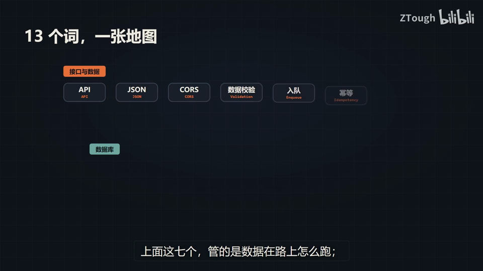
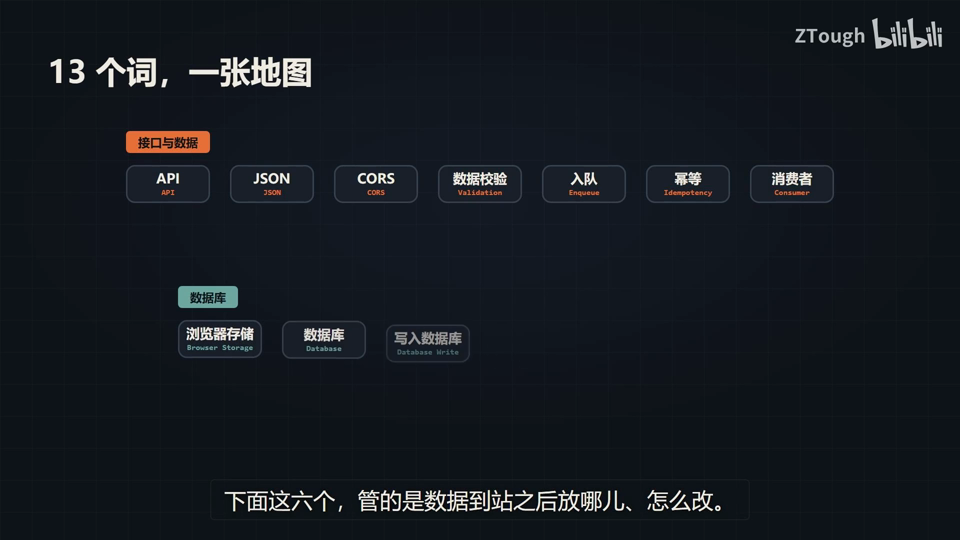
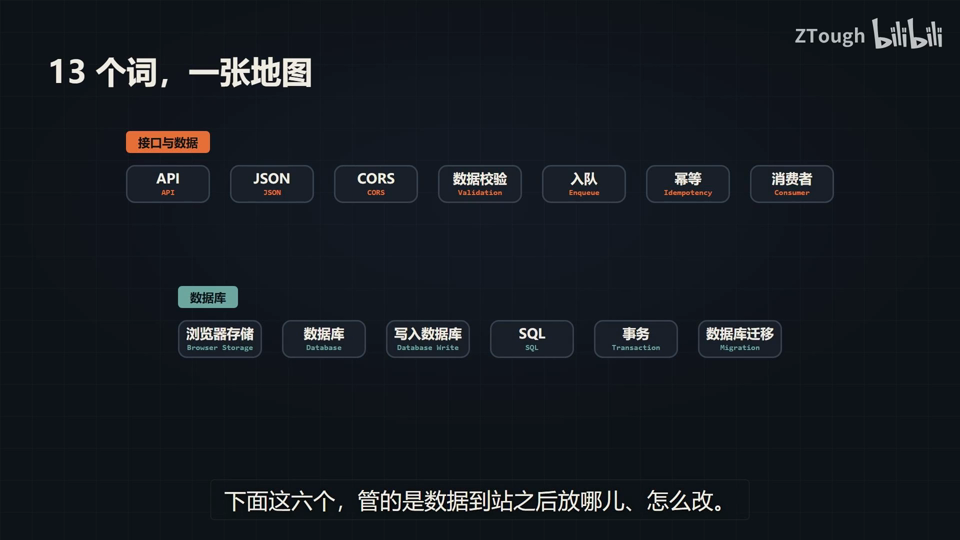
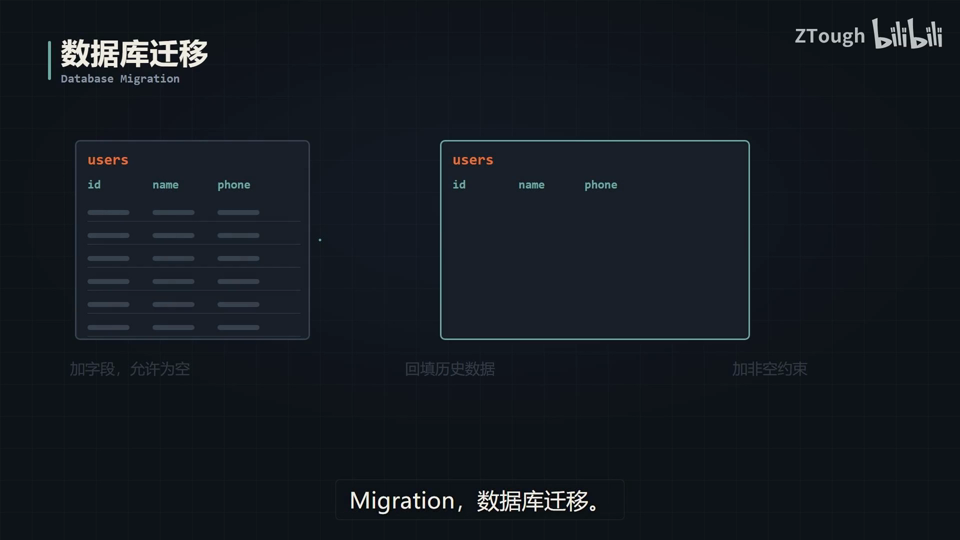
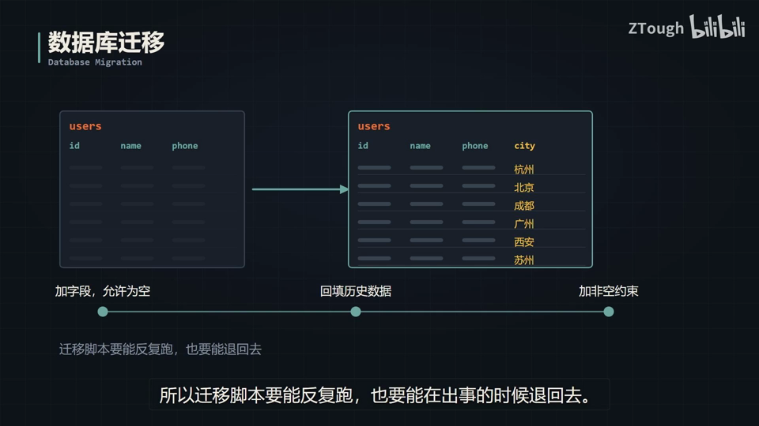

# Vibe Coding 术语课 第17 集｜VibeCoding 术语课｜看完这 13 个术语，后端不再玄学

> 主题：后端 13 术语=一趟数据的一生：数据在路上 7 个(API/JSON/CORS/数据校验/入队/幂等/消费者)+到站后 6 个(浏览器存储/数据库/写入数据库/SQL/事务/数据库迁移)。

> 视频时长 5:56｜逐字稿见 `~/VibeCoding术语课/逐字稿/17_*.txt`｜术语 13 个

### 1. API｜接口(API)

- **定义**：后端能力对外开放的“柜台窗口”——一句话定死：我能给你什么、你得按什么格式来问。

- **要点**：
  - Application Programming Interface
  - 你在窗口外只能递一张纸条，写上我要什么，等它递东西出来
  - 柜台后面的机器怎么分工，你一概不知道也不用知道
  - 你的 App 只跟它打交道

- **视频画面**：

  

### 2. JSON｜JSON(JavaScript Object Notation)

- **定义**：接口传数据的标准格式——键值对、一坨花括号，人看得懂、机器也读得动。

- **要点**：
  - 纸条的格式：键和值一对一对写(名字:张三、手机号:138****、items:[1,2])
  - 流行就一个原因：人看得懂，机器也读得动
  - 前后端谁都不用迁就谁
  - 说“接口返回数据”，十有八九就是这么一坨 JSON

- **视频画面**：

  

### 3. CORS｜跨域资源共享(CORS)

- **定义**：浏览器的跨域门禁——A 站页面代码想请求 B 站接口，默认拦下；除非 B 站在响应头挂牌子放行。

- **要点**：
  - Cross-Origin Resource Sharing
  - your-site.com 的页面代码想去请求 api.other.com，浏览器默认拦下
  - 除非对面在门口挂个牌子：响应头 Access-Control-Allow-Origin 写明“允许 A 来”
  - 前端改不了，得让后端/网关在响应头放行

- **给 AI 的句式**：前端报跨域时写：“后端把接口响应头加上 Access-Control-Allow-Origin，放行前端这个域名”。

- **避坑**：控制台报错里带 CORS 三个字母，八成是对面没给你开门——跟你代码写得对不对没关系，去查对面的响应头(画面原文)。

- **视频画面**：

  

### 4. Validation｜数据校验

- **定义**：数据安检——手机号填 abc、年龄填负数，别进来，直接打回并附 400。

- **要点**：
  - 安检：-abc / -138... 这类非法输入直接打回去
  - 回 400 Bad Request
  - 页面上那点提示，打开开发者工具就能绕过

- **避坑**：别只信前端校验——前端红字提示能绕过，后端这一关必须自己再查一遍，谁都不能信(字幕原文)。

- **视频画面**：

  

### 5. Enqueue｜入队

- **定义**：把当场办不完的活儿(发短信/压视频/算报表)扔进队列排队，先回请求“已收到”。

- **要点**：
  - 有些活儿当场办不完→先扔进队列里排着
  - 先回请求“已收到，号是 7”，用户不用一直转圈
  - 队列按序处理：已收到 → 已处理

- **视频画面**：

  

### 6. Idempotency｜幂等

- **定义**：同一件事办 100 次，结果跟办一次一样——网络抖、手抖多点几下，只生效一次。

- **要点**：
  - 网络会抖、页面卡住时人会多点两下三下
  - 支付账上只能扣一次(示例：#A7 ¥200 只入账一行，重复的“这个编号见过了”)
  - 做法：每次请求带一个唯一编号，服务端见过的编号一律不再处理
  - 唯一编号=请求的身份证号

- **避坑**：支付/下单这类接口不做幂等，用户重复点击就会重复扣款。

- **视频画面**：

  

### 7. Consumer｜消费者

- **定义**：队列另一头干活的那位——不生产任务，只从队头拿一个、办一个、再拿下一个。

- **要点**：
  - Consumer 1/2/3 并行处理队列里的消息
  - 中途挂掉的任务不能被吞掉，要重新塞回队列让别人接手
  - 队列+消费者这套东西图的是人多好干活，挂一个也不塌

- **避坑**：消费者处理中挂掉，任务要回队列重来，不能吞(画面原文)。

- **视频画面**：

  

### 8. Browser Storage｜浏览器存储

- **定义**：你电脑上的本地“小抽屉”——localStorage 关掉浏览器还在，sessionStorage 关掉标签页就清空。

- **要点**：
  - localStorage：关掉浏览器还在
  - sessionStorage：关掉标签页就清空
  - 写在用户自己的机器上，用户清一次缓存就没了
  - 只配放“上次选的城市、主题偏好”这类丢了也不心疼的数据

- **给 AI 的句式**：主题偏好、上次选的城市这类丢了不心疼的数据，让 AI 存 localStorage。

- **避坑**：余额、权限标记，一件都不许放浏览器存储——用户清一次缓存就没了(画面原文)。

- **视频画面**：

  

### 9. Database｜数据库

- **定义**：服务器上的档案柜——放在服务器上、断电不丢、几万个人能同时读写，和浏览器小抽屉是两回事。

- **要点**：
  - 放在服务器上，断电不丢
  - 几万个人能同时来读写
  - 像一整面墙的档案柜，一格一格分好类，谁都能查但得按规矩查

- **视频画面**：

  

### 10. Database Write｜写入数据库

- **定义**：往数据库写数据——塞进去比拿出来贵：读一次约 1ms，写一次约 8ms(要改数据、改索引、记日志)。

- **要点**：
  - 读一次 1ms / 写一次 8ms(改数据·改索引·记日志)
  - 写比读常常慢好几倍
  - 能在一次写入里办完的事，别拆成十次写

- **避坑**：写放大(一次写入拆成十次)是拖垮后端的常见死法之一(字幕原文)。

- **视频画面**：

  

### 11. SQL｜SQL(Structured Query Language)

- **定义**：跟数据库说话用的那门语言——长得像英文句子，你写“想要什么”，它自己决定怎么翻柜子。

- **要点**：
  - 示例：从 users 表挑 city=杭州、按名字排序、取前 20 条
  - 你写的是想要什么，数据库自己决定怎么找
  - 和写普通代码不一样：写代码你管步骤，写 SQL 你管结果

- **视频画面**：

  

### 12. Transaction｜事务

- **定义**：把多步操作捆成一个包裹——转账 A 扣 200、B 加 200 必须一起成功，或一起不算。

- **要点**：
  - 最经典例子：转账，从 A 扣 200 给 B 加 200，两步必须一起成或一起不算
  - 没有事务：A 扣完、B 没加成(机器断)，合计少了 200
  - 有事务：中间任何一步出事，整个包裹退回去(ROLLBACK)，账上跟没发生过一样
  - 提交叫 COMMIT，退回叫 ROLLBACK

- **避坑**：扣款+入账这类多步写不加事务，扣完断了那 200 就凭空蒸发(字幕原文)。

- **视频画面**：

  

### 13. Migration｜数据库迁移

- **定义**：改表结构(如给 users 表加 city 字段)还不能把线上数据弄丢——老规矩三步走。

- **要点**：
  - 三步走：先加字段、允许为空 → 回填历史数据 → 最后加非空约束
  - 加字段示例：users 表新增 city(旧行 NULL，再回填杭州/北京/成都…)
  - 一步到位去改线上服务=当场报错给你看
  - 迁移脚本要能反复跑，也要能在出事的时候退回去

- **避坑**：别直接加非空约束——先加字段允许为空、回填历史数据，最后才上约束；脚本要可重跑、可回退。

- **视频画面**：

  

  

---
> 本集串联：收尾串联：13 个词=一趟数据的一生——点一下下单，背后是 13 道关：API 窗口→JSON 格式→CORS 门禁→Validation 安检→Enqueue 排队→Idempotency 防重→Consumer 接手；数据到站后：Browser Storage 小抽屉(靠不住)→Database 档案柜→Database Write 写入要省→SQL 说话→Transaction 上锁→Migration 扩容改表。
